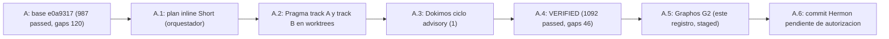

# Feature: Cobertura MCP (ONT-44): reforzar puntos débiles del MCP y trinquete de gaps

- **Documento**: `feature_20261113_004026_mcp_coverage_reinforcement.md`
- **Anterior en la cadena**: [`feature_20261107_135303_ont43_field_report.md`](feature_20261107_135303_ont43_field_report.md)
- **Pipeline mode**: **Short** (orquestador en modo inline; Archon y Ontos omitidos por política de costos del usuario)
- **Stage**: Graphos G2 (post-Dokimos)
- **Intent**: reforzar puntos débiles del MCP
- **Base**: `e0a9317` (rama `integ/coverage`, worktree `integ-cov`); cambios staged, sin commit
- **Veredicto Dokimos**: **VERIFIED** (1 ciclo advisory)

## 1. Origen

AEP se autodiagnosticó con `autoevol(action="gaps")`: 120 omisiones de cobertura, es decir, superficie MCP expuesta sin test que la cubra. Este tramo cierra la mayor parte de esas omisiones y fija el trinquete en 46.

## 2. Ruta de resolución y blast radius

- **Ruta**: Short. Dos tracks Pragma en worktrees aislados (`isolation: "worktree"`), uno por bloque de dominios:
  - Track A: backup, audit, security, landlock.
  - Track B: network, package, service, ipc, storage, hardware; kanban, catalog, lint, playbook, kernel_trace, visual_inspect; funciones del motor.
- **Blast radius de producción**: `engine/backup.py`, `engine/catalog.py`, `engine/privilege.py`, `server.py`. El schema que el servidor anuncia cambia en `min_chmod_octal=6` (backup) y en el resumen compactado (D-04).
- **Blast radius de tests**: 5 archivos nuevos `tests/test_cov_*.py` (~1600 líneas) y dos existentes modificados (`tests/test_l3_contract_compaction.py`, `tests/test_ont41_coverage.py`).
- **Fuera de alcance**: sin cambios de dependencias, de esquema SQL ni de tiers de privilegio.

## 3. Debilidades reales corregidas

| # | Debilidad encontrada | Corrección | Efecto verificable |
|---|----------------------|------------|--------------------|
| P1 | Acciones mutantes de backup sin gate por tier | `BACKUP_MUTATING_ACTIONS` / `MIN_OCTAL` en `engine/privilege.py`: bajo 6 responde `PERMISSION_DENIED` | Hash de la DB intacto tras denegación |
| P2 | `verify_integrity` escribía el canario | Lectura pura (`allow_missing_canary`); `create_backup` limpia sidecars `.bak.tmp`, `-wal`, `-shm` | `verify_integrity` detecta corrupción sin mutar; round-trip de restore |
| P3 | `network.listeners` (fast path) ignoraba `verbosity`, `limit` y `cursor` | Recorte y paginación igual que el fallback | Paginación verificada |
| P4 | `artifact_catalog reindex(force)` nunca reindexaba (`INSERT OR REPLACE` falla en `vec0`) | `DELETE` + `INSERT` con `SAVEPOINT` por fila; un fallo conserva el vector anterior | Reindex efectivo; fallo sin pérdida |
| P5 | D-04: schema summary de 1524 tokens | Excepciones idénticas de 3 o más acciones plegadas en `shared_exceptions` + `legend`: 1278 tokens | Tamaño medido; `test_l3_contract_compaction` ajustado |

## 4. Tests de efecto

Las aserciones comprueban efectos observables, no sólo llamadas: hash de la DB intacto tras una denegación; round-trip de restore; `verify_integrity` detecta corrupción; el lock de concurrencia bloquea a un segundo actor; Landlock devuelve `EACCES` fuera de la ruta permitida; ciclo completo de kanban; paginación de listeners.

## 5. Decisiones

- `micro_snapshot` y `clear_micro_snapshots` quedan **sin gate en servidor** (operan sólo en RAM). El CLI `scripts/aep-ctl` sí los gatea. Diferencia conocida, aceptada y registrada.
- Trinquete `GAPS_BASELINE` de 120 a **46** en `tests/test_ont41_coverage.py`. Subirlo exige justificación en el comentario, como hoy.

## 6. Resultados

- Suite completa: **1092 passed** (previo 987).
- `ruff check` y `ruff format` limpios.
- Gaps de cobertura: **120 a 46**.
- 17 tools / 19 capacidades; sin `claim_drift`.

## 7. Residuo para la próxima tanda

- 15 tests antiguos sin referencia a código del proyecto.
- Gaps de tipo `asserts`: acción con test pero sin aserción sobre su resultado.
- Funciones sin `covers`: `aep_front.main`, `aep_front.create_front_server`, `aep_backend.main`, `BackendWorker`.

## 8. Evolución del estado

