# Feature: Residuo del grafo de hilos, ordenado por criticidad (ONT-45)

- **Documento**: `feature_20261113_080406_ont45_topos_residue.md`
- **Anterior en la cadena**: [`feature_20261113_004026_mcp_coverage_reinforcement.md`](feature_20261113_004026_mcp_coverage_reinforcement.md)
- **Intent**: residuo ordenado por criticidad con clasificación Topos (dependencia / interdependencia / co-dependencia, vertical y horizontal)
- **Pipeline mode**: **Short** (orquestador en modo inline); auditoría de Ontos sobre el plan inline (ver sección 6)
- **Stage**: Graphos G2 (post-Dokimos)
- **Base**: `e1d661f` (rama `integ/ont45`, worktree `integ-ont45`); cambios staged, **sin commit**
- **Veredicto Dokimos**: **VERIFIED** (tras 1 ciclo de corrección de documentación)

## 1. Origen

`autoevol(action="gaps")` dejó 46 omisiones de cobertura bajo el trinquete `GAPS_BASELINE = 46`. El plan de ONT-45 ordena esas omisiones por criticidad y las ataca por niveles, de mayor a menor riesgo, con la clasificación Topos de cada relación. El resultado: 46 omisiones reducidas a **1**, con el residuo visible y no maquillado.

## 2. Niveles, alcance y clasificación

Vertical: Storage → DataAccess → Logic → API → Contrato / Consumidor. Horizontal: pares que comparten `routes`, `privileged_by`, `implemented_by` o estado.

| Nivel | Criticidad | Alcance | Reach | Relación Topos | Acción |
|-------|-----------|---------|-------|----------------|--------|
| N1 | CRÍTICO | 26 acciones de `aep_ctl` sin contrato declarado (`asserts`) | 4 | README / `_INSTRUCTIONS` → código: **dependencia** (el doc consume el código). Pares de `aep_ctl`: comparten superficie de contrato, sin acoplamiento nuevo | Budgets de lectura (regresión real) + tabla de contrato en README (sólo líneas nuevas) |
| N2 | ALTO | Núcleo del plano vivo sin `covers`: `BackendWorker.handle_line`, `create_front_server` | 2 | `aep_front` / `aep_backend`: **sin dependencia de código** en ninguna dirección. Contrato real: protocolo de cable JSON-lines (`health`/`list`/`call`) compartido y spawn de proceso front → backend: **interdependencia documentada**, no co-dependencia | Tests in-process con `socketpair` y `create_front_server(mgr_fake)` |
| N3 | MEDIO | Puntos de entrada: `aep_front.main`, `aep_backend.main`, `BackendWorker.run` | 1 | **dependencia** simple hacia N2 | Tests con parches obligatorios (señales, stdio fake, timeout ≤ 5 s) |
| N4 | MÍNIMO | 15 tests antiguos sin referencia a código del proyecto | 1 | tests → símbolos: **dependencia** (el test consume el código; el código no conoce el test) | Aserción aditiva por test; nada existente se modifica |

Co-dependencias detectadas: **0** (`threads.analyze`). Claims `doc` nuevos fuera de `_DRIFT_KINDS`: **0**. `claim_drift`: **0**.

## 3. Hallazgos clave

- **F1 (claims doc sin detección de regresión).** Los claims `doc` NO se comparan en `claim_drift`: `_DRIFT_KINDS` sólo incluye `tool_count`, `capability_count`, `wf_range` y `version` (`engine/threads.py`). Un claim doc declara contrato y alimenta el ranking y el reach, pero no detecta regresiones. Por eso el presupuesto de tokens es la mitad que sí detecta regresión: es un test real. Consecuencia: el README se escribe sin cifras desnudas que casen con `_text_claims`.
- **F2 (aep_front / aep_backend).** Sin dependencia de código: `aep_backend` no importa `aep_front`; `tm.list_tools()` en `aep_backend.py` es el tool manager de FastMCP vía `server.mcp`. El contrato es el protocolo de cable y el spawn. El grafo atribuyó `handle_line → LivePlaneManager.list_tools` por resolución de nombre (el método `list_tools` existe en ambos lados). Es una **imprecisión del extractor**, registrada como gap futuro (ONT-46 candidato), no corregida aquí.
- **F3 (efecto secundario al importar).** `import aep_backend` ejecuta `os.dup2(sys.stderr.fileno(), 1)` y reasigna `sys.stdout` en el nivel de módulo. Importarlo en pytest corrompe la captura de la suite entera. Remediación: `_Fd1Guard` en `tests/test_cov_live_plane_core.py` guarda `fd 1` y `sys.stdout`, importa y restaura en `finally`; la prueba afirma que el fd 1 queda restaurado. `BACKEND_META` (global) se resetea tras cada test.
- **F4 (promesa falsa de Graphos corregida por Dokimos).** Mi borrador de README prometía que `service.start/stop/restart` funcionaban en `6rw-`. Es falso: en `SIMULATED@4r--` y `DEGRADED@5r-x` el gate de `scripts/aep-ctl` bloquea la acción; en `6rw-` ejecuta `systemctl --user`, por lo que el resultado es OK o DIMINISHED con alcance de usuario. Dokimos lo detectó como DEFECTIVE y se corrigió la documentación. El tier mínimo real es 7rwx efectivo para el alcance de sistema, y `6rw-` para alcance de usuario.

## 4. Ruta de resolución y blast radius

- **Ruta**: Short, tres tracks Pragma en paralelo con `isolation: "worktree"`, archivos disjuntos:
  - Track A (N1): `README.md` (sólo líneas nuevas) y `tests/test_token_budgets.py`.
  - Track B (N2 y N3): `tests/test_cov_live_plane_core.py`. Producción sin cambios.
  - Track C (N4): diez archivos de tests, aserciones aditivas.
- **Blast radius de producción**: ninguno. No se tocó código de producción.
- **Blast radius de documentación**: `README.md` (badge y línea de gaps), `docs/`.
- **Fuera de alcance**: dependencias, esquema SQL, tiers de privilegio, aserciones existentes, marcadores `xfail`.

## 5. Presupuestos: qué entra y qué se descarta

- Entran sólo acciones de **lectura**: `backup_status`, `verify_integrity`, `quarantine_status`, `list_micro_snapshots`, `network.routes`, `package.installed/list/check/info`, `security.landlock_status`, `service.list`, `storage.mounts`.
- Nunca presupuestos sobre acciones mutantes (`restore`, `restore_golden`, `restore_micro_snapshot`, `auto_recover`, `verify_and_auto_recover`, `golden`, `clear_micro_snapshots`, `service.start/stop/restart`).
- **Descartados** por depender del host: `network.interfaces`, `network.inspect`, `network.arp`, `storage.disks`. Un presupuesto que varía con el hardware produce falsos positivos en otra máquina.
- Límite medido en este host × 1.5, redondeado, y siempre < 1500 (D-04).

## 6. Ciclos y métricas

- **Ontos**: loop 1. Rev1 BLOCKED por 3 errores factuales en el plan; rev2 APPROVED.
- **Pragma ↔ Dokimos**: 1 ciclo de corrección (sólo documentación: F4).
- **Tracks**: 3 paralelos (A, B, C) en worktrees.
- **Interrupción**: por límite de tasa del proveedor durante la ejecución; reanudada desde el estado de los worktrees y del plan, sin repetir trabajo verificado.
- **Modo de la cadena**: Short; Archon no se invocó.

## 7. Resultados

| Métrica | Antes | Después |
|---------|-------|---------|
| Suite completa | 1092 passed | **1121 passed** |
| Gaps de cobertura (`GAPS_BASELINE`) | 46 | **1** |
| `claim_drift` | 0 | 0 |
| Co-dependencias | 0 | 0 |
| Código de producción tocado | - | ninguno |
| `ruff check` | limpio | limpio |

## 8. Residuo final y backlog

- **Residuo: 1 gap**, `test_gate8_semantic_sanitization` sin símbolo propietario. Decisión tomada: dejarlo visible, no maquillarlo con un símbolo ficticio. Se resolverá cuando exista una función de saneado con contrato propio.
- **ONT-46 (candidato)**: precisión del extractor de `threads_extractors`: resolución por nombre de métodos (F2) e imports sólo de nivel superior.
- **Fragilidad leve**: `test_d11` usa `server.mcp._tool_manager._tools` (privado de FastMCP). Migrar a una API pública si la versión la expone.
- **Descartados** (ver sección 5): budgets dependientes del host.

## 9. Evolución del estado

```mermaid
flowchart LR
    A["A: base e1d661f (1092 passed, gaps 46)"] --> A1["A.1: plan inline Short, 4 niveles"]
    A1 --> A2["A.2: Ontos BLOCKED rev1 (3 errores factuales)"]
    A2 --> A3["A.3: Ontos APPROVED rev2"]
    A3 --> A4["A.4: tracks A, B, C en paralelo (interrupción por límite de tasa, reanudada)"]
    A4 --> A5["A.5: Dokimos DEFECTIVE (promesa falsa de service en 6rw-)"]
    A5 --> A6["A.6: documentación corregida y Dokimos VERIFIED (1121 passed, gaps 1)"]
    A6 --> A7["A.7: Graphos G2 documentación (staged, sin commit)"]
    A7 --> A8["A.8: commit (Hermon) pendiente de autorización"]
```

## 10. Archivos de esta tanda

- Tests: `tests/test_token_budgets.py`, `tests/test_cov_live_plane_core.py`, y diez archivos de tests con aserciones aditivas (N4).
- Documentación: `README.md` (badge 1121 y línea de gaps 1; tabla de contrato por dominio de `aep_ctl`), `docs/STATE.md`, `docs/COMPACT.md`, `docs/MILESTONES.md` (§12), `docs/pipeline/feature_rollup.md`, `docs/sdd/sdd_ont45_topos_residue.md`, y este registro.
- Producción: ninguno.
