# Feature: Precisión del extractor de hilos (ONT-46)

- **Documento**: `feature_20261113_ont46_extractor_precision.md`
- **Anterior en la cadena**: [`feature_20261113_080406_ont45_topos_residue.md`](feature_20261113_080406_ont45_topos_residue.md)
- **Intent**: eliminar resoluciones débiles por nombre único en `threads_extractors` y registrar sólo aristas con evidencia de tipo o de spawn, con la clasificación Topos de cada relación
- **Pipeline mode**: **Short** (orquestador en modo inline). Archon y Ontos descartados por decisión explícita del usuario; el plan inline del orquestador se guardó en el scratchpad (`plan_ont46.md`)
- **Stage**: Graphos G2 (post-Dokimos, **ciclo 2 final**; ciclo 1 registrado en la sección 5 y 6)
- **Worktree**: `/home/ancruz/Documents/workspaces/agent-execution-plane/.claude/worktrees/agent-ae5bdcba0132a8346` (rama `worktree-agent-ae5bdcba0132a8346`, HEAD `6aad7e0`)
- **Base**: `99f80bb` (rama `dev`)
- **Commits de Pragma** (8 en total, sin commit de Graphos): ciclo 1 `6b05f7b`, `e3f504e`, `5ce73e3`, `8c2583e`, `34ef73b`, `6fafcc9`; ciclo 2 `4844d30`, `6aad7e0`. Este documento **no se commitea**; Hermon integra.
- **Veredicto Dokimos (ciclo 1)**: **DEFECTIVE (LOGIC_ERROR)**, `test_cold_extraction_under_two_seconds` 3.10 s > 2.0 s
- **Veredicto Dokimos (ciclo 2)**: **VERIFIED**
- **Routing de este G2**: Graphos G2 → Hermon (commit y ff a `dev`, user-gated para push)

## 1. Origen

ONT-45 dejó como residuo candidato la precisión del extractor (`threads_extractors`): la resolución de llamadas por nombre de método hace que `x.append`, `x.execute`, `x.terminate` o `x.list_tools` se conecten con cualquier definición homónima del proyecto, aunque el receptor no sea de ese tipo. El resultado son aristas espurias que inflan `covers` y alteran el ranking.

## 2. Diagnóstico medido (antes de tocar código)

| Medición | Valor |
|----------|-------|
| Resoluciones débiles por nombre único | 1855 |
| Pares (llamador, destino) afectados | 305 |
| `x.append` → `PlaneEventSpool.append` | 128 casos |
| `Popen.terminate` (resuelto a método del proyecto) | presente |
| `sqlite.execute` → `harness_reconnect.execute` | presente |
| `FastMCP list_tools` → `LivePlaneManager.list_tools` | presente |
| Gaps si se elimina la resolución débil sin más | 1 → 104 |

Conclusión del diagnóstico: eliminar la resolución débil sin reemplazarla por evidencia de tipo dispararía los gaps de cobertura de 1 a 104. La solución debe distinguir resoluciones con evidencia (tipo conocido, spawn de proceso) de las débiles, y no sólo borrarlas.

## 3. Cambios de Pragma

### Ciclo 1

| Commit | Cambio |
|--------|--------|
| `6b05f7b` | `Edge.weak` (`threads_model.py`): marca de arista resuelta sólo por nombre |
| `e3f504e` | `_TypeIndex` para tipar receptores; `_EXTERNAL_METHODS` (frozenset de la biblioteca estándar, Python 3.14.7, 476 nombres; sin tipo conocido, la llamada se trata como externa); contadores `weak_edges` / `external_skipped` en `ExtractionInfo` |
| `5ce73e3` | `threads/2` (`GRAPH_SCHEMA_VERSION`); `weak_edges` en el payload; `classify_sccs` excluye aristas débiles (`include_weak=False`); fila `thread` con `"weak": true` |
| `8c2583e` | Tests de regresión de precisión, aristas débiles y falsos positivos sobre el repo real (sólo `tests/test_ont46_extractor_precision.py`) |
| `34ef73b` | Cobertura por spawn sólo para literales dentro de llamadas spawn / `sys.executable` (F1), marcada débil |
| `6fafcc9` | Cobertura por spawn con alias local de un nivel (`test_t_f4`) (F1b) |

### Ciclo 2 (Fix Specification del ciclo 1)

| Commit | Cambio |
|--------|--------|
| `4844d30` | `perf`: `_TypeIndex.facts` en una sola pasada cacheada por función (sin `ast.walk` repetido en `local_env`); lista de nodos por test reutilizada entre resoluciones; spawn sólo si el cuerpo menciona `sys.executable` (`has_exec`); `global` sólo en funciones y métodos de nivel de módulo |
| `6aad7e0` | `fix`: `_store_names` cuenta sólo `Name` con `ctx` Store; `mcp._mcp_server.x = ...` ya no deja a `mcp` como desconocido; módulos de proyecto alcanzados vía import tipan sus atributos de módulo; 4 tests dejan de dar cobertura falsa a `LivePlaneManager.list_tools`; test (p) sintético que fija el comportamiento |

Correcciones del orquestador en ruta (2 en todo el run, sin nuevas en el ciclo 2):

- **F1**: un literal `.py` suelto era una referencia hueca. Se restringe a spawn / `sys.executable`, marcado como débil.
- **F1b**: alias local de un nivel para `test_t_f4`.

## 4. Ruta de resolución y blast radius

- **Ruta**: Short. Plan inline del orquestador, un único track de Pragma en un worktree (sin paralelismo; Pragma trabaja sobre `engine/`).
- **Blast radius de producción**: `engine/threads_extractors.py` (874 líneas tocadas), `engine/threads_model.py` (`Edge.weak`), `engine/threads.py` (clasificación SCC, payload del grafo, fila `thread` con `weak`), y la cobertura por spawn. Sin cambios de tiers de privilegio ni de API pública de MCP; cambia el contrato de payload (`threads/2`, sección 6 del SDD).
- **Blast radius de tests**: módulo nuevo `tests/test_ont46_extractor_precision.py` y `tests/test_ont40_threads_core.py` (2 inserciones, 1 borrado, por la nueva forma de cobertura); ninguna aserción existente debilitada.
- **Diff acumulado** `99f80bb..6aad7e0`: 5 archivos, +1332 / −33.

## 5. Verificación de Dokimos (ciclo 1)

Veredicto: **DEFECTIVE (LOGIC_ERROR)**. Suite: **1145 passed / 1 failed** en 230 s.

| Ítem | Resultado |
|------|-----------|
| Test fallido | `tests/test_ont40_acceptance.py::test_cold_extraction_under_two_seconds_and_stable_r` |
| Tiempo de extracción en frío | 3.10 s (umbral 2.0 s) |
| Base `99f80bb` | 1.27–1.31 s |
| HEAD `6fafcc9` | 3.15–3.26 s |
| Flaky | no (fallo reproducido en las tres corridas) |
| Perfil: `local_env` | 4373 llamadas, 4.9 s (`ast.walk` repetido por función) |
| Perfil: `build_type_index` | 3.4 s (bajo cProfile) |
| `root_hash` | estable `b1f5cdf81643e266` |
| Nodos / aristas | 2296 / 7182 (−82 frente a base) |
| `weak_edges` | 114 |
| Gaps / co-dependencias | 1 (`test_gate8`) / 0 |

Regresiones de precisión detectadas en el ciclo 1: `handle_line` conectado a `list_tools`; `PlaneEventSpool.append` alcanzable desde todos los llamadores; `harness_reconnect.execute` alcanzable desde todos los llamadores. Dos aristas falsas por `server.mcp._tool_manager.list_tools()` (atributo de módulo `server.mcp` sin tipo).

## 6. Verificación de Dokimos (ciclo 2): VERIFIED

| Ítem | Resultado |
|------|-----------|
| Suite completa | **1147 passed / 0 failed** en 183 s |
| `ruff check` | limpio |
| Extracción en frío (`analyze` sin caché) | **1.50–1.72 s** (base 1.3 s, tope 2.0 s; **margen escaso**) |
| `root_hash` | estable `bb4094ddcf76` |
| Aristas | **7194** (base 7264) |
| `weak` | 111 |
| Gaps | **1** (`test_gate8`, visible a propósito) |
| `own_gaps` / co-dependencias | 0 / 0 |
| Claves del payload terse | idénticas a `dev` (`codep`, `edges`, `gaps_open`, `nodes`, `own_gaps`, `root`) |
| Funciones que pasan a cobertura `none` | 0 |
| Funciones de direct a transitive | 5, porque su cobertura directa era falsa: `BackendConnection.initialize`, `LivePlaneManager.list_tools`, `SessionPool.cache_get`, `KanbanBoard.create_task`, `TemplateRegistry.catalog` |
| Recambio de `consumes` | 196 aristas fuera / 194 dentro, casi todas falsas por colisión de nombre |

Pérdida real de bajo impacto: llamadas vía campos `Callable` de adaptadores (`ad.read_sysctl()`, `kit.summarize()`). No tienen efecto en cobertura.

Muestra de 10 aristas débiles revisadas: 9 correctas, 1 plausible.

## 7. Métricas del pipeline

- **Modo**: Short.
- **Archon ↔ Ontos**: 0 ciclos (descartados por decisión del usuario).
- **Pragma ↔ Dokimos**: 1 ciclo de corrección (LOGIC_ERROR, ciclo 1 → ciclo 2 VERIFIED).
- **Correcciones del orquestador en ruta**: 2 (F1, F1b).
- **Dokimos approximation ratio**: no aplica (sin trazas Scrutator).
- **Duración total**: no medida en este registro.

## 8. Residuo y backlog

- `_TypeIndex.resolve` no sigue defaults de campos `Callable`. Pérdida de bajo impacto documentada en la sección 6.
- `threads_supervise.file_units` aún incluye aristas `weak`.
- `_EXTERNAL_METHODS` (476 nombres) depende de la versión de Python. Se registra `py_version` en el payload para que el consumidor sepa contra qué versión se clasificó.
- 20 nombres de método del proyecto coinciden con `_EXTERNAL_METHODS`: `acquire`, `append`, `create_task`, `execute`, `flush`, `get`, `is_running`, `mro`, `release`, `reset`, `resolve`, `run`, `select`, `shutdown`, `start`, `step`, `stop`, `terminate`, `acquire_lock`, `release_lock`. Una llamada sobre receptor sin tipo con uno de esos nombres no genera arista. Trade-off aceptado y visible, no oculto.

## 9. Estado del pipeline (decisiones)

- No se creó commit en este paso. Hermon integra la tanda (commits de Pragma más los documentos de Graphos) con ff a `dev` bajo autorización del usuario; push user-gated.
- Documentación actualizada en este G2: `README.md` (badge 1147, línea ONT-46), `docs/STATE.md`, `docs/COMPACT.md`, `docs/MILESTONES.md` (sección 13), SDD `docs/sdd/sdd_ont46_extractor_precision.md`.
- Rollup: el convenio de `feature_rollup.md` marca el siguiente rollup al quinto documento posterior a `feature_20261113_004026_mcp_coverage_reinforcement.md`. Este documento es el tercero de esa cuenta (004026 → 080406 → ont46); **no regenerar todavía**.

## 10. Evolución del estado

```mermaid
flowchart LR
    A["A: base 99f80bb (gaps 1, 1121 passed)"] --> A1["A.1: plan inline Short (orquestador)"]
    A1 --> A2["A.2: Pragma ciclo 1 6b05f7b a 6fafcc9 (Edge.weak, _TypeIndex, threads/2, spawn)"]
    A2 --> A3["A.3: Dokimos ciclo 1 DEFECTIVE (LOGIC_ERROR): extraccion en frio 3.10 s > 2.0 s"]
    A3 --> A4["A.4: Graphos G2 registra LOGIC_ERROR (ciclo 1)"]
    A4 --> A5["A.5: Pragma ciclo 2 4844d30 (perf) y 6aad7e0 (fix atributos de modulo)"]
    A5 --> A6["A.6: Dokimos ciclo 2 VERIFIED: 1147 passed, 1.50-1.72 s, gaps 1"]
    A6 --> A7["A.7: Graphos G2 final (este registro, README, STATE, COMPACT, MILESTONES, SDD)"]
    A7 --> A8["A.8: Hermon ff a dev (pendiente de autorizacion)"]
```

## 11. Archivos de esta tanda

- Producción (Pragma, 8 commits): `engine/threads_extractors.py`, `engine/threads_model.py`, `engine/threads.py`.
- Tests (Pragma): `tests/test_ont46_extractor_precision.py` (nuevo, 427 líneas), `tests/test_ont40_threads_core.py` (2 inserciones, 1 borrado).
- Documentación de este G2 (sin commit): `docs/pipeline/feature_20261113_ont46_extractor_precision.md`, `docs/sdd/sdd_ont46_extractor_precision.md`, `README.md`, `docs/STATE.md`, `docs/COMPACT.md`, `docs/MILESTONES.md`.
