# Feature: Gaps de dogfooding ronda 2 (ONT-48)

- **Documento**: `feature_20261113_ont48_dogfood_gaps.md`
- **Anterior en la cadena**: [`feature_20261113_ont47_dogfood_frictions.md`](feature_20261113_ont47_dogfood_frictions.md)
- **Intent**: cerrar los gaps G10–G26 detectados al usar AEP contra el plano vivo en la segunda ronda de dogfooding, sin tocar `aep_front.py` ni `aep_backend.py`, y dejar explícitos los que quedan omitidos o abiertos (T12/G18, G21, G27)
- **Pipeline mode**: **Short** (plan inline del orquestador; Archon y Ontos descartados por decisión del usuario). Plan: scratchpad `plan_ont48.md`
- **Stage**: Graphos G2 (post-Dokimos, veredicto **VERIFIED**)
- **Worktree**: `/home/ancruz/Documents/workspaces/agent-execution-plane/.claude/worktrees/agent-a0cf12c1becaa70e5` (rama `worktree-agent-a0cf12c1becaa70e5`, HEAD `8f68910`)
- **Base**: `c2f5152` (rama `dev`, ONT-47 publicado)
- **Commits de Pragma** (13; docs de Graphos en el commit de Hermon): `aab6d4e`..`8f68910`. Rango de sha→tarea: `git log --oneline c2f5152..HEAD`
- **Routing de este G2**: Graphos G2 → Orchestrator → **Hermon** (publicado en dev)
- **Nota sobre el nombre**: el nombre sigue la indicación del orquestador (fecha y descriptor, sin HHMMSS), igual que ONT-46 y ONT-47. Si se quiere el formato estricto `feature_YYYYMMDD_HHMMSS.md`, Hermon o el orquestador deciden el renombrado.

## 1. Origen

Segunda ronda de uso real del plano vivo por el orquestador (gaps G10–G23 en el scratchpad `gaps_dogfood_round2.md`). Durante la ronda aparecieron además G24–G27: el sandbox con `rw_paths` que dejaba `/dev/null` sin escritura, el despacho de comandos outward-facing sin confirmación, la persistencia de generaciones de otro árbol o con commit desconocido, y la cola pueue que se vació sin rastro. G17 (`pb_multi_isolation` con 824 runs) tiene la misma raíz que F9 de ONT-47 y ya estaba corregida.

## 2. Mapa gap → tarea → sha

| Gap | Tarea | Commit | Resultado |
|-----|-------|--------|-----------|
| G24 | T1 sandbox `rw_paths` / `/dev` / `EXEC_SUSPECT` | `aab6d4e` | cerrado |
| G25 | T2 `OUTWARD_COMMANDS` + `confirm` + `label_generated` | `5f01529` | cerrado |
| G16, G26 | T3 `persist_generation` (`foreign_root`, `unknown_commit`, `node_count_drop`), `root_path` | `437307e` | cerrado |
| G22 | T4 `archive(task_id)` y `title_like` | `5d3fa78` | cerrado |
| G23 | T5 `create` con `description` y `refs` | `c1e7a25` | cerrado |
| G13 | T6 `service.status` → `NOT_FOUND` / `WARN` | `05b9511` | cerrado |
| G15 | T7 `autoevol(report)` → `PARAM_ERROR` / `REJECTED_NOT_FIELD_ERROR` | `7311d90` | cerrado |
| G11 | T8 `cursor` en `execute_in_ram` y `kernel_trace`; `next_action` de promote | `cfae6c5` | cerrado |
| G10 | T9 `discover(playbook)` compacto (≤ 900 tok); WF-10 con `target`/`ports` | `fc59cf6` | cerrado |
| G12 | T10 `audit.usage` compacto con `fields_unavailable` | `71fbaf9` | cerrado |
| G14 | T11 `ts_iso` en crashes | `d6860cc` | cerrado |
| G18 | T12 proyección duplicada en `playbook_run(batch)` | sin commit | **omitida** (ver §4) |
| G19 | T13 mapa de servicios TCP ampliado | `ed4967c` | cerrado |
| G20 | T14 catálogo de plantillas en inglés | `8f68910` | cerrado |
| G21 | `network.neighbors` (descubrimiento de vecinos LAN) | — | **no aprobado**: decisión de diseño pendiente del usuario |
| G27 | cola pueue vaciada sin rastro en AEP | — | **abierto**, nuevo (ver §4) |

Trece commits para doce tareas ejecutadas (T1–T11, T13, T14). Los dos gaps G16 y G26 comparten `437307e`.

## 3. Veredicto Dokimos (recibido por Graphos)

**VERIFIED.**

| Ítem | Resultado |
|------|-----------|
| Suite completa (una corrida) | **1230 passed / 0 failed** (baseline 1174) |
| `ruff` | limpio (273 archivos) |
| Budgets (`tests/test_token_budgets.py`) | sin cambios; ninguno sube |
| `GAPS_BASELINE` | 1; `own_gaps` 0 |
| Scope | `server.py`, `engine/{kanban,net_telemetry,privilege,security,threads}.py`, `scripts/aep-ctl`, `schemas/database.sql`, `templates/registry.json`, `tests/` |
| `aep_front.py`, `aep_backend.py` | intactos |
| Test existente modificado | `tests/test_ont30_schema_and_runner_ergonomics.py:257`: `summary` → `detail`; aserciones sin tocar |

Observaciones no bloqueantes de Dokimos:

- `node_count_drop` no actúa hasta la primera fila con `root_path` (las filas anteriores a ONT-48 no lo tienen).
- Dokimos no cubrió `archive` sobre `PROMOTED` ni `confirm=True`; esos casos están cubiertos por los tests de Pragma.

## 4. Omisiones y pendientes

- **T12 / G18 omitida.** `playbook_run(batch, select_fields)` sigue duplicando la proyección. No se cambió por contrato de tests. El detalle del test que fija la forma no consta en las fuentes de este registro (assumption: el usuario lo indicó en el brief de Graphos).
- **G21 no aprobado.** `network.neighbors` requiere decisión de diseño del usuario (barrido UDP con ≥ 6rw-, lectura pasiva en 5r-x y 4r--). No se implementó.
- **G27 abierto (nuevo).** La cola pueue pasó de 150 tareas a 0 entre las 23:50 y las 01:00 sin registro en AEP. Probablemente otro harness o un `pueue clean` manual. `test_gap_om06_async_job_dispatch_compact_status_pagination` depende de ese historial (más de 5 tareas). Propuesta del registro de ronda: evento de audit cuando el total de tareas caiga más de un 50 % entre llamadas, y fixture que siembre su propio historial. Sin implementar.
- **Limpieza de la base kanban real** no se hizo en este track. La hace el orquestador por tool con `archive(task_id)` ahora que T4 existe.

## 5. Medidas (según Dokimos)

| Medida | Antes | Después |
|--------|-------|---------|
| `discover(playbook)` summary/brief | ≈ 2900 tok | 820 tok de payload (presupuesto ≤ 900) |
| Sobre (envelope) de esa llamada | 985 tok | 884 tok (cifras tal como las entregó Dokimos; el desglose antes/después no consta) |
| `aep_ctl(audit, usage)` compacto | 553 tok, `bytes` y `tokens` a cero | 457 tok con `fields_unavailable: ["bytes","tokens"]` |
| `sandbox_run` con `rw_paths` | `/` en `ro_mounts`; `/dev/null` no escribible; pytest dentro del sandbox | sin `/` en `ro_mounts`; `/dev/null` escribible; pytest 1 passed |
| `sandbox_run` exit 0 con traceback | `SUCCESS` | `EXEC_SUSPECT` con `hint` |
| `async_job_dispatch(dispatch)` con `git push origin main` | encolaba | `CONFIRM_REQUIRED` sin encolar (6 → 6 tareas); también `docker push`, `gh pr merge`, `npm publish` |
| `persist_generation` de árbol ajeno | persistía | `persisted: false`, `reason: foreign_root` (threads_gen 65 → 65) |

Otras verificaciones de Dokimos: `service` con unidad inexistente → `NOT_FOUND` / `WARN`; `report` sin campo → `PARAM_ERROR`, con campo no válido → `REJECTED_NOT_FIELD_ERROR`; cursores en `execute_in_ram` y `kernel_trace`; `ts_iso` en crashes; `archive(task_id)` y `title_like`; `create` con `description` y `refs` en `detail`; mapa de servicios; catálogo en inglés; label autogenerado `aep-true-<hash>`.

## 6. Ruta de resolución y blast radius

- **Ruta**: Short. Plan inline; un track de Pragma en worktree dedicado; sin paralelismo.
- **Tools**: git, pytest, ruff sobre el worktree; Dokimos ejecutó las llamadas de medida in-process y un sandbox `bwrap` real con `rw_paths`.
- **Blast radius de producción**: `server.py` (sandbox_run, async_job_dispatch, autoevol, kanban_board, aep_ctl, discover, playbook_run, kernel_trace, artifact_execute_in_ram, diagnose_system_crashes, artifact_lint_and_build), `engine/{kanban,net_telemetry,privilege,security,threads}.py`, `scripts/aep-ctl`, `schemas/database.sql` (DDL aditivo: `root_path`, `description`, `refs`), `templates/registry.json`.
- **Contrato MCP**: aditivo en `detail`. Cambios de forma sólo en compactos (playbook summary, audit usage, schema). `async_job_dispatch` gana `confirm` (default `False`) y una nueva respuesta `CONFIRM_REQUIRED` para comandos outward-facing; cambio de comportamiento deliberado.
- **Tests**: un test existente cambió de `summary` a `detail`, sin tocar aserciones.

## 7. Evolución del estado

```mermaid
flowchart LR
    A["A: base dev c2f5152 (ONT-47 publicado, 1174 passed)"] --> A1["A.1: plan inline Short G10-G26"]
    A1 --> A2["A.2: Pragma T1-T11, T13, T14 (13 commits aab6d4e..8f68910)"]
    A2 --> A3["A.3: T12 G18 omitida por contrato de tests"]
    A3 --> A4["A.4: Dokimos VERIFIED: 1230 passed, 0 failed, ruff limpio"]
    A4 --> A5["A.5: Graphos G2 registra VERIFIED (este documento)"]
    A5 --> A6["A.6: Hermon commit publicado en dev"]
    A6 --> A7["A.7: ff a dev y push (publicado en dev)"]
    A7 --> A8["A.8: decision network.neighbors G21 (usuario) y G27 abierto"]
```

## 8. Routing

- Veredicto VERIFIED → **Hermon** (publicado en dev).
- No hay rutas LOGIC_ERROR, PLAN_GAP ni DEPENDENCY_ISSUE en este veredicto. G27 queda como gap abierto para decisión del orquestador, no como bloqueo.

## 9. Documentación de este G2 (publicada en dev)

- Este registro; `docs/sdd/sdd_ont48_dogfood_gaps.md` (contrato nuevo); `docs/reports/2026-11-13_dogfood_frictions_report.md` (sección "ONT-48: cierre de G10–G26").
- `README.md` (badge 1230, párrafo y grafo ONT-48, líneas de `sandbox_run` y `async_job_dispatch`).
- `docs/STATE.md`, `docs/COMPACT.md`, `docs/MILESTONES.md` (sección 15), `docs/pipeline/feature_rollup.md` (rollup de la cadena, ver nota abajo).
- Todos los cambios documentales publicados en dev.

## 10. Rollup

Este documento es el **quinto** de la cadena desde `feature_20261113_004026_mcp_coverage_reinforcement.md` (004026 → 080406 → ONT-46 → ONT-47 → ONT-48). Por la regla de cada quinto documento se añade una sección de rollup al inicio de `feature_rollup.md`. El rollup anterior (documentos 1–26) se conserva debajo.
