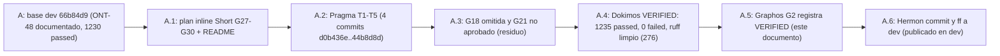

# Feature: Gaps de dogfooding ronda 3 (ONT-49)

- **Documento**: `feature_20261114_ont49_dogfood_round3.md`
- **Anterior en la cadena**: [`feature_20261113_ont48_dogfood_gaps.md`](feature_20261113_ont48_dogfood_gaps.md)
- **Intent**: cerrar los gaps G28–G30 detectados en la tercera ronda de uso real y cerrar G27 (cola pueue vaciada sin rastro) con detección y evento de audit; dejar explícitos G18 y G21 como abiertos
- **Pipeline mode**: **Short** (plan inline del orquestador; Archon y Ontos descartados por decisión del usuario). Plan: scratchpad `plan_ont49.md`
- **Stage**: Graphos G2 (post-Dokimos, veredicto **VERIFIED**)
- **Worktree**: `/home/ancruz/Documents/workspaces/agent-execution-plane/.claude/worktrees/agent-a9c338f8824ab1a32` (rama `worktree-agent-a9c338f8824ab1a32`, HEAD `44b8d8d`)
- **Base**: `66b84d9` (rama `dev`, ONT-48 documentado)
- **Commits de Pragma** (4; docs de Graphos incluidos en el commit de Hermon): `d0b436e`..`44b8d8d`. Rango de sha a tarea: `git log --oneline 66b84d9..HEAD`
- **Routing de este G2**: Graphos G2 → Orchestrator → **Hermon** (publicado en `dev`)
- **Nota sobre el nombre**: el nombre sigue la indicación del orquestador (fecha y descriptor, sin HHMMSS), igual que ONT-46, ONT-47 y ONT-48. Si se quiere el formato estricto `feature_YYYYMMDD_HHMMSS.md`, Hermon o el orquestador deciden el renombrado.
- **Rollup**: este documento es el **sexto** de la cadena (`004026` → `080406` → ONT-46 → ONT-47 → ONT-48 → ONT-49). El siguiente rollup corresponde al décimo; no se genera uno ahora.

## 1. Origen

Tercera ronda de uso real del plano vivo por el orquestador. Aparecieron tres fricciones nuevas: el barrido de `archive` devolvía `ARCHIVED` aunque no hubiera candidatos y añadía `hint: null` (G28); el tablero terse seguía enviando todas las tarjetas, lo que lo hacía caro en tokens (G29); y no había forma de saber si `kanban_board` o `artifact_catalog` apuntaban a la base real o a una ruta de prueba (G30). Además, la cola pueue de ONT-48 (G27) seguía sin rastro, y el test `test_gap_om06_async_job_dispatch_compact_status_pagination` dependía del historial del host.

## 2. Mapa gap → tarea → sha

| Gap | Tarea | Commit | Resultado |
|-----|-------|--------|-----------|
| G28 | T1 barrido `archive` sin candidatos: `NOOP`, `applied: false`, `archived: 0`; sin `hint: null` | `d0b436e` | cerrado |
| G29 | T2 `kanban_board` modo `terse` pliega lanes por `limit` (`[task_id, title[:60]]`) | `d1d6ad6` | cerrado |
| G30 | T3 `db_scope` (`real`/`custom`) y `db_path` en `kanban_board` y `artifact_catalog` (detail) | `d1d6ad6` | cerrado |
| G27 | T4 `history_drop` en `async_job_dispatch(status)` + evento `jobs.history_drop`; fixture om06 siembra sus tareas | `f5b8212` | cerrado en detección y auditoría (ver §4) |
| — | T5 README: fila `async_job_dispatch` alineada con la firma real | `44b8d8d` | cerrado |
| G18 | proyección duplicada en `playbook_run(batch)` | — | **omitida** (ver §4) |
| G21 | `network.neighbors` | — | **no aprobado**: decisión de diseño pendiente del usuario |

Cinco tareas en cuatro commits: T2 y T3 comparten `d1d6ad6`; T4 incluye la siembra de la fixture om06.

## 3. Veredicto Dokimos (recibido por Graphos)

**VERIFIED.**

| Ítem | Resultado |
|------|-----------|
| Suite completa (una corrida) | **1235 passed / 0 failed** (baseline 1230; 192,85 s) |
| `ruff` | limpio (276 archivos) |
| Budgets (`tests/test_token_budgets.py`) | sin cambios; ninguno sube |
| `GAPS_BASELINE` | 1; `own_gaps` 0 |
| Scope | `server.py`, `engine/kanban.py`, `README.md`, `tests/test_ont49_dogfood_round3.py` (nuevo), `tests/test_spec_om7_ipc_batch.py` (solo siembra añadida) |
| `aep_front.py`, `aep_backend.py` | intactos |

Medidas verificadas por Dokimos:

- `kanban_board` terse con `limit=1` y 45 tarjetas: **175 tok** (tope del test: 400).
- `archive` sin candidatos: `status: NOOP`, `applied: false`, `archived: 0`, sin clave `hint`. Con candidatos: `status: ARCHIVED`, `archived: n`.
- `db_scope` real o custom en `kanban_board` y `artifact_catalog` (browse). `db_path` sólo aparece en detail y cuando el scope es `custom`.
- `history_drop` con `{from, to}` y `severity: WARN` cuando el total cae más de un 50 % desde un valor previo >= 10. Evento `jobs.history_drop` registrado en `security_audit_log`.

## 4. Omisiones, pendientes y límites

- **G18 omitida (abierto, decisión de contrato).** `playbook_run(batch, select_fields)` sigue duplicando la proyección. No se cambió por contrato de tests. Requiere decisión del usuario sobre qué forma fija el test.
- **G21 no aprobado.** `network.neighbors` requiere decisión de diseño del usuario. No se implementó.
- **G27 cerrado sólo en detección.** `history_drop` avisa y audita la caída de la cola; no la impide. La causa externa (otro harness o un `pueue clean` manual) no está identificada. Assumption: la caída es externa al servidor AEP, como indicó la ronda 2.
- **Fixture om06 desacoplada del host.** Siembra `pueue add -l seed-om06-<i> -- true` cuando hay menos de 6 tareas. No ejecuta `pueue clean`.
- **Limpieza de la base kanban real** sigue siendo tarea del orquestador por tool con `archive(task_id)`; no se hizo en este track.

## 5. Medidas (según Dokimos)

| Medida | Antes | Después |
|--------|-------|---------|
| `kanban_board` terse, `limit=1`, 45 tarjetas | todas las tarjetas (sin pliegue) | 175 tok (tope 400) |
| `archive` sin candidatos | `ARCHIVED` con `hint: null` | `NOOP`, `applied: false`, `archived: 0`, sin `hint` |
| `kanban_board` / `artifact_catalog` | sin indicación de base | `db_scope` `real` o `custom` (+ `db_path` en detail/custom) |
| Caída de cola pueue > 50 % desde >= 10 | sin rastro | `history_drop` + `WARN` + `jobs.history_drop` en audit |
| Fixture om06 | dependía del historial del host | siembra propia si < 6 tareas, sin `clean` |

Budgets sin subir; GAPS_BASELINE 1.

## 6. Ruta de resolución y blast radius

- **Ruta**: Short. Plan inline; un track de Pragma en worktree dedicado; sin paralelismo.
- **Tools**: git, pytest, ruff sobre el worktree; pueue monkeypatched para `history_drop`; la fixture om06 usa la cola del host; los tests usan base kanban en tmp.
- **Blast radius de producción**: `server.py` (`kanban_board`, `artifact_catalog`, `async_job_dispatch`), `engine/kanban.py` (barrido `archive`). Sin cambios en `engine/catalog.py` ni `engine/security.py` (el helper de auditoría existente se reutiliza).
- **Contrato MCP**: aditivo. `archive` cambia de forma sólo en el caso sin candidatos (`NOOP`, sin `hint: null`); `kanban_board` `terse` gana el pliegue por `limit`; `db_scope` y `db_path` son campos nuevos en detail.
- **Tests**: un test nuevo (`tests/test_ont49_dogfood_round3.py`); la fixture om06 gana siembra propia.

## 7. Evolución del estado

## 8. Routing

- Veredicto VERIFIED → **Hermon**.
- No hay rutas LOGIC_ERROR, PLAN_GAP ni DEPENDENCY_ISSUE en este veredicto. G18 y G21 son decisiones del usuario, no bloqueos del pipeline.

## 9. Documentación de este G2

- Este registro; `docs/sdd/sdd_ont49_dogfood_round3.md` (contrato nuevo); `docs/reports/2026-11-13_dogfood_frictions_report.md` (sección "ONT-49: ronda 3").
- `README.md` (badge 1235, párrafo y grafo ONT-49).
- `docs/STATE.md`, `docs/COMPACT.md`, `docs/MILESTONES.md` (sección 16).
- Los cambios documentales de este G2 se incluyen en el commit de Hermon.
