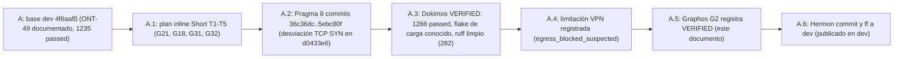

# Feature: Descubrimiento de vecinos LAN, proyección única y fricciones ronda 4 (ONT-50)

- **Documento**: `feature_20261114_ont50_neighbors_projection.md`
- **Anterior en la cadena**: [`feature_20261114_ont49_dogfood_round3.md`](feature_20261114_ont49_dogfood_round3.md)
- **Intent**: cerrar G21 (`network.neighbors`, descubrimiento de vecinos LAN), G18 (proyección duplicada en `playbook_run` compacto), G31 (`NOOP`/`DRY_RUN`/`SKIPPED` sin severidad INFO) y G32 (`async_job_dispatch(status)` terse sin filas repetidas); registrar la limitación de egress bajo VPN con kill-switch.
- **Pipeline mode**: **Short** (plan inline del orquestador; Archon y Ontos descartados). Plan: `/tmp/claude-1000/-home-ancruz-Documents-workspaces-agent-execution-plane/35ca3808-1a4d-4b75-ac5d-4ce0a6c2d86b/scratchpad/plan_ont50.md`.
- **Decisiones de diseño**: tomadas por el orquestador por delegación del usuario (2026-11-14). Se registran de forma explícita en §4; no son decisiones del agente Graphos.
- **Stage**: Graphos G2 (post-Dokimos, veredicto **VERIFIED**).
- **Worktree**: `/home/ancruz/Documents/workspaces/agent-execution-plane/.claude/worktrees/agent-ad4287007de048e0a` (rama `worktree-agent-ad4287007de048e0a`, HEAD `5ebc80f`).
- **Base**: `4f6aaf0` (rama `dev`, ONT-49 documentado).
- **Commits de Pragma** (8; los docs de Graphos se incluyen en el commit de Hermon): `36c36dc`..`5ebc80f`. Rango por tarea: `git log --oneline 4f6aaf0..HEAD`.
- **Routing de este G2**: Graphos G2 → Orchestrator → **Hermon** (publicado en `dev`).
- **Nota sobre el nombre**: el nombre sigue la indicación del orquestador (fecha y descriptor, sin HHMMSS), igual que ONT-46 a ONT-49. Si se quiere el formato estricto `feature_YYYYMMDD_HHMMSS.md`, Hermon o el orquestador deciden el renombrado.
- **Rollup**: este documento es el **séptimo** de la cadena (`004026` → `080406` → ONT-46 → ONT-47 → ONT-48 → ONT-49 → ONT-50). El siguiente rollup corresponde al décimo; no se genera ahora.

## 1. Origen

Cuarta ronda de uso real del plano vivo. Cuatro fricciones seguían abiertas o sin contrato:

- **G21**: no existía forma de listar los hosts de la LAN. `discover("find hosts on my LAN")` no tenía destino útil.
- **G18**: `playbook_run` compacto (`summary`/`brief`/`terse`) emitía la misma proyección dos veces, en el nivel superior y en `output.<path>`.
- **G31**: `NOOP`, `DRY_RUN` y `SKIPPED` no tenían severidad INFO y se trataban como incidencia.
- **G32**: `async_job_dispatch(status)` en modo terse repetía filas y grupos aunque todos estuvieran `Running`.

## 2. Mapa gap → tarea → sha

| Gap | Tarea | Commit | Resultado |
|-----|-------|--------|-----------|
| G21 | T1 motor `discover_neighbors` (`engine/net_telemetry.py`) | `36c36dc` | cerrado |
| G21 | T1 acción `aep_ctl network neighbors` en `server.py`, CLI `scripts/aep-ctl`, schema, matriz de degradación y `discover` | `d058642` | cerrado |
| G21 | T1 barrido primario por TCP SYN no bloqueante, fallback UDP/9 (**desviación del plan**, ver §4) | `d0433e6` | cerrado |
| G21 | T1 hint `egress_blocked_suspected` (limitación VPN, ver §5) | `5ebc80f` | cerrado con limitación documentada |
| G18 | T2 proyección única en `playbook_run` compacto (`single_projection`) | `5c9b934` | cerrado; cambia contrato (ver §6) |
| G31 | T3 `NOOP`, `DRY_RUN` y `SKIPPED` como INFO con `next_action` neutro | `296b8b7` | cerrado |
| G32 | T4 `async_job_dispatch(status)` terse: filas plegadas, sin `groups` salvo grupos no `Running` | `ab4ab3b` | cerrado |
| — | T5 fila ONT-49 en el rollup | `9b12da5` | docs |

G18 y G21 quedan cerrados. En `feature_20261114_ont49_dogfood_round3.md` figuraban como omitido y no aprobado respectivamente; este documento los reemplaza.

## 3. Veredicto Dokimos (recibido por Graphos)

**VERIFIED.**

| Ítem | Resultado |
|------|-----------|
| Suite completa | **1266 passed** (baseline 1235; **+31 casos** nuevos en 29 funciones de `tests/test_ont50_*.py`, una de ellas parametrizada en 3 estados) |
| Flake de carga | 1 fallo de carga en `test_cold_extraction` (heredado de ONT-46); **pasa aislado**. Dokimos lo reporta como flake, no como fallo de contrato |
| `ruff` | limpio (282 archivos; baseline 276) |
| Budgets (`tests/test_token_budgets.py`) | sin diff; ninguno sube |
| `GAPS_BASELINE` | 1; `own_gaps` `[]` |
| Scope | 12 archivos: `server.py`, `engine/net_telemetry.py`, `engine/privilege.py`, `engine/telemetry.py`, `engine/ipc_pool.py`, `scripts/aep-ctl`, `docs/pipeline/feature_rollup.md`, `tests/test_ont50_neighbors.py` (nuevo), `tests/test_ont50_noop_severity.py` (nuevo), `tests/test_ont50_projection.py` (nuevo), `tests/test_ont50_pueue_terse.py` (nuevo), `tests/test_spec_om7_ipc_batch.py` (3 tests de contrato adaptados) |

Nota sobre la cifra: el veredicto decía "+30 tests". La diferencia real frente al baseline es **31 casos** (29 funciones, una parametrizada en 3 estados). Se corrige aquí.

Medidas en vivo (Dokimos, host real, tier 7rwx):

- `network.neighbors` con tier 7: **254 hosts barridos** por `tcp_syn`, **1 vecino** (gateway), **804 ms** (tope de la planificación: < 3 s en /24). `egress_blocked_suspected: true` (ver §5).
- `network.neighbors` con `nosweep`: **0,2 ms**, sin barrido.
- Tier 4: `sweep: false`, lectura pasiva.
- `discover("find hosts on my LAN")`: confianza **HIGH**, enruta a `aep_ctl network neighbors`.

## 4. Decisiones de diseño y desviaciones

### 4.1 Decisiones tomadas por el orquestador por delegación del usuario (2026-11-14)

- **D1. Capacidad compuesta, no tool nueva.** `network.neighbors` es una acción de `aep_ctl` (solo lectura de host). Se mantienen 17 tools y 19 capacidades; sin dependencias nuevas.
- **D2. Barrido gated por tier.** El barrido solo corre con tier >= 6rw-. En 5r-x y 4r-- la acción es pasiva (solo `/proc/net/arp`). Sin ICMP raw ni privilegios.
- **D3. Prefijos acotados.** Solo prefijos `scope link` de /22 o más estrechos (<= 1024 hosts). Prefijos más anchos van a `skipped_prefixes` con razón.
- **D4. Sondas acotadas.** `probe` como máximo sobre 16 vecinos; el resto cuenta en `probe_skipped`.
- **D5. Proyección única en compactos (G18).** En `summary`/`brief`/`terse`, `select_fields` proyecta una vez al nivel superior y omite `output`. `detail` conserva ambos. Esto cambia el contrato anterior de G18, que el test fijaba como duplicado; los tres tests afectados se adaptaron (ver §6).
- **D6. Severidad INFO para `NOOP`, `DRY_RUN` y `SKIPPED` (G31).** `NOT_FOUND` ya era WARN y no cambia.
- **D7. Pueue terse plegado (G32).** Filas plegadas como en `summary`; grupos omitidos salvo que alguno no esté `Running`.
- **Fuera de alcance** (decidido): ARP crudo por `AF_PACKET` (requiere privilegios), tabla OUI de fabricantes y escucha pasiva de mDNS/SSDP. Se anotan en `limits`.

### 4.2 Desviación del plan decidida por el orquestador

- **Barrido primario por TCP SYN, no UDP/9.** El plan describía un datagrama UDP al puerto 9 como barrido. El commit `d0433e6` lo cambió: el primario es un `connect_ex` no bloqueante al puerto 80 por host, en lotes de 256, cerrado de inmediato; el SYN que sale del host hace que el kernel resuelva ARP. El UDP/9 queda como fallback solo si todo el primer lote devuelve `EPERM` o `EACCES`. El campo `sweep_method` toma `tcp_syn`, `udp` o `none`.
- **Motivo**: Decisión del orquestador (fix spec 2026-11-14): el host devuelve EPERM a todo UDP saliente nuevo hacia la LAN (netfilter), mientras un SYN TCP no bloqueante sí sale; por eso TCP SYN es el método primario y UDP/9 el fallback.
- El cambio no altera el gate de tier (>= 6rw-) ni el tope de 1024 hosts.

## 5. Limitación conocida: VPN con kill-switch (egress bloqueado)

- En el host de medición hay una VPN con kill-switch (tabla nft `inet windscribe`) que bloquea el egress hacia la LAN.
- Consecuencia medida: el barrido emite 254 SYN, pero solo aparece el gateway como vecino. Por eso `egress_blocked_suspected: true`.
- El hint es una **heurística**: se activa cuando un barrido de >= 16 hosts no deja ninguna fila ARP nueva (ni `INCOMPLETE`) y hay <= 1 vecino. La causa atribuida a la VPN es el diagnóstico del orquestador; no se ha comprobado de forma aislada (asunción).
- **Efecto para el usuario**: con el kill-switch activo, el descubrimiento de la LAN completa no funciona en este host. Hay que desactivar el kill-switch o usar una ruta sin VPN para obtener vecinos reales. El hint lo señala en `limits`.

## 6. Ruta de resolución y blast radius

- **Ruta**: Short. Plan inline del orquestador; un track de Pragma en worktree dedicado; sin paralelismo.
- **Tools**: git, pytest y ruff sobre el worktree; sockets, ARP y rutas monkeypatched en los tests (sin tráfico de red real en la suite). La medición en vivo se hizo solo en la verificación de Dokimos y generó 254 SYN locales hacia la LAN del host.
- **Blast radius de producción**:
  - `server.py`: rama `neighbors` de `aep_ctl network` (~L3965), `playbook_run` (proyección), `async_job_dispatch` (status terse).
  - `engine/net_telemetry.py`: módulo nuevo de 332 líneas (`discover_neighbors`, parseo de argumentos, compactado).
  - `engine/privilege.py`: matriz de degradación de `neighbors`, rutas de `system_inspect` y palabras clave de `discover`.
  - `engine/telemetry.py`: clasificación de severidad (`NOOP`, `DRY_RUN`, `SKIPPED`).
  - `engine/ipc_pool.py`: parámetro `single_projection` en `project_fields` (7 líneas).
  - `scripts/aep-ctl`: subcomando `network neighbors`.
- **Contrato MCP**:
  - Aditivo: `aep_ctl(domain="network", action="neighbors")`, con paginado `limit`/`cursor`.
  - **Cambio de forma en compactos**: `playbook_run` `summary`/`brief`/`terse` ya no emite `output.<path>` para las claves proyectadas. Un consumidor que leyera `output.<clave>` en compacto debe leer la clave de nivel superior. `detail` no cambia.
  - **Cambio de severidad**: `NOOP`, `DRY_RUN` y `SKIPPED` pasan a INFO. Un consumidor que filtrara por WARN deja de verlos.
  - **Cambio de forma en terse**: `async_job_dispatch(status, terse)` omite `groups` cuando todos están `Running`.
- **Tests**: 4 archivos nuevos (`tests/test_ont50_*.py`) y 3 tests adaptados en `tests/test_spec_om7_ipc_batch.py` (`om22_1_smart_projection_fallbacks`, `pico_ansible_saved_playbook_multi_agent_isolation_and_piping`, `om15_batch_discover_and_cache_piping`). Los tres pasan a leer la clave en el nivel superior y afirman la ausencia de `output`.

## 7. Evolución del estado

## 8. Routing

- Veredicto VERIFIED → **Hermon**.
- No hay rutas LOGIC_ERROR, PLAN_GAP ni DEPENDENCY_ISSUE en este veredicto.
- Motivo del cambio de barrido a TCP SYN (§4.2): decisión del orquestador, fix spec 2026-11-14.

## 9. Documentación de este G2

- Este registro; `docs/sdd/sdd_ont50_neighbors_projection.md` (contrato nuevo); `docs/reports/2026-11-13_dogfood_frictions_report.md` (sección "ONT-50").
- `README.md` (badge 1266, párrafo y grafo ONT-50, filas de contrato de `neighbors` y nota de `playbook_run`).
- `docs/STATE.md`, `docs/COMPACT.md`, `docs/MILESTONES.md` (sección 17), `docs/pipeline/feature_rollup.md` (fila ONT-50).
- Los cambios documentales de este G2 se incluyen en el commit de Hermon.

## 10. Pendientes y límites

- **G27** sigue cerrado solo en detección (`history_drop` avisa y audita, no impide la caída de la cola).
- **Flake** `test_cold_extraction` (margen de 1.5–1.7 s frente a 2.0 s, backlog ONT-46).
- **Fuera de alcance**: ARP crudo `AF_PACKET`, tabla OUI, escucha mDNS/SSDP.
- **Limitación VPN** (§5): el descubrimiento de la LAN completa requiere egress sin kill-switch.
