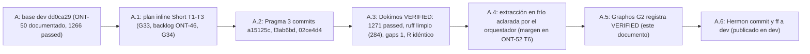

# Feature: Discover por afinidad, supervisión sin aristas débiles y docs históricos (ONT-51)

- **Documento**: `feature_20261114_ont51_discover_supervise.md` (nombre según indicación del orquestador: fecha y descriptor, sin HHMMSS, igual que ONT-46 a ONT-50)
- **Anterior en la cadena**: [`feature_20261114_ont50_neighbors_projection.md`](feature_20261114_ont50_neighbors_projection.md)
- **Intent**: cerrar G33 (`discover` recomendaba `aep_ctl schema` en lugar de `network neighbors`), cerrar el backlog de ONT-46 (aristas `weak` fusionaban archivos en una misma unidad de supervisión) y cerrar G34 (hitos ya publicados que seguían marcados como pendientes en los docs históricos). G36 a G39, el routing de "open ports" y el perfil de extracción quedan para ONT-52.
- **Pipeline mode**: **Short** (plan inline del orquestador; Archon y Ontos descartados). Plan: `/tmp/claude-1000/-home-ancruz-Documents-workspaces-agent-execution-plane/35ca3808-1a4d-4b75-ac5d-4ce0a6c2d86b/scratchpad/plan_ont51.md`.
- **Decisiones de diseño**: tomadas por el orquestador según el plan (delegación del usuario, 2026-11-14). Se registran en §4; no son decisiones del agente Graphos.
- **Stage**: Graphos G2 (post-Dokimos, veredicto **VERIFIED**).
- **Worktree**: `/home/ancruz/Documents/workspaces/agent-execution-plane/.claude/worktrees/agent-a884bcfe5eff9cc2e` (rama `worktree-agent-a884bcfe5eff9cc2e`, HEAD `02ce4d4`).
- **Base**: `dd0ca29` (rama `dev`, ONT-50 documentado).
- **Commits de Pragma** (3; los docs de Graphos G2 van en el commit de docs ONT-51, publicado en dev): `a15125c` (T1), `f3ab6bd` (T2), `02ce4d4` (T3). Rango: `git log --oneline dd0ca29..HEAD`.
- **Routing de este G2**: Graphos G2 → Orchestrator → **Hermon**.
- **Rollup**: este documento es el **octavo** de la cadena (`004026` → `080406` → ONT-46 → ONT-47 → ONT-48 → ONT-49 → ONT-50 → ONT-51). El siguiente rollup corresponde al décimo; no se genera ahora.

## 1. Origen

- **G33**: `discover("find which hosts are on my LAN")` recomendaba `aep_ctl(action="schema")` porque la primera canonical call de la capacidad ganadora era siempre la recomendada (`rec_calls[0]`). Debía recomendar `network neighbors` (ONT-50).
- **Backlog ONT-46**: `engine/threads_supervise.py` construía `file_units` con aristas `weak` (conjeturas de receptor sin tipo). Una sola arista débil podía fusionar dos archivos en una unidad, a diferencia de `classify_sccs`, que ya las excluía.
- **G34**: los docs históricos de `docs/MILESTONES.md` y `README.md` marcaban como "pendiente" hitos ya publicados (ONT-47, ONT-48, ONT-49, E3 y E4).

## 2. Mapa gap → tarea → sha

| Gap | Tarea | Commit | Resultado |
|-----|-------|--------|-----------|
| G33 | T1 `discover` elige la canonical call con mayor solapamiento con el `use_case` (`server.py`, ~L1060-1080) | `a15125c` | cerrado |
| ONT-46 backlog | T2 `file_units` sin aristas `weak` (`engine/threads_supervise.py`) | `f3ab6bd` | cerrado |
| G34 | T3 marcar como publicados los hitos ya publicados (`README.md`, `docs/MILESTONES.md`; sin tocar "Pending alerts" ni la fila de autoevol) | `02ce4d4` | cerrado |
| — | T4 docs de Graphos G2 (este registro, README, STATE, COMPACT, MILESTONES §18, rollup) | commit de docs ONT-51 (publicado en dev) | docs |

## 3. Veredicto Dokimos (recibido por Graphos)

**VERIFIED.**

| Ítem | Resultado |
|------|-----------|
| Suite completa | **1271 passed, 0 failed**, 193,8 s (baseline 1266; **+5**) |
| `ruff` | limpio (284 archivos) |
| Budgets (`tests/test_token_budgets.py`) | sin diff |
| `GAPS_BASELINE` | 1; `own_gaps` `[]` |
| Merkle R | idéntico: motor de `dd0ca29` y motor nuevo sobre el mismo árbol |
| `discover("find which hosts are on my LAN")` | `next_call` → `aep_ctl network neighbors` |
| `discover("list open ports")` | sigue `LOW`; el routing de "open ports" pasa a ONT-52 |
| Scope | `server.py`, `engine/threads_supervise.py`, `docs/MILESTONES.md`, `README.md`, `tests/test_e3_supervise.py`, `tests/test_ont50_neighbors.py` |

### 3.1 Hallazgo para ONT-52: tiempo de extracción en frío

- Dokimos reporta que `tests/test_ont40_acceptance.py::test_cold_extraction_under_two_seconds_and_stable_r` pasa con **3,5 s en la fase `call`** frente al tope nominal de **2,0 s**.
- Lectura del propio test (confirmada por el orquestador, ver Estado): la aserción `elapsed < 2.0` solo cronometra la primera llamada a `threads.analyze(REPO, use_cache=False)`. La segunda llamada, la de estabilidad de R, no se cronometra, pero sí cuenta en la fase `call` de pytest. Así, 3,5 s de `call` pueden ser compatibles con una primera pasada menor de 2,0 s.
- Estado: **aclarado por el orquestador**: la aserción mide solo la primera extracción (< 2.0 s); los 3,5 s de fase call incluyen la segunda extracción de estabilidad de R. El margen se aborda en ONT-52 T6 (ast.dump ~21 % del tiempo). La cifra de 1,5–1,7 s registrada en ONT-50 es anterior a este tramo.

## 4. Decisiones de diseño

- **D1. Afinidad por solapamiento (T1).** Cada canonical call de la capacidad ganadora se puntúa contra el `use_case` por solapamiento de tokens (minúsculas, sin stopwords cortas) con su `tool`, su dominio y su `action` más una tabla de sinónimos pequeña y documentada en el módulo. Se extiende solo con acciones que ya aparecen en `canonical_calls`.
- **D2. Compatibilidad.** Empate o puntuación 0 → `rec_calls[0]`, igual que antes. `suggested_capability[*].canonical_calls` conserva su orden.
- **D3. Dependencias débiles (T2).** `_union_edges` gana `include_weak` (por defecto `True`). `file_units` usa `False`, igual que `classify_sccs`. `_changed_consumers` y la recolección de dependientes conservan las aristas débiles de forma deliberadamente conservadora.

## 5. Ruta de resolución y blast radius

- **Ruta**: Short. Plan inline del orquestador; un track de Pragma en worktree dedicado; sin paralelismo.
- **Tools**: git, pytest y ruff sobre el worktree. Sin tráfico de red ni cambios fuera del worktree.
- **Blast radius de producción**:
  - `server.py`: recomendación de `discover` (`recommended_next_call`). Solo cambia la llamada recomendada cuando hay solapamiento; la forma de la respuesta no cambia.
  - `engine/threads_supervise.py`: `file_units` ya no fusiona archivos por aristas `weak`. Puede aumentar el número de unidades en grafos donde una arista débil cruzaba archivos.
  - Docs: `README.md`, `docs/MILESTONES.md` (solo fechas y SHA de hitos ya publicados).
- **Contrato MCP**: sin cambio de forma. Cambio de comportamiento en `discover`: `recommended_next_call` puede apuntar a otra canonical call cuando el `use_case` solapa con ella.
- **Tests**: `tests/test_ont50_neighbors.py` (+36 líneas, casos de afinidad: LAN → neighbors, "list open ports" → listeners, sin solapamiento → `rec_calls[0]`) y `tests/test_e3_supervise.py` (+35 líneas: dos archivos con ciclo cuya única arista de retorno es `weak` → dos unidades; consumidor solo por arista `weak` sigue como dependiente).

## 6. Evolución del estado

## 7. Routing

- Veredicto VERIFIED → **Hermon**.
- No hay rutas LOGIC_ERROR, PLAN_GAP ni DEPENDENCY_ISSUE en este veredicto.
- Nota para Hermon: los tres commits de Pragma llevan el trailer `Co-Authored-By: Claude Opus 5.5`, que viene del plan de Pragma. Graphos no reescribe historia; Hermon decide si lo señala al orquestador. El push sigue la política vigente (user-gated).

## 8. Documentación de este G2

- Este registro.
- `README.md` (badge 1271 y párrafo ONT-51 antes de ONT-50).
- `docs/STATE.md` (cabecera ONT-51 publicada en dev, tests 1271, bloque en Hecho, Pendientes con ONT-52).
- `docs/COMPACT.md` (regenerado para ONT-51).
- `docs/pipeline/feature_rollup.md` (fila ONT-51; la fila ONT-50 pasa a "publicado en dev").
- `docs/MILESTONES.md` (sección 18).

## 9. Pendientes y límites (ONT-52)

- **G36**: `firewall_status` da falsos negativos.
- **G37**: telemetría de onnxruntime.
- **G38**: etiqueta de FD.
- **G39**: catálogo builtin y score.
- **Routing de "list open ports"**: debe enrutar a `listeners`; hoy sigue `LOW`.
- **Perfil de extracción**: sustituir `ast.dump` por una vía más barata y medir la primera pasada en frío (§3.1).
- **Test de extracción en frío**: revisar qué cronometra la aserción frente a la fase `call` (§3.1).
- **G27** sigue cerrado solo en detección (`history_drop`).
- **Limitación VPN** de ONT-50 (kill-switch que bloquea el egress a la LAN) sigue vigente en este host.
