# Feature: Ronda 6 de gaps: firewall veraz, embedder sin telemetría, etiquetas, catálogo, routing y margen de extracción (ONT-52)

- **Documento**: `feature_20261114_ont52_round6.md` (nombre indicado por el orquestador: fecha y descriptor, sin HHMMSS, igual que ONT-46 a ONT-51)
- **Anterior en la cadena**: [`feature_20261114_ont51_discover_supervise.md`](feature_20261114_ont51_discover_supervise.md)
- **Intent**: cerrar G36 (`firewall_status` daba falsos negativos), G37 (telemetría de onnxruntime), G38 (etiqueta de FD ilegible), G39 (catálogo `browse` sin builtins y score sin explicación), el routing de "list open ports" (T5) y el margen de extracción en frío (T6, ONT-46 backlog). T7 (test de extracción) se descartó tras leer el test: mide correctamente solo la primera extracción.
- **Pipeline mode**: **Short** (plan inline del orquestador; Archon y Ontos descartados). Plan: `/tmp/claude-1000/-home-ancruz-Documents-workspaces-agent-execution-plane/35ca3808-1a4d-4b75-ac5d-4ce0a6c2d86b/scratchpad/plan_ont52.md`.
- **Decisiones de diseño**: tomadas por el orquestador según el plan (delegación del usuario, 2026-11-14). Se registran en §4; no son decisiones del agente Graphos.
- **Stage**: Graphos G2 (post-Dokimos, **dos veredictos**: ciclo 1 `DEFECTIVE (LOGIC_ERROR)`, ciclo 2 `VERIFIED`).
- **Worktree**: `/home/ancruz/Documents/workspaces/agent-execution-plane/.claude/worktrees/agent-a8314a90a3c91355d` (rama `worktree-agent-a8314a90a3c91355d`, HEAD `eb63fc5`).
- **Base**: `4bf0fea` (rama `dev`, ONT-51 documentado).
- **Commits de Pragma** (7; los docs de Graphos G2 quedan sin commit y los compromete Hermon): `19494cc` (T1, G36), `bcfba03` (T2, G37), `a46ae1c` (T3, G38), `7110566` (T4, G39), `aae76de` (T5, routing), `e879e5f` (T6 parcial, `_fast_dump`), `eb63fc5` (style: ruff format tras el ciclo 1). Rango: `git log --oneline 4bf0fea..HEAD`.
- **Routing de este G2**: Graphos G2 → Orchestrator → **Hermon**.
- **Rollup**: este documento es el **noveno** de la cadena (`004026` → `080406` → ONT-46 → ONT-47 → ONT-48 → ONT-49 → ONT-50 → ONT-51 → ONT-52). El siguiente rollup corresponde al décimo; no se genera ahora, solo se añade la fila ONT-52 en `feature_rollup.md`.

## 1. Origen

- **G36 (alta, falso negativo de seguridad)**: `scripts/aep-ctl` `domain_security` `firewall_status` ejecutaba `ufw status` sin sudo. Sin privilegio, stdout vacío y `active: false`, cuando `sudo -n ufw status` decía `Status: active`.
- **G37**: `onnxruntime` abría telemetría al cargar el modelo de `engine/embedder.py` (fastembed).
- **G38**: la etiqueta de FD ilegible tenía textos distintos en `engine/primitives.py` y `server.py`.
- **G39**: `artifact_catalog(action="browse")` no mostraba los builtins de `default_primitives` y `concurrent_mem_stat` tenía `promotion_score` 0.0 sin explicación.
- **T5**: `discover("list open ports")` quedaba `LOW` y no enrutaba a `system_inspect` `listeners`.
- **T6 (backlog ONT-46)**: `ast.dump` consumía ~21 % del tiempo de `threads.analyze`; la extracción en frío estaba en 1,6–2,0 s frente a un tope de 2,0 s.

## 2. Mapa gap → tarea → sha

| Gap | Tarea | Commit | Resultado |
|-----|-------|--------|-----------|
| G36 | T1 `firewall_status` veraz: sudo cuando el tier lo permite, `nft_tables` desde `nft -j`, `DEGRADED` con `active: null` y `reason` sin privilegio; `server.py` `egress_blocked_suspected` → `next_action` = `firewall_status` | `19494cc` | cerrado (verificado en vivo) |
| G37 | T2 `onnxruntime.disable_telemetry_events()` antes de cargar el modelo (`engine/embedder.py`) | `bcfba03` | cerrado en la llamada; **abierto como G42** (el proceso sigue abriendo `onnxruntime.db`) |
| G38 | T3 constante compartida `"[unreadable]"` en `engine/telemetry.py` usada por `primitives.py` y `server.py` | `a46ae1c` | cerrado |
| G39 | T4 `browse` añade builtins `{name, category, builtin: true, call: 'default_primitives(action="run", name=...)'}` al final sin desplazar artefactos; `score_reason` en detail | `7110566` | cerrado (score 0.0 es columna por defecto, tarea aún en CANARY: no es bug) |
| T5 | `engine/privilege.py` keywords de `system_inspect` (`ports open listening port scan sockets connections`, `puertos abiertos escucha`) | `aae76de` | "list open ports" → HIGH → `listeners`; "puertos abiertos escucha" → HIGH pero `next_call` de schema, **abierto como G41** |
| T6 | `_fast_dump` memoizado, equivalente a `ast.dump` (`engine/threads_extractors.py`) | `e879e5f` | parcial: mediana 1,73 s (Dokimos) / 1,78 s (Pragma) frente a objetivo 1,3 s; **abierto como G40** |
| — | style: ruff format en 4 archivos (ciclo 1) | `eb63fc5` | cerrado (ciclo 2) |
| — | T7 descartada: el test de extracción mide solo la primera extracción | — | sin cambio |

## 3. Veredictos Dokimos (recibidos por Graphos)

### 3.1 Ciclo 1: DEFECTIVE (LOGIC_ERROR, cosmético)

| Ítem | Resultado |
|------|-----------|
| Causa | `ruff format --check` fallaba en 4 archivos de los commits de Pragma (defecto de forma, sin cambio de lógica) |
| Suite completa | **1288 passed**, 0 failed (baseline 1271; **+17**) con 1 flake de carga en `test_cold_extraction` que pasa aislado |
| Verificado | `firewall_status` en vivo: `active: true`, backend `ufw`, `nft_tables` con `inet windscribe` (8 cadenas, 64 reglas), `ip filter`, `ip6 filter`; sin privilegio → `DEGRADED`, `active: null`, `reason`; `network neighbors` con `egress_blocked_suspected` → `next_action` = `firewall_status` |
| Verificado | `onnxruntime.disable_telemetry_events()` se llama una vez antes de cargar el modelo; el proceso sigue abriendo `~/.cache/Microsoft/DeveloperTools/.onnxruntime/onnxruntime.db` (+ `-wal`/`-shm`): G42 |
| Verificado | T6: `root_hash` idéntico entre motores; `_fast_dump` == `ast.dump` en 200 nodos y en 10 módulos enteros |
| Verificado | `browse("disk usage")` añade el builtin `disk-usage` con su `call`; `discover("list open ports")` → HIGH, `listeners` |
| Medido | Mediana de `analyze`: 1,83 → 1,73 s (Dokimos); 1,95 → 1,78 s (Pragma). Objetivo 1,3 s **no alcanzado** → G40 (unificar los recorridos `ast.walk`) |
| Routing | LOGIC_ERROR (forma) → Pragma con Fix Specification `ruff format` sobre los 4 archivos |

**Fix Specification (ciclo 1)**: aplicar solo formato (`ruff format`) sobre los archivos afectados, sin cambio de AST; ruff check y format limpios; re-ejecutar tests dirigidos.

### 3.2 Ciclo 2: VERIFIED

| Ítem | Resultado |
|------|-----------|
| Pragma | `eb63fc5` (solo formato); **AST idéntico** en los 4 archivos |
| Estática | `ruff check` y `ruff format --check` limpios (286 archivos) |
| Tests | **56 passed** en la batería dirigida |
| Veredicto | **VERIFIED** |

**Límite registrado**: la suite completa (1288 passed) se ejecutó en el ciclo 1, antes de `eb63fc5`. El ciclo 2 no repitió la suite completa; la equivalencia se apoya en AST idéntico y en la batería dirigida. Hermon puede pedir una pasada completa antes del push si el orquestador lo considera necesario (no es requisito de este G2).

### 3.3 Verificación transversal (ambos ciclos)

- Budgets (`tests/test_token_budgets.py`): sin diff. `GAPS_BASELINE`: 1.
- Scope: `server.py`, `scripts/aep-ctl`, `engine/{catalog,embedder,net_telemetry,primitives,privilege,telemetry,threads_extractors}.py`, `tests/test_ont52_round6.py`. `aep_front.py` y `aep_backend.py` intactos.

## 4. Decisiones de diseño

- **D1. Firewall veraz (T1).** `active` = ufw activo OR alguna tabla nft con reglas. Sin privilegio, el estado es `DEGRADED` con `active: null` y `reason`, nunca `false`. Así un falso negativo de seguridad deja de presentarse como "inactivo".
- **D2. Telemetría de onnxruntime (T2).** Se usa el mecanismo de la API instalada (`disable_telemetry_events()`), no variables de entorno inventadas. Si el proceso sigue escribiendo su base, el hallazgo se registra como G42 y no se oculta.
- **D3. Builtins en `browse` (T4).** Se añaden al final, sin desplazar artefactos. El `call` es explícito para que el agente pueda ejecutar el builtin sin ambigüedad.
- **D4. `score_reason` (T4).** En lugar de tocar la ponderación, la razón del score 0.0 se explica en detail. La tarea aún no ha superado CANARY, así que el 0.0 es esperado.
- **D5. Serializador de hash (T6).** `_fast_dump` replica la semántica de `ast.dump` en el hash de nodos y se valida con igualdad de `root_hash`. Supuesto: no hubo cambio de hash y, por tanto, no hace falta bump a `GRAPH_SCHEMA_VERSION` = `threads/3` (el veredicto no lo reporta; marcado como supuesto, Hermon puede confirmarlo al revisar el diff de `engine/threads_extractors.py`).

## 5. Ruta de resolución y blast radius

- **Ruta**: Short. Plan inline del orquestador; un track de Pragma en worktree dedicado; sin paralelismo. Ciclo de corrección de forma (LOGIC_ERROR) → Pragma.
- **Tools**: git, pytest, ruff y `aep-ctl` en vivo sobre el host de desarrollo (`ufw`, `nft`, `sudo -n`). Sin tráfico de red nuevo ni cambios fuera del worktree.
- **Blast radius de producción**:
  - `scripts/aep-ctl` y `server.py`: `firewall_status` cambia de forma de respuesta en el estado `DEGRADED` (campos `active` y `reason`) y añade `nft_tables`. `next_action` de `network neighbors` cambia cuando hay `egress_blocked_suspected`.
  - `engine/embedder.py`: desactiva la telemetría de onnxruntime antes de cargar el modelo.
  - `engine/catalog.py`: `browse` puede devolver entradas builtin al final y `score_reason` en detail.
  - `engine/privilege.py`: nuevas keywords de `system_inspect`; puede cambiar el routing de consultas que ya contengan esos términos.
  - `engine/threads_extractors.py`: el serializador de hash de nodos cambia de implementación (semántica equivalente).
- **Contrato MCP**: sin cambio de nombres de tool ni de parámetros. Cambios aditivos en `firewall_status` (`nft_tables`, `DEGRADED`) y en `browse` (entradas builtin).

## 6. Evolución del estado

```mermaid
flowchart LR
    A["A: base dev 4bf0fea (ONT-51 documentado, 1271 passed)"] --> A1["A.1: plan inline Short T1-T6 (T7 descartada)"]
    A1 --> A2["A.2: Pragma 6 commits 19494cc, bcfba03, a46ae1c, 7110566, aae76de, e879e5f"]
    A2 --> A3["A.3: Dokimos ciclo 1 DEFECTIVE LOGIC_ERROR (ruff format en 4 archivos; 1288 passed)"]
    A3 --> A4["A.4: Graphos G2 registra ciclo 1 y Pragma Fix Spec"]
    A4 --> A5["A.5: Pragma eb63fc5 (solo formato, AST idéntico)"]
    A5 --> A6["A.6: Dokimos ciclo 2 VERIFIED (ruff limpio 286; 56 passed dirigidos)"]
    A6 --> A7["A.7: Graphos G2 registra ambos veredictos (este documento)"]
    A7 --> A8["A.8: Hermon commit (publicado en dev)"]
```

## 7. Routing

- Veredicto final **VERIFIED** (ciclo 2) → **Hermon**.
- El ciclo 1 (`LOGIC_ERROR` cosmético) ya se resolvió con Pragma `eb63fc5`; no hay rutas PLAN_GAP ni DEPENDENCY_ISSUE.
- Nota para Hermon:
  - Commits de Pragma con el trailer de su plan; Graphos no reescribe historia.
  - Los docs de este G2 (README, `docs/STATE.md`, `docs/COMPACT.md`, `docs/MILESTONES.md` §19, `docs/pipeline/feature_rollup.md`, este documento) quedan sin commit en el worktree, para que Hermon los incluya en la tanda `(ONT-52)`.
  - Push ff a `dev` solo bajo autorización del usuario (7rwx tras VERIFIED).

## 8. Documentación de este G2

- Este registro (ambos veredictos).
- `README.md`: badge 1288; párrafo ONT-52 antes de ONT-51; nota de `security.firewall_status` en la tabla de contrato de `aep_ctl`.
- `docs/STATE.md`: cabecera ONT-52 (publicado en dev), tests 1288, bloque en Hecho, Pendientes = G40, G41, G42.
- `docs/COMPACT.md`: regenerado para ONT-52.
- `docs/pipeline/feature_rollup.md`: fila ONT-52 (9.º documento; el rollup completo corresponde al 10.º).
- `docs/MILESTONES.md`: sección 19.

## 9. Pendientes y límites (cruzan ONT-52)

- **G40 (abierto)**: margen de extracción en frío. Medido 1,73 s / 1,78 s frente al objetivo de 1,3 s. Siguiente acción: unificar los recorridos `ast.walk` que comparten la extracción.
- **G41 (abierto)**: `discover("puertos abiertos escucha")` enruta a HIGH pero `next_call` apunta a schema, no a `listeners`.
- **G42 (abierto)**: onnxruntime sigue abriendo `~/.cache/Microsoft/DeveloperTools/.onnxruntime/onnxruntime.db` (+ `-wal`/`-shm`) pese a `disable_telemetry_events()`. Causa medida por el orquestador: requiere `ORT_DISABLE_TELEMETRY=1` en el entorno antes de importar onnxruntime (planificado en ONT-53 T1).
- **Flake de carga** `test_cold_extraction` (pasa aislado): conocido desde ONT-47 y no bloqueante.
- **Límite del ciclo 2**: suite completa no repetida tras `eb63fc5` (ver §3.2).
- **Limitación VPN** de ONT-50 (kill-switch que bloquea el egress a la LAN) sigue vigente en este host.
- **G27** sigue cerrado solo en detección (`history_drop`).
