# Feature: Telemetría ORT efectiva, sinónimos EN+ES únicos y extracción con recorrido AST memoizado por análisis (ONT-53)

- **Documento**: `feature_20261114_ont53_ort_synonyms_walk.md` (fecha y descriptor, sin HHMMSS, igual que ONT-46 a ONT-52)
- **Anterior en la cadena**: [`feature_20261114_ont52_round6.md`](feature_20261114_ont52_round6.md)
- **Intent**: cerrar G42 (onnxruntime seguía abriendo `onnxruntime.db`), G41 (`discover` en español enrutaba a HIGH con `next_call` de schema) y G40 (margen de extracción en frío, backlog ONT-46). G40 se cierra solo en parte: 1,3 s únicamente en la primera ejecución.
- **Pipeline mode**: **Short** (plan inline del orquestador; Archon y Ontos descartados). Plan con el registro del ciclo 1: `/tmp/claude-1000/-home-ancruz-Documents-workspaces-agent-execution-plane/35ca3808-1a4d-4b75-ac5d-4ce0a6c2d86b/scratchpad/plan_ont53.md`.
- **Decisiones de diseño**: tomadas por el orquestador según el plan (delegación del usuario, 2026-11-14). Se registran en §4; no son decisiones del agente Graphos.
- **Stage**: Graphos G2 (post-Dokimos, **dos veredictos**: ciclo 1 `DEFECTIVE (LOGIC_ERROR)` reclasificado por el orquestador por regla 12, ciclo 2 `VERIFIED`).
- **Worktree**: `/home/ancruz/Documents/workspaces/agent-execution-plane/.claude/worktrees/agent-aed2dedac4764437d` (rama `worktree-agent-aed2dedac4764437d`, HEAD `1a2d6d4`).
- **Base**: `cc10757` (rama `dev`, ONT-52 documentado).
- **Commits de Pragma** (4; los docs de este G2 se comprometen en el commit de Hermon `docs(ONT-53)`): `1630453` (T1, G42), `140d885` (T2, G41), `305851e` (T3, G40, recorrido único memoizado), `1a2d6d4` (fix de T3 tras el ciclo 1: caché con ámbito de análisis, sin memos en nodos). Rango: `git log --oneline cc10757..HEAD`.
- **Routing de este G2**: Graphos G2 → Orchestrator → **Hermon**.
- **Rollup**: este documento es el **décimo** de la cadena (`004026` → `080406` → ONT-46 → ONT-47 → ONT-48 → ONT-49 → ONT-50 → ONT-51 → ONT-52 → ONT-53). Se genera el rollup `feature_rollup.md` ("ONT-43 a ONT-53") y se conserva el anterior. El siguiente rollup llega al quinto documento posterior a este.

## 1. Origen

- **G42 (media, telemetría residual)**: `engine/embedder.py` llamaba `onnxruntime.disable_telemetry_events()` (ONT-52 G37), pero el proceso seguía abriendo `~/.cache/Microsoft/DeveloperTools/.onnxruntime/onnxruntime.db` (+ `-wal`/`-shm`). Medido por el orquestador (onnxruntime 1.31.1): `ORT_DISABLE_TELEMETRY=1` en el entorno antes del import sí evita la apertura; la llamada por API no basta.
- **G41 (media, routing)**: `discover("puertos abiertos escucha")` daba HIGH pero `next_call` apuntaba a `schema`. La tabla de sinónimos de acciones estaba partida: EN en `server.py` (ONT-51) y ES en otro sitio (ONT-52).
- **G40 (media, rendimiento)**: `threads.analyze` repetía ~983k visitas de `ast.walk` en `facts`, `extract_state`, `_string_constants`, `_server_version_literals`, `extract_claims` y `extract_tests` (`engine/threads_extractors.py`). Tope de referencia 1,3 s en frío; ONT-52 dejó 1,73 s (Dokimos) / 1,78 s (Pragma).

## 2. Mapa gap → tarea → sha

| Gap | Tarea | Commit | Resultado |
|-----|-------|--------|-----------|
| G42 | T1 `setdefault("ORT_DISABLE_TELEMETRY", "1")` antes del import perezoso de fastembed; se conserva `disable_telemetry_events()`; un valor explícito del operador no se pisa | `1630453` | cerrado (Dokimos: ningún FD de `/proc/self/fd` apunta a `onnxruntime.db`) |
| G41 | T2 tabla única `ACTION_SYNONYMS` (EN+ES) en `engine/privilege.py`; `server.py` y `_pick_canonical_call` la consumen; keywords de capacidad derivadas de la misma tabla | `140d885` | cerrado ("puertos abiertos escucha" → `listeners`; "hosts en mi red" → `neighbors`; casos EN sin cambio) |
| G40 | T3 índice por tipo de nodo construido una vez por análisis y consumido por los extractores | `305851e` (ciclo 1) → `1a2d6d4` (fix) | parcial: equivalencia exacta; estado estable 1,46–1,49 s frente a 1,67–1,69 s base; primera ejecución 1,31 s; **1,3 s solo en frío**; cierre parcial registrado |
| — | Ciclo 1 reclasificado a LOGIC_ERROR por el orquestador: memos en `node.__dict__` creaban ciclos liberados solo por el GC generacional | `1a2d6d4` | corregido (sin memos en nodos, sin `gc.collect`) |

## 3. Veredictos Dokimos (recibidos por Graphos)

### 3.1 Ciclo 1: VERIFIED con observación, reclasificado como DEFECTIVE (LOGIC_ERROR)

| Ítem | Resultado |
|------|-----------|
| Suite completa | **1303 passed** (estado tras `305851e`); ruff limpio |
| Equivalencia | `root_hash`, `node_hash`, nodos, aristas y gaps idénticos a la base |
| T1 | sin FD de `onnxruntime.db` tras cargar el embedder |
| T2 | rutas ES y EN correctas |
| Observación (no bloqueante para Dokimos) | en estado estable, 8 `analyze` seguidos (como hace el backend vivo): nuevo ~1,92 s / ~394 MB frente a base ~1,69 s / ~327 MB. Causa: memos en `node.__dict__` forman ciclos que solo libera el GC generacional |
| Reclasificación | **DEFECTIVE (LOGIC_ERROR)** por regla 12 del orquestador: la mejora de tiempo en frío no se sostiene en uso real y añade memoria |
| Routing | Graphos G2 → Pragma con Fix Specification (abajo) |

**Fix Specification (ciclo 1)**: el caché de recorridos no puede vivir en el objeto del nodo. Debe ser un caché con ámbito de análisis, creado al entrar en `build_graph` y descartado en `finally`; sin `gc.collect` como parche. Aceptación: estado estable ≤ base en tiempo y ≤ base + 20 MB en RSS; equivalencia exacta.

### 3.2 Ciclo 2: VERIFIED

| Ítem | Resultado |
|------|-----------|
| Pragma | `1a2d6d4`: `ContextVar` con caché `{id(nodo): [nodo, walk, índice]}`, creado y descartado en `finally` de `build_graph`; sin memos en nodos; sin `gc.collect` |
| Suite completa | **1304 passed** (182 s) |
| Estática | `ruff check` limpio (290 archivos) |
| Residuos | `grep _aep_walk` / `_aep_index` vacío en `engine/` (solo aparece en el test que lo verifica) |
| Equivalencia | `root_hash` `2d98d17914bf17946b9142f936804027947d37d532451508324e5ab8270a6d2a`, `node_hash` idéntico, **2482 nodos, 7710 aristas, 1 gap** |
| Veredicto | **VERIFIED** |

**Verificación de Graphos (solo lectura, 2026-11-14)**: `threads.analyze` sobre el árbol del worktree con el motor nuevo y con la copia del motor base (`scratchpad/base`) da el mismo `root_hash` `2d98d179…6d2a`, 2482 nodos, 7710 aristas y 1 gap. Los 2482/7710 de este documento corresponden al árbol del worktree. La medición auxiliar `p53_tree` (2474 nodos, 7684 aristas, root `2fae1e51…95fc`) es un snapshot anterior del árbol y no es la serie de Dokimos.

### 3.3 Tabla de ejecuciones de rendimiento

Serie del orquestador (estado estable, sin dato de Dokimos en esta tabla): 8 `analyze` seguidos sobre el árbol del repo, con `use_cache=False`. Los valores individuales de la serie de 8 no quedaron persistidos; solo constan rangos y primera ejecución. El script `scratchpad/bench.py` reproduce la serie.

| Ciclo | Motor | Primera ejecución | Estado estable (8 seguidos) | RSS estable | Lectura |
|-------|-------|-------------------|-----------------------------|-------------|---------|
| 1 | base `cc10757` | no registrada | ~1,69 s | ~327 MB | referencia |
| 1 | nuevo `305851e` (memos en nodos) | no registrada | ~1,92 s | ~394 MB | **peor** que base: LOGIC_ERROR |
| 2 | base `cc10757` | no registrada | 1,67–1,69 s | 327 MB | referencia |
| 2 | nuevo `1a2d6d4` (caché de ámbito) | **1,31 s** | **1,46–1,49 s** (~12 % menos) | 330 MB (+2 MB) | aceptado |

Medición auxiliar del orquestador (3 ejecuciones seguidas en el árbol `p53_tree`, 2474 nodos, mediana de la pasada):

| Motor | Ejecución 1 | Ejecución 2 | Ejecución 3 | Mediana |
|-------|-------------|-------------|-------------|---------|
| base | 1,50 s | 1,73 s | 1,73 s | 1,73 s |
| nuevo | 1,31 s | 1,54 s | 1,53 s | 1,53 s |

**Lectura honesta**: el objetivo de 1,3 s se alcanza solo en la primera ejecución de un proceso. En estado estable la mejora es de ~12 % (1,67–1,69 s → 1,46–1,49 s). El orquestador acepta el resultado como cierre parcial de G40.

### 3.4 Verificación transversal (ambos ciclos)

- Budgets (`tests/test_token_budgets.py`): sin diff. `GAPS_BASELINE`: 1.
- Scope: `server.py`, `engine/{embedder,privilege,threads_extractors}.py`, `tests/test_ont53_*.py` (`test_ont53_telemetry.py`, `test_ont53_synonyms.py`, `test_ont53_walk_index.py`). `aep_front.py` y `aep_backend.py` intactos.
- Flake de carga conocido `test_cold_extraction`: en el ciclo 2 la suite completa (1304 passed) incluyó `test_cold_extraction` y pasó.

## 4. Decisiones de diseño

- **D1. Telemetría por entorno (T1).** `ORT_DISABLE_TELEMETRY` se fija con `setdefault` antes del import, porque la API `disable_telemetry_events()` no basta en onnxruntime 1.31.1. `setdefault` respeta un valor explícito del operador. La llamada de ONT-52 se conserva.
- **D2. Tabla de sinónimos única (T2).** `ACTION_SYNONYMS` vive en `engine/privilege.py`, junto a las keywords de capacidad. `server.py` y `_pick_canonical_call` la consumen; no hay copia local.
- **D3. Recorrido memoizado por análisis (T3).** El índice por tipo se guarda en un `ContextVar` que se crea y descarta dentro de `build_graph`. No se guarda en los nodos (el ciclo 1 demostró que eso degrada memoria y tiempo en estado estable) y no se fuerza GC.
- **D4. Cierre parcial de G40.** Se entrega la mejor versión equivalente con sus números. La meta de 1,3 s queda solo en primera ejecución. El resto del margen queda como backlog y no se reabre en esta tanda.
- **D5. Ciclo 1 como LOGIC_ERROR.** Se reclasificó por regla 12 del orquestador; el veredicto original de Dokimos (VERIFIED con observación) se conserva en §3.1.

## 5. Ruta de resolución y blast radius

- **Ruta**: Short. Plan inline del orquestador; un track de Pragma en worktree dedicado. Ciclo de corrección de rendimiento (LOGIC_ERROR) → Pragma.
- **Tools**: git, pytest, ruff, `onnxruntime` 1.31.1 y `/proc/self/fd` en el host de desarrollo. Sin red, sin DB real (los tests usan `tmp`).
- **Blast radius de producción**:
  - `engine/embedder.py`: el proceso fija `ORT_DISABLE_TELEMETRY=1` si no existe; no pisa un valor explícito.
  - `engine/privilege.py` y `server.py`: `discover` usa la tabla única. Cambia el `next_call` de consultas en español con términos de puertos y redes; las consultas EN no cambian.
  - `engine/threads_extractors.py`: recorrido AST compartido por análisis; el resultado es el mismo (`root_hash` idéntico).
- **Contrato MCP**: sin cambio de nombres de tools ni de parámetros; sin cambio de forma de respuesta.

## 6. Evolución del estado

```mermaid
flowchart LR
    A["A: base dev cc10757 (ONT-52 documentado, 1288 passed)"] --> A1["A.1: plan inline Short T1-T3 (G40, G41, G42)"]
    A1 --> A2["A.2: Pragma 1630453, 140d885, 305851e"]
    A2 --> A3["A.3: Dokimos ciclo 1 VERIFIED con observación (1303 passed)"]
    A3 --> A4["A.4: Orquestador reclasifica DEFECTIVE LOGIC_ERROR (memos en nodos: 1,92 s / 394 MB)"]
    A4 --> A5["A.5: Pragma 1a2d6d4 (caché con ámbito de análisis, sin memos)"]
    A5 --> A6["A.6: Dokimos ciclo 2 VERIFIED (1304 passed, ruff 290, estable 1,46-1,49 s)"]
    A6 --> A7["A.7: Graphos G2 registra ambos ciclos (este documento)"]
    A7 --> A8["A.8: Hermon commit y ff a dev (publicado en dev)"]
```

## 7. Routing

- Veredicto final **VERIFIED** (ciclo 2) → **Hermon**.
- No hay rutas PLAN_GAP ni DEPENDENCY_ISSUE. G40 queda cerrado en parte y se registra como cierre parcial, no como fallo.
- Nota para Hermon:
  - Commits de Pragma con trailer de su plan; Graphos no reescribe historia.
  - Los docs de este G2 (README, `docs/STATE.md`, `docs/COMPACT.md`, `docs/MILESTONES.md` §20, `docs/pipeline/feature_rollup.md`, este documento) se comprometen en un único commit de Hermon, `docs(ONT-53)`, dentro de la misma tanda.
  - Push ff a `dev` autorizado por el usuario (7rwx tras VERIFIED); publicado en dev.

## 8. Documentación de este G2

- Este registro (ambos ciclos y la tabla de ejecuciones).
- `README.md`: badge 1304; párrafo ONT-53 antes del párrafo ONT-52.
- `docs/STATE.md`: cabecera ONT-53 (publicado en dev), tests 1304, bloque en Hecho, Pendientes: G40 parcial, G41 y G42 cerrados; backlog restante.
- `docs/COMPACT.md`: regenerado para ONT-53.
- `docs/pipeline/feature_rollup.md`: rollup nuevo "ONT-43 a ONT-53" (décimo documento) con la fila ONT-53; rollup anterior conservado.
- `docs/MILESTONES.md`: sección 20 con grafo de refuerzo.

## 9. Pendientes y límites (cruzan ONT-53)

- **G40 (cierre parcial)**: estado estable 1,46–1,49 s frente a 1,67–1,69 s base; 1,3 s solo en la primera ejecución de un proceso. Siguiente acción, si el usuario lo pide: reducir el coste de estado estable, no el de frío.
- **G41 (cerrado)**: "puertos abiertos escucha" → `listeners`; "hosts en mi red" → `neighbors`.
- **G42 (cerrado)**: `onnxruntime.db` no se abre con `ORT_DISABLE_TELEMETRY=1` antes del import; `setdefault` respeta un valor explícito.
- **Límite de medición**: los valores individuales de la serie de 8 ejecuciones no se persistieron; constan rangos y la primera ejecución. `scratchpad/bench.py` la reproduce.
- **Backlog ONT-46 restante**: `_TypeIndex.resolve` no sigue defaults de campos `Callable` en adaptadores; `_EXTERNAL_METHODS` depende de la versión de Python (20 nombres de método del proyecto coinciden).
- **Limitación VPN** de ONT-50 (kill-switch que bloquea el egress a la LAN) sigue vigente en este host.
- **G27** sigue cerrado solo en detección (`history_drop`).
