# Feature: Ronda 7 de gaps: alertas de crash agrupadas, destinos TCP, error_class sin acentos, visual y playbook (ONT-54)

- **Documento**: `feature_20261114_ont54_round7.md` (fecha y descriptor, sin HHMMSS, igual que ONT-46 a ONT-53)
- **Anterior en la cadena**: [`feature_20261114_ont53_ort_synonyms_walk.md`](feature_20261114_ont53_ort_synonyms_walk.md)
- **Intent**: cerrar G43 (alertas de crash duplicadas por reescritura de apport), G44 (`error_class` perdía letras acentuadas), G46 (`kernel_trace` tcp_connect no decía a dónde conecta), G45 (`visual_inspect` con título vacío y sha256 truncado) y G47 (`playbook_run` create con `next_action` genérico y `token_savings_estimate` de ahorro 0).
- **Pipeline mode**: **Short** (plan inline del orquestador; Archon y Ontos descartados). Plan con el registro de ambos ciclos: `/tmp/claude-1000/-home-ancruz-Documents-workspaces-agent-execution-plane/35ca3808-1a4d-4b75-ac5d-4ce0a6c2d86b/scratchpad/plan_ont54.md`.
- **Stage**: Graphos G2 (post-Dokimos, **dos veredictos**: ciclo 1 `VERIFIED` seguido de un `PLAN_GAP` propio del orquestador al revisar la copia de la base real, ciclo 2 `VERIFIED`).
- **Worktree**: `/home/ancruz/Documents/workspaces/agent-execution-plane/.claude/worktrees/agent-ac5eceb339b5ed4bc` (rama `worktree-agent-ac5eceb339b5ed4bc`, HEAD `a7f7aea`).
- **Base**: `74e6aaf` (rama `dev`, ONT-53 documentado).
- **Commits de Pragma** (6; los docs de este G2 se comprometen en el commit de Hermon `docs(ONT-54)`): `a482909` (T1, G43), `a8c55f9` (T2, G44), `71c2887` (T3, G46), `a855351` (T4, G45), `80a59a8` (T5, G47), `a7f7aea` (ciclo 2, corrección de G43). Rango: `git log --oneline 74e6aaf..HEAD`.
- **Routing de este G2**: Graphos G2 → Orchestrator → **Hermon**.
- **Rollup**: este documento no inicia rollup nuevo. Se añade la fila ONT-54 a la sección vigente de `feature_rollup.md` ("ONT-43 a ONT-53"), que ya cubre ONT-46 a ONT-53.

## 1. Origen

- **G43 (media, alertas)**: `sync_apport` usa el fingerprint `apport:{name}:{mtime}`, así que cada reescritura de un crash de apport crea una fila nueva. `pending_alerts` no agrupaba ni limitaba. Medido en vivo: `diagnose_system_crashes(action="alerts", limit=3)` devolvió 7 alertas (~1053 tokens) de tres archivos reales (ids 745/446/2 del mismo Antigravity, 513/453/417 del mismo Chrome y el id 1 de gnome-shell, ya ausente de `/var/crash`).
- **G44 (baja, telemetría)**: `playbook_run(run)` sin variables devolvía `error_class: "parmetro"` (de "parámetro"): `_NON_WORD_RE` eliminaba la vocal acentuada en lugar de plegarla.
- **G46 (media, observabilidad)**: `kernel_trace(mode="tcp_connect")` solo contaba por `comm`. Prototipo verificado en este host (BTF presente) con un mapa `@d[comm, daddr, dport]`: `@d[curl, 172.66.147.243, 443]: 1` y `@d[curl, 127.0.0.1, 1]: 1`.
- **G45 (baja, visual)**: `visual_inspect` sobre `file://README.md` devolvía `title: ""` y el resumen "Rendered ''"; `screenshot_sha256` traía 16 hex.
- **G47 (baja, playbook)**: tras `playbook_run(create)` el `next_action` era genérico, y `run` con `return_only=summary` añadía `token_savings_estimate` con `saved_bytes: 0`.

## 2. Mapa gap → tarea → sha

| Gap | Tarea | Commit | Resultado |
|-----|-------|--------|-----------|
| G43 | T1 `diagnose_system_crashes(action="alerts")` agrupa pendientes, nuevo `cursor`, `pending_groups`, `file_present`, `first_seen`/`last_seen` desde `coredump_info.mtime` | `a482909` (ciclo 1) → `a7f7aea` (ciclo 2) | cerrado en la copia de la base: 7 filas pendientes en 3 grupos, `truncated: false` |
| G44 | T2 `normalize_error_class` pliega acentos con NFKD antes de `_NON_WORD_RE`; espejo `engine/threads_field.py` (justificado por `test_ont43` de acuerdo de normalizadores) | `a8c55f9` | cerrado ("parámetro" → "parametro") |
| G46 | T3 `kernel_trace(tcp_connect)` con BTF añade `destinations` [{comm, daddr, dport, count}] con el mismo `limit`/`cursor`; `counts` por comm intacto; sin BTF, `limits` lo indica | `71c2887` | cerrado en vivo: curl → 127.0.0.1:1, 172.66.147.243:443 e IPv6 ::1:443 |
| G45 | T4 `visual_inspect`: título vacío → último segmento de la URL; `screenshot_sha256` = 64 hex | `a855351` | cerrado (`Rendered 'README.md' ...`) |
| G47 | T5 `playbook_run(create)` con `next_action` concreto (`run` con placeholders del contrato); compacto omite `token_savings_estimate` si `saved_bytes == 0`; detail lo conserva | `80a59a8` | cerrado; se ajustaron tests que fijaban esa clave en compacto |
| — | Ciclo 1 de G43 con PLAN_GAP propio: la clave de agrupación incluía `source`, y las filas legadas `source="coredump"` con `file` apport partían Antigravity en 2 grupos; gnome-shell salía con `file_present: null` pese a no existir | `a7f7aea` | corregido: clave `(executable, file)` cuando hay `file`, `sources` si difieren, `file_present` para cualquier `file` conocido |

## 3. Veredictos Dokimos (recibidos por Graphos)

### 3.1 Ciclo 1: VERIFIED (T1 a T5)
- Suite: **1331 passed** (183,9 s); ruff limpio.
- Contratos según plan. Único test existente tocado: `test_ont41_crash_events` (hermético con `crash_dir`; no se relajó ninguna aserción).
- T3 en vivo: destinos `curl → 127.0.0.1:1`, `172.66.147.243:443` e IPv6 `::1:443`.
- Hallazgo descartado en la ronda: `file_opens` con pocos eventos era real (sistema inactivo), comprobado con bpftrace directo.

### 3.2 Revisión del orquestador sobre la copia de la base real (PLAN_GAP propio)
- `check(limit=3)` sobre una copia de `artifacts.db` devolvió **4 grupos**, no 3: las filas legadas partían Antigravity y gnome-shell quedaba con `file_present: null`.
- Short: re-plan inline (regla de P2), sin pasar por Archon. Aceptación fijada: 3 grupos sobre la copia y `file_present: false` para gnome-shell.

### 3.3 Ciclo 2: VERIFIED
- Suite: **1333 passed** (187 s); ruff limpio (296 archivos).
- Copia de la base real: `pending_count` 7, `pending_groups` 3, `truncated: false`.
  - Antigravity: 3 ocurrencias `[745, 446, 2]`, `sources [apport, coredump]`, `file_present: true`.
  - Chrome: 3 ocurrencias `[513, 453, 417]`, `file_present: true`.
  - gnome-shell: 1 ocurrencia `[1]`, `file_present: false`.
- Diff del ciclo 2: solo `engine/crash_router.py` y su test.

## 4. Chosen resolution path y blast radius (P1)

- **Ruta**: Short, plan inline del orquestador; ejecución por Pragma en 5 tareas y 1 corrección.
- **Tool reach**: lectura de SQLite (`artifacts.db`, copia para validación), `bpftrace` solo en modo `tcp_connect` de `kernel_trace` (tier FULL, lectura de kernel), sin red real en tests (monkeypatch), sin DB real en tests (directorios temporales).
- **Blast radius declarado y observado**: `server.py` (`diagnose_system_crashes`, `kernel_trace`, `visual_inspect`, `playbook_run`), `engine/crash_router.py`, `engine/telemetry.py`, `engine/threads_field.py` (espejo de `norm_error_class`), `engine/headless_display.py`, `tests/`. Sin cambios en `aep_front.py` ni `aep_backend.py`.
- **Presupuestos**: `GAPS_BASELINE` 1; los budgets de tokens no suben. Los contratos previos se conservan salvo los indicados (`detail` conserva forma; `counts` de `kernel_trace` intacto).

## 5. Estado y transiciones

```mermaid
flowchart LR
    A["A: HEAD 74e6aaf (ONT-53 documentado, 1304 passed)"] --> A1["A.1: ciclo 1 Pragma a482909..80a59a8 (T1 a T5)"]
    A1 --> A1V["A.1 V: Dokimos VERIFIED (1331 passed)"]
    A1V --> A2["A.2: PLAN_GAP propio sobre copia de la DB real (clave con source)"]
    A2 --> A3["A.3: ciclo 2 Pragma a7f7aea (clave (executable, file))"]
    A3 --> A3V["A.3 V: Dokimos VERIFIED (1333 passed)"]
    A3V --> G2["Graphos G2: documentado (este registro)"]
    G2 --> H["Hermon: commit docs(ONT-54) y publicacion en dev"]
```

## 6. Pendientes y límites

- **G40 (cierre parcial, ONT-53)**: sin cambio en esta ronda.
- **Backlog ONT-46**: `_TypeIndex.resolve` no sigue defaults de campos `Callable` en adaptadores; `_EXTERNAL_METHODS` depende de la versión de Python.
- **Fuera de alcance**: ARP crudo por `AF_PACKET` (requiere privilegios), tabla OUI de fabricantes y escucha mDNS/SSDP.
- **Límite de verificación**: la suite se ejecutó completa en ambos ciclos; los contadores de ruff y de tests se toman de los reportes de Dokimos.
