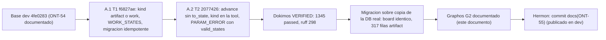

# Feature: Tarjetas de trabajo en kanban y `advance` sin `to_state` (ONT-55)

- **Documento**: `feature_20261114_ont55_kanban_work.md` (fecha y descriptor, sin HHMMSS, igual que ONT-46 a ONT-54)
- **Anterior en la cadena**: [`feature_20261114_ont54_round7.md`](feature_20261114_ont54_round7.md)
- **Intent**: cerrar G48 (`kanban_board(action="advance")` exigía `to_state` aunque el estado siguiente fuera único) y G49 (el tablero solo modelaba el ciclo de vida de artefactos, así que las tarjetas de trabajo ONT-* no podían cerrarse y se archivaban).
- **Pipeline mode**: **Short** (plan inline del orquestador; Archon y Ontos descartados). Plan: `/tmp/claude-1000/-home-ancruz-Documents-workspaces-agent-execution-plane/35ca3808-1a4d-4b75-ac5d-4ce0a6c2d86b/scratchpad/plan_ont55.md`.
- **Stage**: Graphos G2 (post-Dokimos, un ciclo, veredicto `VERIFIED`).
- **Worktree**: `/home/ancruz/Documents/workspaces/agent-execution-plane/.claude/worktrees/agent-a4ab16a81ffef35b5` (HEAD `2077426`).
- **Base**: `4fe0283` (rama `dev`, ONT-54 documentado).
- **Commits de Pragma** (2; los docs de este G2 se comprometen en el commit de Hermon): `f6827ae` (T1, G49: tipo de tarjeta) y `2077426` (T2, G48: `advance` sin `to_state` y parámetro `kind` en la tool). Rango: `git log --oneline 4fe0283..HEAD`.
- **Origen**: G48 y G49 aparecieron al cerrar la tarjeta 502 de ONT-54. Evidencia en vivo: `kanban_board(advance, task_id=502)` respondía `PARAM_ERROR` pidiendo `to_state`; con `to_state="DONE"` respondía `status: "ERROR"`, "estado inválido", con los estados de artefacto (`BACKLOG`..`PROMOTED`/`REJECTED`). Ya había unas diez tarjetas de trabajo (495 a 502) que solo podían archivarse.
- **Decisión de diseño (orquestador)**: `kind` por defecto `"artifact"` para mantener la compatibilidad de todos los llamadores existentes; las tarjetas de trabajo se crean de forma explícita con `kind="work"`.
- **Routing de este G2**: Graphos G2 → Orquestador → **Hermon**.

## 1. Chosen resolution path y blast radius (P1)

- **Camino**: Short, contrato nuevo en el motor (`engine/kanban.py`) y en la tool (`server.py`), sin tocar `aep_front.py` ni `aep_backend.py`.
- **Alcance del cambio**: `engine/kanban.py`, `server.py` (tool `kanban_board`), `tests/test_ont55_kanban_work.py`, documentación.
- **Blast radius**: la tabla `kanban_tasks` gana la columna `kind TEXT NOT NULL DEFAULT 'artifact'` mediante migración idempotente. Las promociones, degradaciones, reevaluación, canary y el archivado de artefactos siguen igual. Las tarjetas de trabajo quedan fuera de la ponderación de confianza. El contrato de estado inválido cambia de `ERROR` a `PARAM_ERROR`.
- **Lo que hereda**: sub-agentes sin cambios; el `board()` añade `work_lanes` y `work_counts` solo cuando hay tarjetas de trabajo no archivadas, así que los presupuestos de salida no suben en una base sin ellas.

## 2. Veredicto Dokimos (recibido por Graphos)

- **Suite**: 1345 passed (192 s), frente al baseline 1333.
- **Lint**: `ruff check` limpio (298 archivos).
- **Migración sobre copia de la base real** (148 MB, 317 filas): el tablero es idéntico antes y después (BACKLOG 13, SYNTHESIZED 163, LINTED 88, CANARY 10, PROMOTED 41, REJECTED 2; `archived_total` 257). Todas las filas quedan `kind=artifact`. La migración es idempotente.
- **Ciclo de trabajo sobre la copia**: IN_PROGRESS, luego DONE, luego NOOP.
- **Concurrencia**: 8 procesos migrando a la vez sin `duplicate column` (`BEGIN IMMEDIATE`).
- **Garantías de los budgets y de `GAPS_BASELINE`**: informadas por Dokimos como sin cambio (`GAPS_BASELINE` 1).

## 3. Estado y transiciones

Estados del tipo de tarjeta:
- **artifact**: BACKLOG → SYNTHESIZED → LINTED → CANARY. Desde CANARY, `advance` sin `to_state` responde `PARAM_ERROR` con `next_action` hacia `promote` (la compuerta de promoción se mantiene). PROMOTED y REJECTED responden `NOOP`.
- **work**: BACKLOG → IN_PROGRESS → DONE; BLOCKED → IN_PROGRESS; DONE responde `NOOP`. No pondera (`promotion_score` intacto); `attempts` sí sube.

## 4. Límites y pendientes

- `promote` y `demote` sobre una tarjeta de trabajo responden `PARAM_ERROR`. `reevaluate` no la toca.
- El barrido de `archive` no archiva tarjetas de trabajo en DONE salvo que se pidan con `states`. El archivado por `task_id` funciona para ambos tipos.
- Tests que fijaban `status: "ERROR"` en estado inválido se ajustaron al nuevo `PARAM_ERROR` por cambio de contrato, según el plan.
- Pendientes heredados sin cambio: backlog ONT-46 (defaults `Callable` en `_TypeIndex.resolve`; `_EXTERNAL_METHODS` por versión de Python). Fuera de alcance: ARP crudo por `AF_PACKET`, tabla OUI y escucha mDNS/SSDP.
- Los commits de Pragma llevan el trailer de coautoría que indica el plan; Hermon lo revisó antes de publicar.

## 5. Routing

Graphos G2 → Orquestador → **Hermon** (commit `docs(ONT-55)` con los documentos de este G2). Publicado en `dev` (ff) con autorización del usuario.
