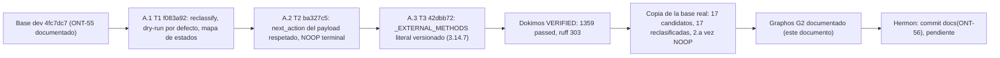

# Feature: Reclasificación de tarjetas legadas, NOOP con guía propia y lista externa congelada (ONT-56)

- **Documento**: `feature_20261114_ont56_reclassify_snapshot.md` (fecha y descriptor, sin HHMMSS, igual que ONT-46 a ONT-55)
- **Anterior en la cadena**: [`feature_20261114_ont55_kanban_work.md`](feature_20261114_ont55_kanban_work.md)
- **Intent**: cerrar G50 (17 tarjetas ONT-* legadas, `kind=artifact` y sin `artifact_name`, no podían cerrarse como trabajo y solo podían archivarse), G51 (el `advance` terminal respondía con una guía genérica en vez de la propia del estado, y `attach_envelope` no respetaba un `next_action` propio del payload) y el backlog ONT-46 (`_EXTERNAL_METHODS` dependía de `dir()` y de la versión del intérprete).
- **Pipeline mode**: **Short** (plan inline del orquestador; Archon y Ontos descartados). Plan: `/tmp/claude-1000/-home-ancruz-Documents-workspaces-agent-execution-plane/35ca3808-1a4d-4b75-ac5d-4ce0a6c2d86b/scratchpad/plan_ont56.md`.
- **Stage**: Graphos G2 (post-Dokimos, un ciclo, veredicto `VERIFIED`).
- **Publicación**: `dev` por ff desde `4fc7dc7` hasta `42dbb72` (Pragma) más el commit `docs(ONT-56)`; el worktree `agent-a0b3d7aeed5acbaf0` se eliminó tras el ff.
- **Base**: `4fc7dc7` (rama `dev`, ONT-55 documentado).
- **Commits de Pragma** (3; los docs de este G2 se comprometen en el commit de Hermon): `f083a92` (T1, G50: `kanban_board(action="reclassify")`), `ba327c5` (T2, G51: `next_action` del payload y NOOP terminal) y `42dbb72` (T3, backlog ONT-46: `_EXTERNAL_METHODS` congelado). Rango: `git log --oneline 4fc7dc7..HEAD`.
- **Origen**: la evidencia de solo lectura sobre la base real (orquestador) encontró 17 tarjetas ONT-* con `artifact_name` NULL y `kind='artifact'` (BACKLOG activas 7, BACKLOG archivada 1, PROMOTED 10). `advance` sobre una tarjeta en DONE respondía `NOOP` con `next_action` genérico ("Nothing to do; adjust filters or apply=true.").
- **Decisiones de diseño (orquestador)**: `reclassify` aplica en dry-run por defecto; las tarjetas con `artifact_name` no se pasan a trabajo; hacia artefacto, una tarjeta de trabajo vuelve a BACKLOG con `promotion_score` 0.0; la lista externa se congela con `SNAPSHOT_PY_VERSION = "3.14.7"` y el snapshot viaja solo en `detail` del grafo, de modo que `py_version` del payload no cambia.
- **Routing de este G2**: Graphos G2 → Orquestador → **Hermon**.

## 1. Chosen resolution path y blast radius (P1)

- **Camino**: Short, con cambio de contrato aditivo en la tool `kanban_board` (acción nueva `reclassify`) y en el envelope de respuesta. Sin tocar `aep_front.py` ni `aep_backend.py`.
- **Alcance del cambio** (`git show --stat`): `engine/kanban.py` (+98), `server.py` (+16/-2), `engine/telemetry.py` (+3), `engine/threads.py` (+1, `external_methods_snapshot` en `detail`), `engine/threads_extractors.py` (+7/-2), `engine/threads_external_methods.py` (nuevo, 494 líneas: literal `EXTERNAL_METHODS` de 476 nombres y `SNAPSHOT_PY_VERSION`), y tres archivos de prueba `tests/test_ont56_*.py`.
- **Blast radius**: `reclassify(apply=True)` modifica `kind` y `state` de filas de `kanban_tasks` dentro de una transacción `BEGIN IMMEDIATE`; no toca `archived`, `description`, `refs` ni `attempts`. El NOOP terminal cambia solo el texto de `next_action`. El grafo de hilos gana un campo en `detail`; el payload y las aristas no cambian.
- **Lo que hereda**: sub-agentes sin cambios. La lista de acciones válidas de `kanban_board` en el error `INVALID_ACTION` incluye `reclassify`.

## 2. Veredicto Dokimos (recibido por Graphos)

- **Suite**: 1359 passed (187 s), frente al baseline 1345.
- **Lint**: `ruff check` limpio (303 archivos).
- **T2**: se revisaron los payloads con `next_action` propio: `engine/hardware.py` (admit x3), `kanban` (x3) y `server.py` (x3, incluido `heal` con `RECONNECT_POINTER`). Todos llevan guía vigente y ya se exponen en el nivel superior; no hizo falta cambio de contrato.
- **T1 sobre copia de la base real**: 17 candidatos (7 BACKLOG, 10 PROMOTED→DONE); 18 con `include_archived`. El dry-run no escribe. Con `apply`: `RECLASSIFIED` 17; tarjetas ONT en lanes de artefacto 23→6 (las 6 restantes tienen `artifact_name`); `work_lanes` 2→19. Una segunda aplicación responde `NOOP`.
- **T3**: el grafo de hilos es idéntico a `4fc7dc7` (root `e34474c4…`, 7928 aristas, 1 gap). Extracción en frío 1.45–1.46 s frente a 1.47–1.54 s en la base; no hay degradación superior al 5 %, así que T3 no se revirtió.
- **Flake de carga**: `test_cold_extraction` falló una vez bajo carga, en una pasada abortada (`-x`), y pasó 5/5 aislado. Es el segundo episodio (el primero fue en ONT-53). Se registra como flake de carga a vigilar; no es un fallo de ONT-56.

## 3. Estado y transiciones

Mapa de estados de `reclassify`:
- **artifact → work**: BACKLOG→BACKLOG; SYNTHESIZED, LINTED y CANARY→IN_PROGRESS; PROMOTED→DONE; REJECTED→BLOCKED.
- **work → artifact**: todo pasa a BACKLOG con `promotion_score` 0.0 (debe volver a ganar su ponderación).
- **Omitidas** (`skipped`): tarjetas con `artifact_name` no nulo hacia trabajo (`has artifact`) y tarjetas que ya son del tipo destino (`already <kind>`).

## 4. Límites y pendientes

- `reclassify` con `title_like` puede alcanzar tarjetas de trabajo nativas que casen el patrón. Para revertir con precisión, usar `task_id`.
- La evidencia de `apply` es sobre una copia de la base. Este track no registra una aplicación sobre la base real; esa decisión queda con el usuario y el orquestador.
- Flake de carga `test_cold_extraction` (ONT-53 y ONT-56): vigilar en las próximas pasadas.
- Backlog ONT-46: solo `_TypeIndex.resolve` sin defaults de campos `Callable` en adaptadores. `_EXTERNAL_METHODS` queda resuelto.
- El grafo de reinforcement del README (intent ONT-40) no se regenera en este G2; es coherente con ONT-55. Si el usuario quiere un grafo propio de ONT-56, se añade en un track posterior.
- Cadena: desde el rollup de ONT-43 a ONT-53 van 3 documentos (ONT-54, ONT-55 y ONT-56). El siguiente rollup por regla llega al quinto, es decir, tras dos documentos más.
- Trailer de coautoría de los commits Pragma: el plan indica `Claude Opus 5.5`, y la política de atribución de la sesión indica `Claude Haiku 5.5`. Hermon lo verificó antes de publicar y no reescribió los commits Pragma; Graphos no modifica commits.

## 5. Routing

Graphos G2 → Orquestador → **Hermon** (commit `docs(ONT-56)` con los documentos de este G2, publicado en `dev` por ff con autorización del usuario).
