# Feature: Severidad explícita para todo estado emitido, hints de dry-run y de reclassify por ids (ONT-57)

- **Documento**: `feature_20261114_ont57_severity_table.md` (fecha y descriptor, sin HHMMSS, igual que ONT-46 a ONT-56)
- **Anterior en la cadena**: [`feature_20261114_ont56_reclassify_snapshot.md`](feature_20261114_ont56_reclassify_snapshot.md)
- **Intent**: cerrar G53 (la severidad de los estados emitidos caía en ERROR por defecto), G52 (el DRY_RUN con candidatos decía "Nothing to do") y G54 (el hint de reverso de `reclassify` usaba `title_like` y alcanzaba tarjetas de trabajo nativas). Origen: en vivo, `reclassify` con `apply=True` devolvió `RECLASSIFIED` con `severity: ERROR` sobre 17 tarjetas reclasificadas correctamente. El escaneo del orquestador encontró 81 estados emitidos; 63 caían en ERROR por defecto, incluidos éxitos (`APPLIED`, `HEALED`, `RECLASSIFIED`, `RESTORED`…).
- **Pipeline mode**: **Short** (plan inline del orquestador; Archon y Ontos descartados). Plan: `/tmp/claude-1000/-home-ancruz-Documents-workspaces-agent-execution-plane/35ca3808-1a4d-4b75-ac5d-4ce0a6c2d86b/scratchpad/plan_ont57.md`.
- **Stage**: Graphos G2 (post-Dokimos, un ciclo, veredicto `VERIFIED`; con un ajuste del orquestador antes de Dokimos).
- **Base**: `dev` `3ff0c6f` (ONT-56 documentado). Worktree `agent-ad62494bd780c4685`, rama `worktree-agent-ad62494bd780c4685`.
- **Commits de Pragma** (4; los docs de este G2 se comprometen en el commit de Hermon): `13238bc` (T1, G53: tablas explícitas de severidad), `e08b516` (T2, G52: DRY_RUN con candidatos), `45a8b03` (T3, G54: `reclassify` por `task_ids` y hint de reverso por ids) y `53958b8` (ajuste del orquestador antes de Dokimos: el escáner captura todos los literales de ternario y `BROKEN` pasa a WARN como diagnóstico). Rango: `git log --oneline 3ff0c6f..HEAD`.
- **Semántica fijada**: `INFO` = la llamada logró su propósito; `WARN` = resultado parcial o que pide atención o una decisión; `ERROR` = la llamada no logró su propósito. `is_field_error_status` y la lista blanca del field report (ONT-43) quedan intactos.
- **Routing de este G2**: Graphos G2 → Orquestador → **Hermon**.

## 1. Chosen resolution path y blast radius (P1)

- **Camino**: Short, con cambios aditivos en la respuesta de `kanban_board` (acción `reclassify`) y en la clasificación de severidad de `engine/telemetry.py`. Sin tocar `aep_front.py` ni `aep_backend.py`.
- **Alcance del cambio** (`git show --stat`):
  - `13238bc`: `engine/telemetry.py` (+83/-32 en el módulo), `tests/test_ont57_severity_table.py` (nuevo).
  - `e08b516`: `engine/telemetry.py` (+14/-1), `tests/test_ont57_dryrun_next_action.py` (nuevo).
  - `45a8b03`: `engine/kanban.py` (+43/-9), `server.py` (+4/-1), `tests/test_ont57_reclassify_ids.py` (nuevo).
  - `53958b8`: `engine/telemetry.py` (+3/-1), `tests/test_ont57_severity_table.py` (+44/-4).
- **Blast radius**:
  - La severidad se deriva en el emisor de la respuesta; el valor de `status` no cambia para ningún estado existente. Lo que cambia es el campo `severity` de algunas respuestas (de ERROR por defecto a INFO o WARN según la tabla).
  - `reclassify` gana el parámetro `task_ids` (lista explícita de ids) y la clave `reclassified_ids` en la respuesta. `title_like` y `task_id` siguen funcionando.
  - El DRY_RUN con candidatos cambia solo su `next_action` textual: "Review candidates; repeat with apply=True to execute."
  - No se toca el esquema de la base ni `kanban_tasks`. Las pruebas corren en tmp; no se escribe la base real.
- **Lo que hereda**: sub-agentes sin cambios. Los consumidores que filtren por `severity == "ERROR"` verán menos falsos errores.

## 2. Tabla de severidad: decisiones por estado

- Conjuntos explícitos `_INFO_STATUSES`, `_WARN_STATUSES` y `_ERROR_STATUSES` en `engine/telemetry.py`, más reglas por sufijo: `*_ERROR`, `*_FAILED`, `CORRUPTED_*` e `INVALID*` → ERROR; `*_NOT_FOUND` con prefijo → ERROR.
- Un estado desconocido sigue siendo ERROR (valor seguro), pero un test impide que exista un estado emitido sin clasificación explícita.
- El test escanea los literales de estado de `server.py`, `engine/*.py` y `scripts/aep-ctl`, incluidos los de cada rama de los ternarios (`53958b8`). Falla si alguno no está clasificado. Un literal sintético en cada rama de ternario lo hace fallar, como se comprobó.
- Desviaciones justificadas del criterio por defecto: `UNPROVEN` → WARN (la prueba no se pudo establecer); `BROKEN` → WARN (es un diagnóstico, par de `CLEAN`); `harness_reconnect` con fallo de comprobación pasa a ERROR, no WARN.
- Revisión: cada estado se contrastó contra su emisor. Dokimos no encontró clasificaciones erróneas.

## 3. Verdicto Dokimos (recibido por Graphos)

- **Suite**: 1386 passed + 1 failed (1387 colectados). El fallo es `test_cold_extraction` bajo carga paralela; pasa 5/5 en aislamiento y ningún commit de ONT-57 toca su código.
- **Flake**: tercer episodio de este flake (ONT-53, ONT-56, ONT-57). Se registra como gap abierto **G56**: el test mide tiempo de pared; candidato a medir tiempo de CPU, con justificación escrita antes del cambio.
- **Lint**: `ruff check` limpio (307 archivos).
- **T3 sobre copia de la base real**: ida y vuelta por `task_ids` exacta; las tarjetas 503, 504 y 505 quedan intactas.
- **Observación G55**: el reverso work→artifact→work no restaura el estado original. Una tarjeta DONE vuelve como BACKLOG, porque work→artifact siempre pasa a BACKLOG con `promotion_score` 0.0 (decisión de ONT-56). El hint de reverso debe advertirlo.
- **Semgrep**: `engine/kanban.py:689` confirmado como falso positivo. Solo se interpolan `?` de SQLite; los valores son `int()` ligados como parámetros. Riesgo menor: límite de variables de SQLite con listas muy grandes de `task_ids`.

## 4. Estado y transiciones

```mermaid
flowchart LR
    A["Base dev 3ff0c6f (ONT-56 documentado)"] --> A1["A.1 T1 13238bc: tabla de severidad INFO/WARN/ERROR"]
    A1 --> A2["A.2 T2 e08b516: DRY_RUN con candidatos sugiere review y apply"]
    A2 --> A3["A.3 T3 45a8b03: reclassify por task_ids y hint de reverso por ids"]
    A3 --> A4["A.4 53958b8: escáner de ternarios, BROKEN como WARN (ajuste del orquestador)"]
    A4 --> V["Dokimos VERIFIED: 1386 passed + 1 flake de carga (G56), ruff 307"]
    V --> M["Copia de la base real: ida y vuelta por task_ids exacta, 503/504/505 intactas"]
    M --> D["Graphos G2 documentado (este documento)"]
    D --> H["Hermon: commit docs(ONT-57), publicado en dev"]
```

## 5. Gaps y pendientes

- **G52** (DRY_RUN con candidatos): cerrado. Responde "Review candidates; repeat with apply=True to execute."
- **G53** (severidad por defecto ERROR): cerrado. Tabla explícita, escáner de ternarios y test que impide estados sin clasificar.
- **G54** (hint de reverso con `title_like`): cerrado. El hint usa `task_ids`/`task_id`.
- **G55** (abierto): el reverso work→artifact→work no restaura el estado original (DONE vuelve como BACKLOG). Decisión de diseño pendiente; el hint lo advierte, no lo corrige.
- **G56** (abierto): flake de carga `test_cold_extraction`, tercer episodio. Candidato: medir tiempo de CPU con justificación escrita. No se aplica en este track.
- **Backlog ONT-46** (abierto): solo `_TypeIndex.resolve` sin defaults de campos `Callable` en adaptadores.
- **Límite**: listas muy grandes de `task_ids` pueden superar el límite de variables de SQLite. Sin acción en este track.
- **Trailers de coautoría**: según el orquestador, los trailers `Claude Opus 5.5` de los commits Pragma son correctos (atribución de su sesión). Graphos no reescribe commits.

## 6. Routing

Graphos G2 → Orquestador → **Hermon** (commit `docs(ONT-57)` con los documentos de este G2, publicado en `dev` con ff autorizado por el usuario).
