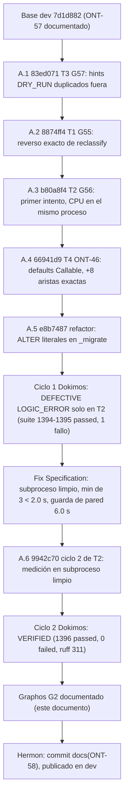

# Feature: Pendientes de ONT-57 cerrados (reverso exacto, medición de coste por CPU, hints y defaults Callable) (ONT-58)

- **Documento**: `feature_20261114_ont58_pending.md` (fecha y descriptor, sin HHMMSS, igual que ONT-46 a ONT-57)
- **Anterior en la cadena**: [`feature_20261114_ont57_severity_table.md`](feature_20261114_ont57_severity_table.md)
- **Intent**: cerrar G55 (el reverso work→artifact→work no restauraba el estado original), G56 (flake de carga de `test_cold_extraction`, cuarto episodio) y G57 (hints de DRY_RUN que repetían `next_action`), y cerrar el backlog ONT-46 (defaults `Callable` en `_TypeIndex.resolve`).
- **Pipeline mode**: **Short** (plan inline del orquestador; Archon y Ontos descartados). Plan: `/tmp/claude-1000/-home-ancruz-Documents-workspaces-agent-execution-plane/35ca3808-1a4d-4b75-ac5d-4ce0a6c2d86b/scratchpad/plan_ont58.md`.
- **Stage**: Graphos G2 tras **dos ciclos** Pragma→Dokimos. Ciclo 1: `DEFECTIVE (LOGIC_ERROR)` en T2. Ciclo 2: `VERIFIED`.
- **Base**: `dev` `7d1d882` (ONT-57 documentado). Worktree `agent-a20d98d9e238787ed`, rama `worktree-agent-a20d98d9e238787ed`.
- **Commits** (rango `git log --oneline 7d1d882..HEAD`; los docs de este G2 se comprometen en el commit `docs(ONT-58)`, publicado en dev):
  - `83ed071` (T3, G57): hints de DRY_RUN duplicados fuera en archive y reclassify. El hint de archive conserva solo la reversibilidad en inglés (`Reversible: kanban_board(action='unarchive', task_id=...)`).
  - `8874ff4` (T1, G55): reverso exacto de `reclassify` con `prev_kind`, `prev_state` y `prev_score` (migración idempotente en `engine/kanban.py`).
  - `b80a8f4` (T2, G56, primer intento): medición de CPU del proceso con guarda de pared. Se revela insuficiente en el ciclo 1.
  - `66941d9` (T4, backlog ONT-46): `_TypeIndex.resolve` sigue defaults `Callable` de campos de clases del proyecto.
  - `e8b7487` (refactor): sentencias `ALTER` como literales en `_migrate`, a petición del orquestador tras un hallazgo de Semgrep.
  - `9942c70` (ciclo 2 de T2): medición en subprocesos limpios.
- **Routing de este G2**: Graphos G2 → Orquestador → **Hermon**.

## 1. Chosen resolution path y blast radius (P1)

- **Camino**: Short. Cambios en `engine/kanban.py`, `engine/playbook.py`, `engine/threads_extractors.py`, `engine/telemetry.py` (sin cambios de tabla de severidad), `tests/` y `_migrate` de kanban. Sin tocar `aep_front.py` ni `aep_backend.py`.
- **Blast radius**:
  - **T1 (reverso exacto)**: columnas aditivas `prev_kind TEXT`, `prev_state TEXT`, `prev_score REAL` en `kanban_tasks` (migración idempotente dentro de `BEGIN IMMEDIATE`). El dry-run añade `restores_previous: true` en las filas que vuelven a su estado previo. Las tarjetas sin `prev_*` (p. ej. las 17 legadas) siguen el mapa actual. El test `test_ont56` se ajustó y la justificación queda en el commit: G55 cambia el resultado que ese test fijaba.
  - **T3 (hints)**: se elimina el `hint` en DRY_RUN que duplicaba `next_action`. Se conserva la reversibilidad de archive. Los tests que fijaban esos textos se ajustaron.
  - **T4 (ONT-46)**: `_TypeIndex.resolve` resuelve un default `Callable` cuando es un `Name` o `Attribute` que apunta a una función del proyecto. `None` y otros defaults no cambian. El grafo gana aristas `consumes`; ninguna se elimina.
  - **T2 (medición)**: solo el test cambia. El umbral de coste no sube.
  - **Lo que hereda**: sub-agentes sin cambios. Consumidores de `kanban_board(reclassify)` ven el campo nuevo `restores_previous` en dry-run y el reverso exacto en apply.
  - La base real no se escribió: las pruebas usan `tmp_path`; la verificación de T1 se hizo sobre una copia de la base real.

## 2. Ciclo 1: Pragma → Dokimos → DEFECTIVE (LOGIC_ERROR)

- **Veredicto**: `DEFECTIVE (LOGIC_ERROR)`, solo en T2 (`test_cold_extraction_under_two_seconds_and_stable_root_hash`). Los demás cambios pasaron.
- **Lo que pasó**: suite de 1394 a 1395 passed + 1 failed; ruff limpio (311).
- **Verificaciones positivas del ciclo**:
  - T1 sobre copia de la base real: las tarjetas 503 (DONE) y 119 (PROMOTED, 0.925) vuelven exactas; 8 procesos sin `duplicate column`.
  - T4: +8 aristas exactas (`execute`, `build_plan` y `certify_loopback` de `harness_reconnect` hacia `read_sysctl`, `acquire_lock`, `release_lock`, `open_tty`, `check_tty_fd` y `run_helper`), 0 aristas eliminadas, `gaps` 1 (sin cambio), cobertura `none` idéntica, CPU de extracción 1.52 frente a 1.54 s (11 corridas intercaladas). La guarda de pared detecta un `sleep` de 7 s.
- **Defecto (causa medida)**: dentro del proceso de la suite, cada `analyze` cuesta 2.0 a 2.5 s de CPU. El estado del proceso es el factor: la base también mide 2.31 a 2.45 s y pasa por azar. Aislado cuesta ~1.5 s. Medir CPU del proceso no aísla ese estado.
- **Fix Specification (de Dokimos, aceptada por el orquestador)**: medir en subproceso limpio (`sys.executable -c`, `time.process_time()` alrededor de `analyze`), mínimo de 3 corridas `< 2.0 s` (umbral sin subir), guarda de pared `< 6.0 s` y assert de estabilidad de `root_hash` conservados.

## 3. Ciclo 2: Pragma → Dokimos → VERIFIED

- **Cambio**: `9942c70` (solo el test, `tests/test_ont40_acceptance.py`).
- **Veredicto**: `VERIFIED`. Suite 1396 passed, 0 failed (191 s). `ruff` limpio (311). El diff de `9942c70` toca solo el test.
- **Cierre de G56**: la causa raíz no era contención del planificador sino el coste de la suite en su proceso. Medir en subproceso limpio es la forma que corresponde al requisito de ONT-40 (coste de extracción en frío). G56 queda **cerrado**.

## 4. Verificaciones de los gaps cerrados

- **G55 (cerrado)**: work DONE → artifact → work vuelve DONE; artifact PROMOTED 0.9 → work DONE → artifact vuelve PROMOTED 0.9; la tercera reclasificación sin `prev_*` usa el mapa; migración sobre DB vieja sin `prev_*` correcta; tablero y `work_lanes` intactos.
- **G57 (cerrado)**: DRY_RUN de archive y de reclassify ya no repite texto en `hint`. Reversibilidad de archive conservada en inglés.
- **Backlog ONT-46 (cerrado)**: `_TypeIndex.resolve` resuelve defaults `Callable` de proyecto. Gaps 1, `own_gaps` 0, co-dependencias 0, cobertura `none` sin funciones nuevas; regresión de CPU dentro del 5 %.

## 5. Entorno del host (hecho registrado en este track)

- Durante el re-test, el orquestador actualizó el Go del host de **1.22.5** (fuera de soporte) a **1.27.4**, a petición del usuario. Verificación de sha256 oficial. Instalación en `/mnt/apps/tools/go`; rollback en `/mnt/apps/tools/go1.22.5`.
- Las 8 plantillas Go pasan `go vet` con 1.27.4.
- La cabecera de `scripts/setup.sh` sigue fijando Go 1.26.10: planificado en ONT-59 (T4 toolchain soportado; T5 canal stable de Go en setup.sh).
- El trabajo sobre kanban con filosofía Go queda para ONT-59.

## 6. Gaps y pendientes

- **G55** (cerrado): reverso exacto con `prev_*`.
- **G56** (cerrado): causa raíz de coste en el proceso de la suite; medición en subproceso limpio.
- **G57** (cerrado): hints duplicados fuera.
- **Backlog ONT-46** (cerrado): defaults `Callable` resueltos en `_TypeIndex.resolve`. La lista del backlog queda vacía.
- **Abiertos para ONT-59** (kanban con filosofía Go):
  - **K1**: invalidación por hash.
  - **K2**: errores como valores.
  - **K3**: curación mecánica.
  - **Toolchain soportado**: planificado en ONT-59 (T4 toolchain soportado; T5 canal stable de Go en setup.sh).
- **Abiertos para ONT-60**:
  - **G58**: el sandbox trunca la salida sin cursor.
  - **G59**: el sandbox no ve toolchains enlazados fuera de los montajes.
  - **G60**: el chequeo de paquetes solo usa `dpkg`.
- **Trailers de coautoría**: según el orquestador, los trailers `Claude Opus 5.5` de los commits Pragma son correctos. Graphos no reescribe commits.

## 7. Estado y transiciones

## 8. Routing

Graphos G2 → Orquestador → **Hermon** (commit `docs(ONT-58)` con los documentos de este G2 y el README, STATE, COMPACT, MILESTONES y rollup actualizados; publicado en `dev`).
