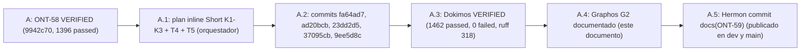

# Feature: Kanban de artefactos con la filosofía de Go y canal stable de Go en el montaje (ONT-59)

- **Documento**: `feature_20261114_ont59_go_philosophy_kanban.md` (fecha y descriptor, sin HHMMSS, como ONT-46 a ONT-58)
- **Anterior en la cadena**: [`feature_20261114_ont58_pending.md`](feature_20261114_ont58_pending.md)
- **Intent**: mejorar el kanban de artefactos con la filosofía de Go, actualizando el toolchain si hace falta, y montar Go desde cero con el canal `stable`. Petición del usuario, 2026-11-14.
- **Pipeline mode**: **Short** (plan inline del orquestador; Archon y Ontos descartados). Plan: `/tmp/claude-1000/-home-ancruz-Documents-workspaces-agent-execution-plane/35ca3808-1a4d-4b75-ac5d-4ce0a6c2d86b/scratchpad/plan_ont59.md`.
- **Stage**: Graphos G2 tras **un ciclo** Pragma→Dokimos. Veredicto: `VERIFIED`.
- **Base**: `dev` `da22d5d`. Worktree `/home/ancruz/Documents/workspaces/agent-execution-plane/.claude/worktrees/agent-a136904026e74a4af`, rama `worktree-agent-a136904026e74a4af`, HEAD `9ee5d8c`.
- **Commits** (`git log --oneline da22d5d..HEAD`, publicados en `dev` y `main`; Graphos no comprometió nada):
  - `fa64ad7` T4: `engine/go_toolchain.py` nuevo (`GO_SUPPORTED_MIN = "1.26"`, gofmt resuelto por GOROOT), bloque `go` en el detalle de `discover`, WARN `toolchain_outdated`.
  - `ad20bcb` T1 (K1): evidencia y promoción ligadas a `(source_hash, toolchain)`. El catálogo guarda `previous_stats` y `metrics_floor`. Se ajusta `tests/test_spec_om7_ipc_batch.py`.
  - `23dd2d5` T2 (K2): `record_build_failure` registra `failures`, `last_error_class` y `kanban_task_id`, con penalización de calidad acotada.
  - `37095cb` T3 (K3): gofmt, luego `go fix -diff` (se aplica solo con `autofix=True`), luego `go vet ./...` como compuerta, golangci-lint consultivo y `go build -trimpath` en modo módulo (`go.mod` generado, `GOTOOLCHAIN=local`).
  - `9ee5d8c` T5: canal `stable` en `scripts/setup.sh` con `toolchain.env`, pin de caída go1.27.4 con sha256 y `--check` informativo.
- **Routing de este G2**: Graphos G2 → Orquestador → **Hermon**. El commit `docs(ONT-59)` lleva los documentos de este G2. Publicado en `dev` y `main` por Hermon con autorización explícita del usuario (2026-11-14).

## 1. Chosen resolution path y blast radius (P1)

- **Camino**: Short. Pragma ejecutó los cambios con shell y el Go 1.27.4 del host. `setup.sh` tiene red hacia go.dev solo al montar o con `--update`. Dokimos ejecutó la verificación. Graphos solo documenta y no modifica código.
- **Blast radius medido** (`git diff --stat da22d5d..HEAD`): 12 archivos, +1823 / −106.
  - Código: `server.py`, `engine/kanban.py`, `engine/catalog.py`, `engine/go_toolchain.py` (nuevo), `scripts/setup.sh`.
  - Tests: cinco `tests/test_ont59_*.py` nuevos y `tests/test_spec_om7_ipc_batch.py` (16 líneas).
  - Documentación: `README.md`.
- **Migraciones aditivas e idempotentes** (sentencias literales, `BEGIN IMMEDIATE`):
  - `kanban_tasks`: `source_hash`, `toolchain`, `generation`, `last_error_class`, `failures`.
  - Catálogo `artifacts`: `source_hash`, `toolchain`, `previous_stats`, `metrics_floor`.
- **Contratos que cambian para consumidores**:
  - `artifact_lint_and_build` devuelve `source_hash`, `toolchain`, `generation`, `cached`, un bloque `healing` y `kanban_task_id` en errores.
  - Nuevo parámetro `autofix` (por defecto `False`).
  - `discover` devuelve un bloque `go`.
- **Herencia en el montaje**: `setup.sh` ya no usa `apt install golang-go`. Descarga Go desde go.dev (JSON y tarball) con verificación sha256 y escribe `~/.local/share/agent-os/toolchain.env`. Un Go ajeno (`/usr/local/bin/go`, `/mnt/apps/tools/go`) no se modifica.
- **Ajuste de test por consecuencia de K1**: `test_spec_om7_ipc_batch` fijaba la herencia de estado que K1 elimina (`attempts` 4→1, 8→5, 8→1 con 7 cached). La prueba de concurrencia sin colisión sigue vigente.

## 2. Principios de Go → cambio en el kanban

| Principio de Go | Cambio en el kanban | Tarea | Commit |
|---|---|---|---|
| Direccionamiento por contenido (caché de build y test por hash de entradas) | Evidencia y promoción pertenecen a `(source_hash, toolchain)`, no al nombre. Mismo par: `cached`, sin cambio de estado, canary ni score. Par distinto: `generation+1`, LINTED, `canary_passed=0`, `demoted_from` y `reason` (`source_changed` o `toolchain_changed`). El catálogo guarda `previous_stats` y `metrics_floor`. | T1 (K1) | `ad20bcb` |
| Los errores son valores | Un fallo de vet, fmt, build o hydrate queda registrado en la tarjeta (`failures`, `last_error_class`). Una tarjeta PROMOTED no se degrada, porque la publicación es atómica y el binario publicado sigue siendo el bueno. La calidad baja `*= 1 - 0.1*min(failures, 5)` y TRUST no cambia. | T2 (K2) | `23dd2d5` |
| Forma canónica y correcciones mecánicas antes de juzgar (gofmt, `go fix`, analizadores con SuggestedFixes) | Orden: gofmt siempre (`healing.gofmt_applied`), `go fix -diff` informado (`fix_lines`) y aplicado solo con `autofix=True`, `go vet ./...` como compuerta dura, golangci-lint consultivo. Lo semántico se juzga, no se reescribe sin permiso. | T3 (K3) | `37095cb` |
| Toolchain explícito y soportado (`go`, `toolchain`) | `supported(version)` con `GO_SUPPORTED_MIN = 1.26`. Versión fuera de soporte: WARN `toolchain_outdated` (el build sigue). El montaje usa el canal `stable` y `GOTOOLCHAIN=local` para no descargar nada durante un build. | T4 y T5 | `fa64ad7`, `9ee5d8c` |

## 3. Hechos medidos (antes del cambio)

- El host tenía Go 1.22.5, fuera de soporte. Go parchea solo las dos últimas mayores (hoy 1.27 y 1.26). Se actualizó a go1.27.4 (sha256 oficial verificado, `/mnt/apps/tools/go`, rollback `/mnt/apps/tools/go1.22.5`); el hecho ya estaba registrado en ONT-58.
- `gofmt` no está en PATH. Se resuelve como `$(go env GOROOT)/bin/gofmt`.
- K1 medido: recompilar con fuente distinta conservaba PROMOTED, canary y estadísticas. `register_artifact` en `ON CONFLICT(name)` solo actualizaba `go_source` y `binary_hash`.
- K2 medido: LINT_ERROR, BUILD_ERROR y HYDRATE_ERROR no tocaban el kanban.
- K3 medido: no había gofmt ni `go fix` antes de vet, y vet corría en modo archivo suelto.

## 4. Verificación (Dokimos, un ciclo, VERIFIED)

- Suite: 1462 passed, 0 failed. `ruff` limpio (318). `bash -n` y shellcheck limpios en `scripts/setup.sh`.
- Migraciones sobre copia de la base real (322 tarjetas, 95 artefactos): idempotentes, sin pérdida de filas, 8 procesos concurrentes sin error.
- K1 de punta a punta con go1.27.4: `cached` en la segunda compilación, nueva generación al cambiar la fuente, `toolchain_changed` y `metrics_floor` verificados.
- T2, T3 y T5 según plan.
- Gaps: `GAPS_BASELINE 1` según la regla del plan. **Confirmado por Dokimos** (GAPS_BASELINE=1 sin cambio, test_ont41_coverage en verde).

## 5. Decisiones aceptadas

- Un reinicio por cambio de fuente deja `success_rate 1.0` y `execution_count 0`, igual que un artefacto nuevo.
- Las tarjetas legadas con `source_hash` NULL se democionan en su próxima recompilación. Es correcto porque también cambió el toolchain.
- `failures` se reinicia con un build exitoso.
- `metrics_floor` es decisión de Pragma y se acepta. Sin él, `record_execution` revivía estadísticas viejas tras reiniciar.

## 6. Hechos operativos a registrar

- 40 tarjetas vivas (30 PROMOTED, 10 CANARY) con `source_hash` NULL bajarán a LINTED en su próxima recompilación. Recuperan la promoción al pasar canary.
- `gofmt` no unifica todos los layouts: una llamada en una línea y otra multilínea producen hashes distintos. Es una limitación conocida, no un gap.

## 7. Pendientes

- **ONT-59, abiertos menores**:
  - **G61**: la acción `lint` (`server.py` ~1510) sigue usando `go vet` de archivo suelto, sin `build_env`.
  - **G62**: `previous_stats` guarda solo la generación anterior.
- **ONT-60, abiertos (sin cambios)**: G58 sandbox trunca la salida sin cursor; G59 sandbox no ve toolchains enlazados fuera de montajes; G60 chequeo de paquetes solo con dpkg.
- **Cerrados**: K1, K2, K3, toolchain soportado (T4) y canal `stable` de Go en el montaje (T5).
- **Documentación revisada**: el badge de Go del README (`1.26+`, probado con `1.27.4`) es coherente con `GO_SUPPORTED_MIN = 1.26` y con el pin de caída go1.27.4. La lista de dominios de red de la sección 12 ya incluía go.dev y dl.google.com; no requirió cambios.

## 8. Evolución de estado (A → A.1 → …)

## 9. Routing

Graphos G2 → Orquestador → **Hermon** (commit de documentación y ff a `dev` solo con autorización del usuario).
