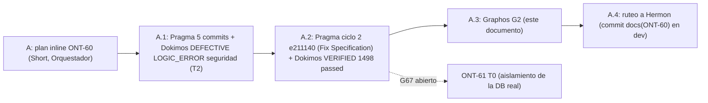

# Feature: Fricciones de sandbox y paquetes halladas usando AEP (ONT-60)

- **Documento**: `feature_20261114_ont60_sandbox_packages.md` (fecha y descriptor, sin HHMMSS, como ONT-46 a ONT-59)
- **Anterior en la cadena**: [`feature_20261114_ont59_go_philosophy_kanban.md`](feature_20261114_ont59_go_philosophy_kanban.md)
- **Intent**: corregir fricciones que el propio AEP expuso en uso real (sandbox que trunca sin cursor, toolchains fuera del jail, `package check` que no ve binarios fuera de dpkg, `lint` sin modo módulo, historial de estadísticas de una sola generación). Petición del usuario, 2026-11-14 ("Procede").
- **Pipeline mode**: **Short** (plan inline del orquestador; Archon y Ontos descartados). Plan: `/tmp/claude-1000/-home-ancruz-Documents-workspaces-agent-execution-plane/35ca3808-1a4d-4b75-ac5d-4ce0a6c2d86b/scratchpad/plan_ont60.md`.
- **Stage**: Graphos G2 tras **dos ciclos** Pragma→Dokimos. Veredicto final: `VERIFIED` (ciclo 2). Ciclo 1: `DEFECTIVE (LOGIC_ERROR, seguridad)` en T2.
- **Base**: `dev` `3a89423`. Worktree `/home/ancruz/Documents/workspaces/agent-execution-plane/.claude/worktrees/agent-a0368bc8d404d0b6c`, rama `worktree-agent-a0368bc8d404d0b6c`, HEAD `e211140`.
- **Commits** (`git log --oneline 3a89423..HEAD`; Pragma los confirmó, Graphos no comprometió nada):
  - `cf2d8fb` T3 (G60): `package check` con respaldo por PATH (`source`, `path`, `realpath`, `version`).
  - `8da28ad` T1 (G58): salida truncada persistida en `<pool>/sandbox_out/` (0700, archivos 0600) con `output_ref` + `cursor`; paginado sin re-ejecutar.
  - `b9b7f43` T2 (G59): auto-montaje solo lectura de raíces de toolchains enlazados fuera del jail (`auto_mounts`).
  - `5f35ed7` T5 (G62): `stats_history` acotado a 5 generaciones; `previous_stats` se conserva.
  - `5dad90d` T4 (G61): `lint` en modo módulo con healing informativo.
  - `e211140` ciclo 2: corrección de seguridad de T2, validación de nombres en package check, tope exacto de la salida.
- **Trailers de los commits de Pragma**: `Co-Authored-By: Claude Sonnet 5.5`, que es el autor real del trabajo (decisión del usuario).
- **Routing de este G2**: Graphos G2 → Orquestador → **Hermon**. Publicación solo en `dev`; `main` no se toca (la autorización a main de ONT-59 fue de un solo uso).

## 1. Chosen resolution path y blast radius (P1)

- **Camino**: Short. Pragma ejecutó con shell y el Go 1.27.4 del host. Dokimos verificó con la suite completa y pruebas en vivo contra el sandbox. Graphos solo documenta.
- **Blast radius medido** (`git diff --stat 3a89423..e211140`): 8 archivos, +805 / −17.
  - Código: `server.py` (+263), `scripts/aep-ctl` (+42), `engine/catalog.py` (+36).
  - Tests nuevos: `tests/test_ont60_lint.py`, `tests/test_ont60_package_path.py`, `tests/test_ont60_sandbox_paging.py`, `tests/test_ont60_sandbox_toolchain_mounts.py`, `tests/test_ont60_stats_history.py`.
  - Sin cambios en `engine/telemetry.py`: `stats_history` no es un estado nuevo del kanban.
- **Migración aditiva e idempotente**: `ALTER TABLE artifacts ADD COLUMN stats_history TEXT` (nullable), condicionada a `PRAGMA table_info`.
- **Contratos que cambian para consumidores**:
  - `sandbox_run`: parámetros nuevos `output_ref` y `cursor` (y `limit`) para paginar sin `command`. Respuesta con `output_ref` y `cursor` cuando hay truncado; `auto_mounts` y `auto_mounts_skipped` con su motivo.
  - `aep_ctl(domain="package", action="check")`: campos `source` (`dpkg` | `path`), `path`, `realpath`, `version`.
  - `artifact_lint_and_build(action="lint")`: bloque `healing` informativo (`gofmt_needed`, `fix_lines`).

## 2. Ciclo 1: Pragma y Dokimos DEFECTIVE (LOGIC_ERROR de seguridad en T2)

- **Pragma**: cinco commits (T3, T1, T2, T5, T4). Salida de T1 en `<pool>/sandbox_out/` por las limpiezas de slots: aceptado.
- **Dokimos**: `DEFECTIVE (LOGIC_ERROR, seguridad)`. Resto verificado: suite 1485 passed (204 s), ruff limpio (324), T1 sin lectura fuera del pool en 8 vectores, permisos 0600/0700, ref de 40 bits (uuid4), nunca `truncated` sin `cursor`; T3, T4 y T5 funcionales; migración de T5 sobre copia de la DB real correcta.
- **Defecto**: `_toolchain_auto_mounts` filtraba solo con `is_path_blacklisted(root)`. Esa función rechaza rutas iguales o **dentro** de la blacklist, no rutas que la **contienen**. Casos medidos:
  - symlink a `/etc/shadow` montaba `/etc`;
  - `$HOME/bin/x` montaba `$HOME` (con `~/.ssh`);
  - `~/.local/bin/uv` montaba `~/.local` (con la DB de AEP);
  - `/dev/null` montaba `/dev`.
  Solo lectura, pero exponía rutas vetadas. Routing: Graphos G2 → Pragma con Fix Specification.
- **Hallazgo adicional**: la DB real ya tenía la columna `stats_history` antes de que Dokimos la copiara. Algún test o demo abrió la DB real. Inocuo (columna nullable), pero es una fuga de aislamiento. Registrado como G67.

## 3. Ciclo 2: corrección (commit `e211140`) y VERIFIED

- **Fix Specification aplicada**:
  - Se rechazan las raíces exactas prohibidas (`/`, `$HOME`, `/etc`, `/dev`, `/proc`, `/sys`, `/run`, `/home`, `/root`, `/var`, `/tmp`) y toda raíz igual o **ancestra** de una ruta vetada (blacklist, `~/.ssh`, `~/.gnupg`, datos de AEP).
  - Cuando la raíz sería `$HOME` o `~/.local`, se baja a `real.parent`.
  - Los descartes quedan en `auto_mounts_skipped` con motivo.
  - `package check` valida `name` con `^[A-Za-z0-9._+][A-Za-z0-9._+-]*$` y pasa el nombre a `dpkg-query` tras `-W`, sin guion inicial.
  - Tope exacto de 64 en la salida (reap tras escribir).
- **Dokimos VERIFIED**: 1498 passed (205 s), ruff limpio (324), 9 vectores bloqueados o reducidos, `go version` dentro del sandbox OK.

## 4. Hechos y gaps

- Medidos antes del cambio: G58 `truncated: true` con `cursor: null` (~1194 tok); G59 `go` dentro del sandbox es un symlink colgante (`/mnt/apps` no montado); G60 `package check go` devolvía `installed: false` con go instalado fuera de dpkg; G61 `lint` con `go vet` suelto; G62 `previous_stats` guarda solo una generación.
- **Abiertos (no bloquean ONT-60)**:
  - **G67** (prioridad alta, ONT-61 T0): `import server` instancia `ArtifactCatalog()` y `KanbanBoard()` a nivel de módulo (`server.py` ~165-168) sobre `~/.local/share/agent-os/artifacts.db` y ejecuta `_migrate`. La colección de pytest migra la DB real con código no verificado. Confirmado por Dokimos con HOME temporal.
  - **G63**: test `test_criterion_6_zero_fd_leak` flaky.
  - **G64**: sandbox sin `/etc/alternatives` (awk y 165 alternativas colgantes).
  - **G65**: bloque `go` compacto en el resumen de `discover`.
  - **G66**: `IN (?,...)` reemplazable por `json_each` (falso positivo de Semgrep y límite de variables).
- **Operativo**: `setup.sh --update` no se ejecutó en el host (`go.channel` null); espera decisión del usuario.

## 5. Estado de evolución (A → A.1 → A.2)

## 6. Decisiones aceptadas

- Publicación solo en `dev`. `main` no se toca.
- Los trailers `Claude Sonnet 5.5` de los commits de Pragma se conservan: son el autor real del trabajo.
- La salida de T1 en `<pool>/sandbox_out/` depende de las limpiezas de slots del pool; se acepta el riesgo de paginar después de un reap, que devuelve `output_ref expirado` como `PARAM_ERROR`.
- G67 queda para ONT-61 T0 y no se corrige dentro de ONT-60.
