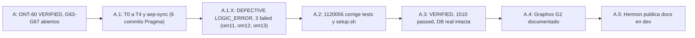

# Feature: Aislamiento de la DB real en la suite y fricciones G63–G66 (ONT-61)

- **Documento**: `feature_20261114_ont61_db_isolation.md` (fecha y descriptor, sin HHMMSS, como ONT-46 a ONT-60)
- **Anterior en la cadena**: [`feature_20261114_ont60_sandbox_packages.md`](feature_20261114_ont60_sandbox_packages.md)
- **Intent**: cerrar los hallazgos G63–G66 de la ronda ONT-60 ("Fix them.", orden del usuario 2026-11-14) y el hallazgo G67 encontrado durante ONT-60: `import server` migraba la base de datos real del usuario durante la colección de pytest.
- **Pipeline mode**: **Short** (plan inline del orquestador; Archon y Ontos descartados). Plan: `/tmp/claude-1000/-home-ancruz-Documents-workspaces-agent-execution-plane/35ca3808-1a4d-4b75-ac5d-4ce0a6c2d86b/scratchpad/plan_ont61.md`.
- **Stage**: Graphos G2 tras **dos ciclos** Pragma→Dokimos. Veredicto final: `VERIFIED` (ciclo 2). Ciclo 1: `DEFECTIVE (LOGIC_ERROR en tests)`.
- **Base**: `dev` `8d271f4`. Worktree `/home/ancruz/Documents/workspaces/agent-execution-plane/.claude/worktrees/agent-acf26c30de3644631`, rama `worktree-agent-acf26c30de3644631`, HEAD `1120056`.
- **Commits** (`git log --oneline 8d271f4..HEAD`; Pragma y el orquestador los crearon, Graphos no comprometió nada):
  - `a369d22` T0 (G67): `engine/paths.data_home()` como única fuente de `AEP_DATA_HOME` (por defecto `~/.local/share/agent-os`); los módulos que resolvían la ruta de datos pasan a usarla; `tests/conftest.py` fija un directorio temporal de sesión antes de importar `server`; test centinela.
  - `ff28e2f` T4 (G66): `reclassify` con `task_ids` mediante `json_each` y un único parámetro JSON; sin f-string SQL. Test con 2000 ids.
  - `b527e77` T3 (G65): bloque `go: {version, supported}` compacto en el resumen de `discover(capabilities)`; budget 6000→6100 B por +64 B, documentado.
  - `448307b` T2 (G64): sandbox monta en solo lectura `/etc/alternatives`, `localtime`, `passwd` y `group`. Nunca `shadow`, `gshadow`, `sudoers` ni `ssh`.
  - `6f57a52` T1 (G63): causa raíz documentada; no hay fuga real de FDs (50 swaps, delta 0 por tipo). La medición se hace en un subproceso limpio; el assert `delta == 0` se conserva.
  - `e73d7d8` aep-sync (hueco hallado por el orquestador antes de Dokimos): el smoke import del hook pre-commit usa un `AEP_DATA_HOME` desechable.
  - `1120056` ciclo 2: corrección de la suite (ver ciclo 1).

## Resolution path y blast radius

- **Camino elegido**: camino estándar en Short (sin herramienta nueva). Una sola fuente de verdad para el directorio de datos (`AEP_DATA_HOME`), aislamiento de la suite por variable de entorno en `pytest_configure`, y medición de FDs en subproceso limpio.
- **Blast radius declarado (P1)**:
  - T0: `engine/paths.py` (nuevo, 19 líneas) y los módulos que resolvían la ruta de datos: `engine/backup.py`, `engine/catalog.py`, `engine/crash_router.py`, `engine/docs_vectorizer.py`, `engine/go_toolchain.py`, `engine/kanban.py`, `engine/playbook.py`, `engine/threads.py`, `server.py`; `tests/conftest.py`. Sin cambio de comportamiento en producción (valor por defecto idéntico).
  - T1: solo tests. `aep_front.py` y `aep_backend.py` no se tocaron, porque la medición mostró que no había fuga real.
  - T2: montajes de bwrap del sandbox (solo lectura).
  - T3: resumen de `discover(capabilities)` y su budget.
  - T4: `reclassify` de `engine/kanban.py` y las consultas `IN (...)` del mismo tipo.
  - Ciclo 2: `tests/test_spec_om7_ipc_batch.py`, `tests/test_agent_experience_evaluation.py` y `scripts/setup.sh`.
- **Subagentes**: ninguno. Pragma y Dokimos se ejecutaron en el mismo worktree.

## Ciclo 1

- **Pragma**: `a369d22`, `ff28e2f`, `b527e77`, `448307b`, `6f57a52`, `e73d7d8`.
- **Dokimos**: `DEFECTIVE (LOGIC_ERROR en tests)`. Resultado: 1507 passed, 3 failed (1510 en total).
  - `tests/test_spec_om7_ipc_batch.py::om11` (info de `socket_monitor`): NOT_FOUND.
  - `om12` (ejecución de `socket_monitor`): ERROR.
  - `om13` (`query_system_docs(q="ip")`): 0 resultados.
  - Los tres dependían de datos de la DB real. T0 los dejó con DB vacía: es un acoplamiento oculto que el aislamiento hizo visible.
- **Hallazgo adicional**: el bloque «SQLite Catalog & Integrity» de `scripts/setup.sh` (lanzado por un test vía `setup.sh --check`) abría la DB real en solo lectura y creaba `-wal`/`-shm` vacíos (`O_RDWR|O_CREAT`).
- **Integridad de la DB real en el ciclo 1**: md5 `205d8013…`, mtime igual tras 4 suites y `aep-sync --check`; `strace -f` sin aperturas de escritura desde pytest.
- **Routing del ciclo 1**: LOGIC_ERROR → Graphos G2 → Pragma (fix de tests, sin tocar los asserts).

## Ciclo 2

- **Pragma**: `1120056`.
  - `om11` y `om12` siembran `socket_monitor` con un build real dentro del directorio temporal (nunca copian ni abren la DB real).
  - `om13` ingiere `man ip` en el directorio temporal.
  - `scripts/setup.sh` deriva su ruta de datos de `AEP_DATA_HOME` (por defecto la actual) y el test que lanza `setup.sh --check` le pasa un `AEP_DATA_HOME` temporal.
- **Dokimos**: `VERIFIED`.
  - 1510 passed, 0 failed.
  - md5 y mtime de `artifacts.db` y `system_docs.db`, y de sus `-wal`/`-shm`, idénticos antes y después de la suite.
  - `strace -f` sin aperturas de la DB real por pytest.
  - Asserts sin relajar. `ruff` limpio (330 según Dokimos).
- **Comprobación de Graphos al activarse**: md5 de `~/.local/share/agent-os/artifacts.db` = `205d80137c9b…`, igual al del ciclo 1. `ruff check .` en el worktree: "All checks passed!".

## Veredictos

| Ciclo | Origen | Veredicto | Ruteo |
|-------|--------|-----------|-------|
| 1 | Dokimos sobre `e73d7d8` | DEFECTIVE (LOGIC_ERROR en tests: 3 failed) | Graphos G2 → Pragma |
| 2 | Dokimos sobre `1120056` | VERIFIED (1510 passed) | Graphos G2 → Hermon (publicado en dev) |

## Evolución del estado

## Lección registrada

Los tests no deben depender de datos de la DB real. El aislamiento de T0 es lo que hizo visible el acoplamiento de `om11`, `om12` y `om13`. Regla: cada test siembra sus datos en un `AEP_DATA_HOME` temporal.

## Abierto (no bloqueante)

- `aep_front.py:63` define `BACKEND_LOG_DIR = Path.home() / ".local" / "share" / "agent-os" / "logs"`, fuera de `AEP_DATA_HOME`. Afecta solo a logs del front, que es estable. Queda anotado; no se toca en ONT-61.
- `setup.sh --update` sin ejecutar en el host. Espera la decisión del usuario.

## Ruteo

VERIFIED → Hermon. Los cambios de documentación de Graphos se registraron en un commit `docs(ONT-61)` y se publicaron en `dev` con autorización explícita del usuario (modo Short).
