# Feature: Pendientes menores, falsos negativos de salud y actualización de setup.sh (ONT-62)

- **Documento**: `feature_20261115_ont62_health_and_update.md`
- **Anterior en la cadena**: [`feature_20261114_ont61_db_isolation.md`](feature_20261114_ont61_db_isolation.md)
- **Intent**: cerrar los pendientes menores de ONT-61 (logs del front fuera de `AEP_DATA_HOME`), los falsos negativos de `setup.sh --check` (hook pre-commit y sonda de pueue), la invisibilidad de los demonios de usuario en `aep_ctl service status` y el hallazgo G71 encontrado al ejecutar `setup.sh --update` real. Origen: el usuario, 2026-11-15, "continúa con los pendientes"; después autorizó `setup.sh --update` completo asumiendo el blast radius ("update uv and asume the blast radius, from reinstall pipeline and aply the fix like false alarms is neccesry"; "the reinstall would clean code drift").
- **Pipeline mode**: **Short** (plan inline del orquestador; Archon y Ontos descartados). Plan: `/tmp/claude-1000/-home-ancruz-Documents-workspaces-agent-execution-plane/35ca3808-1a4d-4b75-ac5d-4ce0a6c2d86b/scratchpad/plan_ont62.md`.
- **Stage**: Graphos G2 tras **dos ciclos** Pragma→Dokimos. Veredicto final: `VERIFIED` (ciclo 2). Ciclo 1: `DEFECTIVE (LOGIC_ERROR en T4)`.
- **Base**: `dev` `a25d4a0`. Worktree `/home/ancruz/Documents/workspaces/agent-execution-plane/.claude/worktrees/agent-a00b767d80b587df1`, rama `worktree-agent-a00b767d80b587df1`, HEAD `da05dd1`.
- **Commits** (`git log --oneline a25d4a0..HEAD`; creados por Pragma y el orquestador; Graphos no comprometió nada):
  - `67896be` T1: `BACKEND_LOG_DIR` de `aep_front.py` respeta `AEP_DATA_HOME` en línea, sin importar `engine/`. Test de paridad con `engine/paths.data_home()`. Aplica al reiniciar el front (el front no es hot-swappable).
  - `72750c8` T2 (G68) + T3 (G69): `setup.sh --check` compara `core.hooksPath` por ruta real; la sonda de pueue hace hasta 3 intentos con `timeout 5` y 1 s de espera.
  - `4eb222f` T4 (G70): `aep_ctl service status` reporta unidades de usuario (`scope: "user"`) y procesos sin unidad (`RUNNING_UNMANAGED`, WARN, `scope: "process"`).
  - `31690c2` T5 (G71): `setup.sh --update` reutiliza el venv 3.14 existente; crea el venv solo si no existe; otra versión → WARN; `AEP_RECREATE_VENV=1` → `uv venv --clear`.
  - `9d3940f` ciclo 2: cabecera políglota de `scripts/aep-ctl` restaurada byte a byte; guarda del symlink `~/.local/share/agent-os/venv`; `service status` con nombre inválido → `PARAM_ERROR`; test `sh scripts/aep-ctl schema`.
  - `da05dd1` ciclo 2: `[tool.ruff] extend-exclude` y `force-exclude` para `scripts/aep-ctl` en `pyproject.toml`.

## Resolution path y blast radius

- **Camino elegido**: camino estándar en Short (sin herramienta nueva). Cambios puntuales en los scripts de instalación y control, sin tocar el motor de datos.
- **Blast radius declarado (P1) y comprobado con `git diff --stat a25d4a0..HEAD`** (10 archivos, +486 / -9):
  - `aep_front.py` (5 líneas): solo ruta de logs del front. El front no se reinicia en este ciclo; el cambio aplica en el próximo reinicio.
  - `scripts/setup.sh` (51 líneas): `--check` (hook y pueue), bloque de venv en `--update`, guarda del symlink del venv.
  - `scripts/aep-ctl` (43 líneas): rama `service status` (scope, RUNNING_UNMANAGED, validación de `name`); cabecera políglota intacta.
  - `pyproject.toml` (5 líneas): exclusión de ruff para `scripts/aep-ctl`.
  - `engine/telemetry.py` (1 línea): clasificación de estado nuevo (WARN). Según el plan, la clasificación de estados nuevos se verifica con `test_ont57`; Graphos no revisó la línea individualmente.
  - `tests/test_live_plane_fixes.py` (4 líneas): lee la ruta de logs vía `engine.paths.data_home()`, como indica Dokimos.
  - Cuatro archivos nuevos `tests/test_ont62_*.py` (+386 líneas, sin modificar código de producción).
  - No se tocó `server.py` ni la base de datos real.
- **Herramientas**: `uv` falso en PATH y `pueue` falso en los tests; ningún `uv` real se ejecutó en la suite. El `setup.sh --update` real del host se ejecutó fuera de esta suite (ver "Hallazgo G71").
- **Subagentes**: ninguno. Pragma y Dokimos se ejecutaron en el mismo worktree.

## Hallazgo G71 (RCA del orquestador)

- `setup.sh --update` real instaló `uv 0.13.7` y después abortó con `rc=2` en el bloque `uv venv --python 3.14 "$VENV_DIR"` sobre el `.venv` existente. uv rechaza recrear un venv sin `--clear`.
- **Causa raíz**: desde `41e4ade` (2026-10-25) el modo `update` ejecuta `uv venv` sobre el venv existente. `uv 0.12.10` y `uv 0.13.7` devuelven `rc=2` por igual (probado). Con `set -euo pipefail` el fallo es fatal. Por tanto `--update` nunca funcionó en un host que ya tenía venv. **La actualización de uv no fue la causa**; solo la expuso.
- **Riesgo adicional**: recrear el venv de la que corre el plano vivo a mitad de una actualización rompe el servidor MCP.
- **Revisados y seguros**: el reemplazo de Go (`mv` con `.prev`) y el de pueue (`mv` cross-fs sobre un binario en ejecución funciona; `cp` daría `ETXTBSY`, probado).
- **Lección**: los modos de un instalador que nunca se ejecutan en CI ocultan fallos durante semanas. Una ejecución real de `--update` es la prueba.

## Ciclo 1

- **Pragma**: `67896be`, `72750c8`, `4eb222f`, `31690c2`.
- **Dokimos**: `DEFECTIVE (LOGIC_ERROR en T4)`. Resultado: 1529 passed, 3 failed (`gate2`, `t_f2`, `gate6`).
  - Causa única: `4eb222f` reescribió la línea 4 políglota sh/python de `scripts/aep-ctl` (`''''true; ... # '''` → `"""'true; ... #"""`). `ruff format` normalizó las comillas de un archivo sin extensión. Resultado: `sh scripts/aep-ctl` falla con `Syntax error: "(" unexpected`.
  - Publicado, habría roto toda llamada directa a `aep-ctl`, incluido el `aep_ctl` del MCP.
- **Verificado en el ciclo 1**: md5 de la DB real sin cambio; T5 correcto (4 casos con `uv` falso, y bloque real con `uv 0.13.7` sin llamar a `uv venv`); `setup.sh --check` en HEALTHY; `RUNNING_UNMANAGED` con el pid real 50132 (WARN); el front no importa `engine`; `aep_backend` sin diff.
- **Menores del ciclo 1**: `ln -sfn $VENV_DIR ~/.local/share/agent-os/venv` crea `venv/.venv` cuando el destino es un directorio real; `aep-ctl service status -- -x` produce `TypeError` (previo a este ciclo).
- **Ruteo**: LOGIC_ERROR → Graphos G2 → Pragma, con la especificación de corrección anterior.

## Ciclo 2

- **Pragma**: `9d3940f`, `da05dd1`.
  - Cabecera restaurada byte a byte de `a25d4a0`; `scripts/aep-ctl` excluido de ruff `format` y `lint` con `force-exclude` (porque `extend-exclude` se ignora con rutas pasadas explícitamente).
  - Test de regresión `sh scripts/aep-ctl schema` con rc 0.
  - Guarda del symlink: si `~/.local/share/agent-os/venv` es un directorio real (no symlink) → no se enlaza y se emite WARN con la ruta. No se borra: puede ser un venv del usuario.
  - `service status` con nombre inválido (p. ej. `-- -x`) → `PARAM_ERROR` en vez de `TypeError`.
  - `tests/test_live_plane_fixes.py` lee logs vía `engine.paths.data_home()`.
- **Dokimos**: `VERIFIED`.
  - 1536 passed, 0 failed (baseline 1510; +26 tests nuevos).
  - md5 y mtime de la DB real iguales antes y después de la suite.
  - `aep-ctl` directo: `service status pueued` → `RUNNING_UNMANAGED`, pid 50132.
  - Recomendación de Dokimos sobre ruff (exclusión solo en `pyproject.toml`) verificada por el orquestador.

## Veredictos

| Ciclo | Origen | Veredicto | Ruteo |
|-------|--------|-----------|-------|
| 1 | Dokimos sobre `31690c2` (T1 a T5) | DEFECTIVE (LOGIC_ERROR en T4: cabecera políglota de `aep-ctl`, 3 failed) | Graphos G2 → Pragma |
| 2 | Dokimos sobre `da05dd1` | VERIFIED (1536 passed, 0 failed) | Graphos G2 → Hermon |

## Pendientes tras publicar (no ejecutados por Graphos)

1. Ejecutar `./scripts/setup.sh --update` real con el venv existente y comprobar que no aborta (rc 0) y que no se llama a `uv venv` sin `--clear`.
2. Ejecutar `./scripts/setup.sh --check` con HOME real: el hook debe salir en PASS.
3. Reconexión del front por el usuario (`/mcp`) para aplicar T1 (logs del front bajo `AEP_DATA_HOME`).
4. Lo que reporte el `--update` real se registra en un documento posterior de la cadena; no se asume éxito aquí.

## Evolución del estado

```mermaid
flowchart LR
    A["A: ONT-61 VERIFIED, base dev a25d4a0"] --> A1["A.1: T1 a T5 Pragma (67896be, 72750c8, 4eb222f, 31690c2)"]
    A1 --> A1X["A.1.X: DEFECTIVE LOGIC_ERROR, 3 failed (gate2, t_f2, gate6)"]
    A1X --> A2["A.2: 9d3940f restaura cabecera, guarda de symlink, PARAM_ERROR"]
    A2 --> A3["A.3: da05dd1 ruff force-exclude de aep-ctl"]
    A3 --> A4["A.4: VERIFIED, 1536 passed, DB real intacta"]
    A4 --> A5["A.5: Graphos G2 documentado (este registro)"]
    A5 --> A6["A.6: Hermon publicado en dev (ff y push a origin/dev)"]
```

