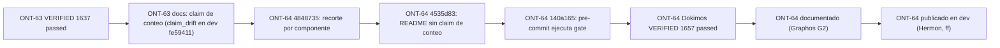

# Feature: recorte de `aep_python.path` y puerta de cobertura en pre-commit (ONT-64)

- **Documento**: `feature_20261115_ont64_path_trim_and_doc_gate.md`
- **Anterior en la cadena**: [`feature_20261115_ont63_orientation_layer.md`](feature_20261115_ont63_orientation_layer.md)
- **Intent**: cerrar el cosmético de `aep_python.path`, que recortaba el prefijo "Documents" de forma poco legible, y cerrar el gap `claim_drift` que el commit de documentación de ONT-63 introdujo después de la verificación de Dokimos. Origen: el usuario, 2026-11-15: "continúa con el cosmético de aep_python.path".
- **Pipeline mode**: **Short** (plan inline del orquestador; Archon y Ontos descartados). El tramo no incluye commits de Graphos.
- **Stage**: Graphos G2 tras **un ciclo** Pragma→Dokimos. Veredicto: `VERIFIED` (ciclo 1). Publicación en `dev`: **publicado en dev por Hermon** (ff `fe59411`..`dev`, autorizado por AP-1 tier 7rwx).
- **Base**: `dev` `fe59411`. Worktree `/home/ancruz/Documents/workspaces/agent-execution-plane/.claude/worktrees/agent-a1a8de650a0c35de8`, rama `worktree-agent-a1a8de650a0c35de8`, HEAD `140a165` (3 commits sobre la base).

## Commits

| Commit | Contenido |
|---|---|
| `4848735` | fix: `_trim_path` en `engine/primitives_orient.py` recorta la ruta por límites de componente, medida en bytes UTF-8. En este host la ruta se muestra como `…/workspaces/agent-execution-plane/.venv/bin/python`. Tests: `tests/test_ont64_aep_python_path.py`. |
| `4535d83` | docs: en el README, la fila de la tabla de orientación ya no se lee como claim de conteo. La frase previa que afirmaba un máximo de herramientas (tool_count 30) contradecía el conteo real de 17; ahora dice "hasta 30 binarios por consulta". |
| `140a165` | chore: `scripts/aep-sync.sh --check` (hook pre-commit) ejecuta `tests/test_ont41_coverage.py` cuando hay staged `*.md`, `engine/threads*.py` o `tests/*`. Tests: `tests/test_ont64_precommit_gate.py`. Coste de ~7,5 s solo en esos commits. |

## Verificación (Dokimos, VERIFIED en un ciclo)

- 1657 passed, 0 failed.
- DB real: md5 y mtime sin cambio.
- Gaps: 1 (gate8, baseline conocido).
- Fuzz de 300 000 rutas: longitud ≤ 60 B y UTF-8 válido en todos los casos.
- Observación sin impacto: el último componente de 58 a 60 B se corta con `…` dentro del componente. Es cosmético y queda como pendiente opcional de Pragma.

## Causa raíz de la regresión de ONT-63 (RCA)

1. El commit de documentación de ONT-63 se hizo después de la verificación y añadió un claim de conteo de herramientas en el README.
2. El analizador del grafo (`engine/threads_extractors.py`, `_TOOL_COUNT_RE` y `_CAP_COUNT_RE`) lee los `*.md` como afirmaciones de conteo y las compara con el conteo real.
3. `tests/test_ont41_coverage.py` falló en `dev` con un `claim_drift` (claim 30 frente a 17 reales).
4. **Causa**: la documentación, no el código. El gate solo corre en la suite, así que un commit de docs posterior a la verificación no lo activaba.
5. **Mitigación**: el hook pre-commit de `140a165` ejecuta el gate cuando el commit toca documentos, `engine/threads*.py` o `tests/`.

## Ruta elegida y radio de impacto

- **Ruta**: Short, cambio mínimo. Código en `engine/primitives_orient.py` (solo la presentación de la ruta), hook en `scripts/aep-sync.sh`, README y documentación.
- **Blast radius**: la salida de `_trim_path` cambia de forma cosmética; el contrato de las herramientas no cambia. El hook pre-commit solo se activa en commits con staged `*.md`, `engine/threads*.py` o `tests/*`, así que no afecta a los demás commits.
- **Tool reach**: sin cambios de privilegios ni de sandbox.

## Diagrama de evolución de estado

## Veredictos

- **Dokimos**: `VERIFIED` (ciclo 1), 1657 passed, 0 failed.
- **Graphos G2**: registra `VERIFIED`, actualiza la documentación y el `COMPACT.md`.

## Enrutado

- Orquestador → **Hermon**, para publicar en `dev` el tramo `fe59411..140a165`. El push a `origin/dev` fue autorizado por el usuario (AP-1, tier 7rwx) y se ejecuta como fast-forward, sin force ni `main`.

## Pendientes

- M12 de ONT-63 (`aep_python.path`, cosmético) queda resuelto por `4848735`.
- Opcional, sin impacto: el truncado de 58 a 60 B dentro del último componente.
- Publicación en `dev`: hecha por Hermon (fast-forward, sin force, sin `main`).
