# Feature: cero gaps por lectura de archivos del proyecto y publicación a main (ONT-65)

- **Documento**: `feature_20261115_ont65_zero_gaps.md`
- **Anterior en la cadena**: [`feature_20261115_ont64_path_trim_and_doc_gate.md`](feature_20261115_ont64_path_trim_and_doc_gate.md)
- **Intent**: llevar el grafo de cobertura a cero gaps, de modo que el test que audita archivos del proyecto leyéndolos por ruta cuente como cobertura. Origen: el gap omisión `test:tests/test_privilege_degradation.py::test_gate8_semantic_sanitization` (aceptado por `GAPS_BASELINE = 1` desde ONT-64). Autorización del usuario, 2026-11-15: "una vez sin gaps puedes hacer commit y push a main."
- **Pipeline mode**: **Short** (plan inline del orquestador; Archon y Ontos descartados).
- **Stage**: Graphos G2 tras **dos ciclos** Pragma→Dokimos. Veredicto final: `VERIFIED` (ciclo 2). Registro previo: ciclo 1 `DEFECTIVE (LOGIC_ERROR)`.
- **Base**: `dev` `fa1c1b9`. Worktree `/home/ancruz/Documents/workspaces/agent-execution-plane/.claude/worktrees/agent-a528667b8d6f54be6`, rama del worktree, HEAD `086dc02` (4 commits sobre la base, 5 archivos, +203 / -8 líneas).
- **Publicación**: `dev` y `main` **publicados por Hermon** (fast-forward, sin force). `main` (`3a89423`) es ancestro de `dev`.

## Commits

| Commit | Contenido |
|---|---|
| `9bb7758` | feat: `engine/threads_extractors.py` añade la categoría de referencia `read_mods`. Dentro de un test (y helpers que llame), una expresión de ruta construida con `/` o `os.path.join` con segmentos `str` constantes que termina en un `.py` de los módulos del proyecto produce una arista `covers` **débil** (`module:engine.privilege`). Archivos no `.py` (`setup.sh`, `aep-ctl`, `*.md`) no generan arista; rutas dinámicas (f-strings con variables, globs) no se infieren. Tests: `tests/test_ont65_read_covers.py`. |
| `7c29bfb` | test: `GAPS_BASELINE` pasa de 1 a 0 en `tests/test_ont41_coverage.py` (endurecer, no relajar). |
| `535b4b0` | fix: el primer operando de la ruta debe estar anclado a la raíz del proyecto (`__file__` o nombre de módulo ligado). Parámetros, locals y `tmp_path` quedan excluidos. |
| `086dc02` | test: los tests de spec que necesitan gaps usan gaps sintéticos; los límites de presupuesto no cambian. |

Asignación de commits a ciclos (inferida por el orden del `git log`, no declarada por Dokimos): `9bb7758` y `7c29bfb` en el ciclo 1; `535b4b0` y `086dc02` en el ciclo 2.

## Ciclo 1: DEFECTIVE (LOGIC_ERROR)

1. Tres tests asumían al menos un gap real (`gaps[0]`) y fallaban con `GAPS_BASELINE = 0`, que deja el grafo sin gaps.
2. `read_mods` tomaba `tmp / "engine" / "__init__.py"` de las fixtures como lectura real: **75 aristas falsas**, todas desde directorios temporales.
3. No hubo enmascaramiento: un experimento con 25 funciones confirmó que la arista débil solo resolvía la omisión del propio test.
4. **Causa**: el test que usaba gaps reales como material se rompía al llegar a 0, y la lectura no estaba anclada a la raíz del proyecto.
5. Efecto colateral: el orquestador creó una tarjeta kanban durante la suite. Esto cambió md5 y mtime de la base real (ver lección 3).

## Ciclo 2: VERIFIED

- **1666 passed, 0 failed**.
- `analysis.gaps == []`. `GAPS_BASELINE = 0`: cualquier gap rompe `test_ont41_coverage.py`.
- DB real: md5 y mtime sin cambio respecto al inicio de la verificación.
- Aristas débiles: 97 → 117. Muestra de 10 aristas revisada a mano: sin falsos positivos.
- Aristas originadas en fixtures: 0.
- Enmascaramiento re-probado con 5 funciones: 0 gaps perdidos.
- Evidencia de rendimiento y ruff (registrada tras el ciclo 2): rendimiento del análisis 1.62 s → 1.59 s (ciclo 1) y ~0.75 s tras el ciclo 2, dentro del criterio ≤5 %; `ruff check` y `ruff format --check` limpios (350 archivos, Dokimos ciclo 2).

## Lecciones

1. **Cero gaps sin enmascarar**: una arista débil solo debe resolver la omisión del propio test. Si una arista débil cubre gaps ajenos, el cero es falso.
2. **Tests que usan gaps reales como material se rompen al llegar a 0**: el test debe sembrar su propio gap sintético (`086dc02`), no leer el grafo real.
3. **No escribir en la DB real durante una verificación**: la suite debe correr con `AEP_DATA_HOME` temporal, y el orquestador no debe operar sobre la base real mientras Dokimos verifica (incidente del ciclo 1).

## Ruta elegida y radio de impacto

- **Ruta**: Short, cambio mínimo en el extractor y en los tests del grafo.
- **Blast radius**: `engine/threads_extractors.py` (categoría nueva, solo aristas `covers` débiles) y el conjunto de tests de cobertura. Los contratos de las herramientas MCP no cambian. El número de aristas fuertes del grafo real no cambia (la comparación está en `tests/test_ont65_read_covers.py`).
- **Tool reach**: sin cambios de privilegios, sandbox ni tiers. La publicación a `main` la autorizó el usuario de forma explícita, condicionada a 0 gaps (condición cumplida en el ciclo 2).

## Diagrama de evolución de estado

```mermaid
flowchart LR
    A["ONT-64 VERIFIED 1657 passed, gaps 1"] --> A1["ONT-65 9bb7758: read_mods (covers débiles)"]
    A1 --> A2["ONT-65 7c29bfb: GAPS_BASELINE 0"]
    A2 --> A3["ONT-65 ciclo 1 DEFECTIVE: 3 tests con gaps[0], 75 aristas desde fixtures"]
    A3 --> A4["ONT-65 535b4b0: primer operando anclado a la raíz"]
    A4 --> A5["ONT-65 086dc02: tests de spec con gaps sintéticos"]
    A5 --> A6["ONT-65 ciclo 2 VERIFIED 1666 passed, gaps 0"]
    A6 --> A7["ONT-65 documentado (Graphos G2, rollup ONT-61..65)"]
    A7 --> A8["ONT-65 publicado en dev y main (Hermon)"]
```

## Veredictos

- **Dokimos ciclo 1**: `DEFECTIVE (LOGIC_ERROR)`. Fix spec: anclar el primer operando, sembrar gaps sintéticos en los tests de spec.
- **Dokimos ciclo 2**: `VERIFIED`, 1666 passed, 0 failed, gaps 0.
- **Graphos G2**: registra ambos veredictos, actualiza README, `docs/STATE.md`, `docs/COMPACT.md`, `docs/MILESTONES.md` (sección 32) y el rollup.

## Enrutado

- Orquestador → **Hermon** (ejecutado): publicar `fa1c1b9..086dc02` en `dev` (fast-forward) y después `main` (fast-forward a `dev`, autorizado por el usuario). Sin force, sin reescritura de historia.

## Pendientes

- **ONT-66 ENCOLADO**: `aep_notice` ruidoso (AEP debe notificar al agente de turno lo que detecta, con `ask_user` redactado para el usuario). Plan: `docs/pipeline/plan_ont66_noisy_notices.md`. Motivo: el claim_drift del README (ONT-63 → ONT-64) y la omisión de gate8 no se notificaron; los encontró un test y una consulta manual.
- Publicación en `dev` y `main`: completada por Hermon.
- Evidencia de rendimiento y ruff: registrada (ver Ciclo 2).
- Opcional, sin impacto: truncado de 58 a 60 B dentro del último componente de `aep_python.path` (ONT-64).
