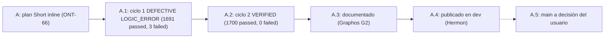

# Feature: AEP ruidoso, avisos de estado y push MCP (ONT-66)

- **Documento**: `feature_20261115_ont66_noisy_notices.md`
- **Anterior en la cadena**: [`feature_20261115_ont65_zero_gaps.md`](feature_20261115_ont65_zero_gaps.md)
- **Primero de la cadena nueva 66..70** (el rollup 61..65 queda cerrado en `feature_rollup.md`).
- **Intent**: AEP anuncia lo que detecta al agente de turno. Origen, usuario 2026-11-15: "debe ser ruidoso, debe notificarle a la agente de turno, cuando hay algo que notificar ... 'AEP reporta x, y o Z, quieres mejorarlo?'".
- **Plan**: `docs/pipeline/plan_ont66_noisy_notices.md`.
- **Pipeline mode**: **Short** (plan inline del orquestador; Archon y Ontos descartados).
- **Stage**: Graphos G2 tras **dos ciclos** Pragma→Dokimos. Veredicto final `VERIFIED` (ciclo 2). Ciclo 1 `DEFECTIVE (LOGIC_ERROR)`.
- **Base**: `main` = `dev` = `69b1b76`. Worktree `/home/ancruz/Documents/workspaces/agent-execution-plane/.claude/worktrees/agent-a1f0db185df7df481`, rama `worktree-agent-a1f0db185df7df481`, HEAD `5c93d12` (5 commits sobre la base).
- **Publicación**: publicado en `dev` por Hermon (fast-forward). `main` queda a decisión del usuario.

## Diagnóstico previo (RCA)

AEP detectaba pero no anunciaba. Ni el `claim_drift` del README (ONT-63 a ONT-64) ni la omisión `gate8` se notificaron: los halló un test y una consulta manual. El único canal era `reconcile_top`, que solo aparecía en `discover(capabilities, terse)`, usaba solo el análisis en caché (frío tras cada hot-swap), excluía omisiones y no tenía push.

## Camino elegido y radio de impacto

- **Camino**: Short, inline. Alcance de herramientas: servidor AEP (`server.py`, `aep_backend.py`, `aep_front.py`), registro nuevo `engine/notices.py`, `engine/telemetry.py`, `engine/threads.py`, una línea en `engine/privilege.py` (`c6508ee`), y pruebas `tests/test_ont66_*.py` más ajustes en `tests/test_e4_reconcile.py` y `tests/test_ont41_meta.py`.
- **Radio de impacto**: cada respuesta de cualquier herramienta puede llevar `aep_notice` mientras haya avisos sin reconocer; `autoevol` gana `notices` y `ack`; `discover` y `orient` ganan `gaps_open` y la línea de reenvío de `ask_user`; el push MCP llega a clientes que recargan `/mcp`.
- **Fuera de alcance**: sin cambios de tier, sin commits ni push de Graphos.

## Commits

| Commit | Contenido | Ciclo |
|---|---|---|
| `7129048` | Análisis caliente tras la carga del backend (hilo daemon, fail-soft); `engine/notices.py` como registro de avisos | 1 |
| `ce8210c` | `aep_notice` en `attach_envelope` (todas las respuestas, hasta `ack` o resolución); `autoevol` `notices` y `ack` | 1 |
| `fa1d18c` | Push MCP `notifications/message` con logger `aep.notice`, una vez por cambio; deduplicado en el front entre generaciones | 1 |
| `c6508ee` | `orient` y `discover` con `gaps_open`; línea "relay ask_user" en `_INSTRUCTIONS`; paso WF-0; documentación de `setup.sh --update` | 1 |
| `5c93d12` | Endurecimiento de etiquetas, referencias cortas, recorte de instrucciones y prueba LRU no vacua; corrige `cached_analysis` | 2 |

## Ciclos

- **Ciclo 1, DEFECTIVE (LOGIC_ERROR)**: 1691 passed, 3 failed.
  - Test de presupuesto terse: 414 > 400 bytes. Pragma afirmó un cambio que no estaba commiteado.
  - Literal de conteo de herramientas en pruebas nuevas.
  - `_INSTRUCTIONS` 9465 > 9400 bytes.
  - Prueba de `cached_analysis` vacua.
  - Bug real corregido: `cached_analysis` devolvía la última entrada insertada, no la analizada.
- **Ciclo 2, VERIFIED**: 1700 passed, 0 failed (reportado por Dokimos; Graphos solo reejecutó `tests/test_ont41_coverage.py`: 11 passed).
  - Gaps 0. DB real intacta. `_INSTRUCTIONS` 9388 bytes, sin subir el tope.
  - Etiquetas filtradas a la clase `[\w.:/≠<>-]`: 49 ataques de inyección neutralizados (sin prosa, sin caracteres de control ni RTL).
  - Basename vetado, se muestra `<path>`. Referencias cortas de gap resolubles por `spec` y `ack`: 14 de 14.
  - Byte-identidad de las respuestas sin avisos.
  - Push: un mensaje por cambio, sin repetición tras hot-swap.
  - Swap +20 ms, `fd_delta` 0.

## Estado (diagrama de evolución)

## Residuales registrados

1. El `ack` vive en el proceso backend: se pierde en un hot-swap y los avisos reaparecen en las respuestas. El push no se repite.
2. Riesgo teórico: un `gap.ref` ajeno podría coincidir con una referencia corta (`resolve_in` prioriza `ref`). Colisión prácticamente imposible por el formato.
3. Acks y avisos no van al ledger.
4. El push requiere `/mcp` del usuario, porque el front no es hot-swappable.

## Lecciones

1. Un agente que reenvía texto del repositorio al usuario necesita filtrar por clase de caracteres, no solo recortar.
2. Los informes se limitan a lo commiteado. Lo afirmado sin commit se rechaza.
3. Las pruebas de regresión deben fallar en la base antes de pasar.

## Ruteo

Documentado VERIFIED. Siguiente parada: **Hermon** (publicación en `dev`, fast-forward, sin force). Publicar en `main` queda a decisión del usuario.
