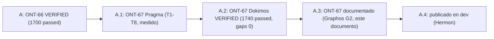

# ONT-67 — Uso de RAM: optimizaciones medidas y aplicadas (Short)

**Modo:** Short. **Agente:** Graphos G2 (registro tras el veredicto de Dokimos).
**Base:** `dev` `2317d8d`. **Worktree:** `worktree-agent-a97a79376546e1bcf`, HEAD `e2f1e19`.
**Veredicto:** VERIFIED en un ciclo (1740 passed, 0 failed; gaps 0; DB real intacta).
**Publicación:** publicado en `dev` por Hermon (fast-forward, sin force). Graphos no hace commits ni push.

**Anterior en la cadena:** [`feature_20261115_ont66_noisy_notices.md`](feature_20261115_ont66_noisy_notices.md)
**Plan y resultados completos (no duplicados aquí):** [`plan_ont67_ram_efficiency.md`](plan_ont67_ram_efficiency.md)

**Origen:** el usuario (2026-11-16) pidió aplicar de un prompt de contexto (ADN/PIM) solo lo realmente aplicable a la memoria RAM, investigando primero la práctica de la industria, y que el instalador lo contemple en un fresh start.

## 1. Ruta elegida y radio de impacto (P1)

- **Ruta:** corta (Short). El orquestador planificó en línea; Pragma ejecutó; Dokimos verificó con el banco reproducible.
- **Herramientas usadas:** git, pytest del host, `scripts/bench_ram.py` (banco de RSS por fase), `/proc/<pid>/status`, `os.memfd_create` con `fcntl` (sellos), `malloc_trim` por ctypes (fail-soft, solo glibc), `compression.zstd` de la stdlib.
- **Radio de impacto:**
  - embedder (descarga por inactividad y recarga perezosa);
  - caché de análisis (`threads` `cached_analysis`, sin AST);
  - salidas persistidas de sandbox en tmpfs (zstd);
  - `process_inspect` con bloque `memory` en `detail`;
  - `setup.sh --check` (solo lectura) y `toolchain.env` (`AEP_EMBED_IDLE_S` se persiste solo si el usuario lo fija).
- **Fuera del radio:** sysctl, zram, KSM y THP del host. Son cambios privilegiados y no se aplicaron; solo se diagnostican.
- **Sub-agentes:** sin privilegios nuevos.

## 2. Diagnóstico previo (medido en el host)

- Backend: VmRSS 306 128 kB (RssAnon 294 948 kB). `process_inspect(pid=0)` informó 31 596 kB. Ese valor no se reprodujo: `rss_kb` ya era VmRSS (330 916 frente a 333 380 kB en vivo). Se añadió el bloque `memory` para que la lectura sea explícita.
- Host: 30 GB de RAM, 3,4 GB disponibles, swap al 96 %. `vm.memfd_noexec=0`, KSM en run=1, THP en madvise.
- `server.py` creaba el memfd con `os.memfd_create(name, 0)`: sin `MFD_CLOEXEC`, sin sellos y sin `MFD_EXEC` explícito.
- SQLite ya usaba `mmap_size` de 256 MB y `cache_size` de 64 MB por conexión.
- El embedder se cargaba de forma perezosa y nunca se descargaba.
- La caché de análisis retenía ~168 MB por entrada, porque `type_index` mantenía todos los AST.

## 3. Resultados (fuente: verificación de Dokimos y banco)

| Medida | Resultado | Fuente |
|---|---|---|
| RSS en reposo | −41,6 % | Verificación Dokimos |
| RSS tras autoevol | −43,2 % | Verificación Dokimos |
| Reposo en el banco final | 548 592 → 328 188 kB (−40,2 %); RssAnon −44,3 % | `ont67_bench_base.json`, `ont67_bench_final.json` |
| Recarga del embedder | +136 ms, una vez | Verificación Dokimos |
| Sandbox con salida grande | +5,6 ms | Verificación Dokimos |
| Salidas de sandbox con zstd | ≈17× en salida secuencial (4,1× en código, 3,4× en git log) | Plan, banco T7 |

La diferencia entre el −41,6 % de Dokimos y el −40,2 % del banco se debe a corridas distintas; ambas quedan documentadas. La cifra de 31 MB frente a 306 MB no se reprodujo, y los tests fijan la lectura correcta.

## 4. Decisiones por tarea

| Tarea | Decisión | Motivo medido |
|---|---|---|
| T0 banco | Conservado | Medición reproducible (`scripts/bench_ram.py`) |
| T1 `process_inspect` | Conservado (bloque `memory`) | El RSS ya era correcto; se añadió el desglose |
| T2 memfd | Conservado: `MFD_CLOEXEC`, `MFD_ALLOW_SEALING`, `MFD_EXEC` con fallback `EINVAL`, sellos `WRITE\|SHRINK\|GROW\|SEAL`, `error_class` `memfd_noexec_enforced` | Compatibilidad e integridad (patrón runc) |
| T3 embedder | Conservado: descarga por inactividad (`AEP_EMBED_IDLE_S`, 600 s; `0` = nunca) y `malloc_trim` | Reposo −21,3 % tras T3 solo |
| T3 `enable_cpu_mem_arena=False` | Revertido | Sin ganancia (529 268 frente a 529 536 kB) |
| T4 caché sin AST | Conservado | 168 MB → 6,2 MB por entrada |
| T5 SQLite `cache_size` | No aplicado | Sin efecto: RSS idéntico y latencia 1,38 frente a 1,37 ms |
| T6 allocator global | No aplicado | `malloc_trim` tras analyze/embed +1,2 % sin ganancia; `MALLOC_ARENA_MAX=2` −0,1 %; `PYTHONMALLOC=malloc` +3,7 % RSS y +39 % latencia |
| T7 zstd tmpfs | Conservado: nivel 3 para salidas ≥ 4 KiB | 17× en seq; coste ≈6 ms con 2,7 MB |
| T8 instalador | Conservado: línea **Memory** en `setup.sh --check` | Ver sección 6 |

**No aplicable al uso de RAM de AEP:** PIM (UPMEM, HBM-PIM, AiM), CXL, Arrow/DuckDB, Bloom/VSA/SIMD y THP para el heap de Python. No hay hardware ni caso de uso que los justifique.

## 5. Estado del pipeline (evolución)

## 6. Instalador (fresh start)

- `setup.sh --check` añade la línea **Memory**. Muestra `vm.memfd_noexec`, THP, KSM, presión de swap y los ajustes efectivos de AEP.
  - FAIL si `vm.memfd_noexec=2`, porque la ejecución en RAM de AEP no funciona.
  - WARN si vale 1, o si el swap supera el 90 %. En ese caso recomienda zram como acción manual del usuario.
  - Nunca escribe sysctl, zram, KSM ni THP.
- Los valores por defecto viven en el código, así que un fresh start los hereda.
- `AEP_EMBED_IDLE_S` se persiste en `toolchain.env` solo si el usuario lo fija. El reescrito de `toolchain.env` lo conserva. `setup.sh --update` no lo pisa.

## 7. Hallazgos para futuros ONT (pendientes, sin bloquear ONT-67)

1. **`server.py:2067` y `server.py:2079`:** `raw_elf[:4] == b"ELF"` nunca coincide, porque el magic es `\x7fELF`. La caché de binarios en disco no se usa nunca. **Corrección (ONT-68):** falso positivo. El literal contenía el byte 0x7f en bruto, así que la comparación sí coincidía; ver `feature_20261116_ont68_aep_findings.md`.
2. **`test_ont40_acceptance`:** la extracción en frío es sensible a la carga del host. Riesgo de falso fallo bajo carga.
3. **`KEEP_EMBED_IDLE`:** variable muerta en `setup.sh`. **Resuelto en ONT-68:** no era código muerto, sino un bug real (un `AEP_EMBED_IDLE_S` fijado solo en `toolchain.env` se perdía al reescribirlo).

## 8. Lecciones

- Medir antes de aplicar: T5 y T6 parecían prometedores y no ganaron nada en el banco.
- La lectura de RSS en `process_inspect` debe ser explícita (VmRSS frente a RssAnon); una cifra sin desglose llevó a un diagnóstico falso.

## Reinforcement graph

```mermaid
flowchart LR
    I67["Intent: uso de RAM (ONT-67)"] --> M1["M1: medición reproducible y memory en process_inspect (T0, T1) ✅"]
    M1 --> M2["M2: memfd sellado y compatible (T2) ✅"]
    M2 --> M3["M3: descarga del embedder y caché sin AST (T3, T4) ✅"]
    M3 --> M4["M4: zstd en tmpfs y línea Memory del instalador (T7, T8) ✅"]
    M4 --> M5["M5: Dokimos VERIFIED 1740 passed, gaps 0 ✅"]
    M5 --> M6["M6: documentado (Graphos G2) ✅"]
    M6 --> M7["M7: publicado en dev (Hermon) ✅"]
```

