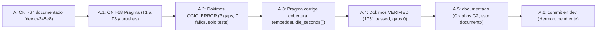

# ONT-68 — Hallazgos reportados por AEP: caché ELF, `KEEP_EMBED_IDLE` y extracción en frío (Short)

**Modo:** Short. **Agente:** Graphos G2 (registro tras el veredicto de Dokimos).
**Base:** `dev` `c4345e8`. **Estado:** cambios sin commit en el árbol de trabajo. Graphos no hace commits; el commit lo realiza Hermon.
**Veredicto:** VERIFIED tras dos ciclos (ciclo 1 LOGIC_ERROR solo en tests; ciclo 2 VERIFIED). Suite 1751 passed, 0 failed (serie); gaps 0; md5 de la DB real sin cambios.
**Origen:** el orquestador reportó tres hallazgos al usuario como hallazgos de AEP; el usuario pidió corregirlos.

**Anterior en la cadena:** [`feature_20261116_ont67_ram_efficiency.md`](feature_20261116_ont67_ram_efficiency.md)
**Nombre:** sigue la convención de la cadena (`feature_YYYYMMDD_<intent>.md`) y el nombre pedido por el usuario.

## 1. Ruta elegida y radio de impacto (P1)

- **Ruta:** corta (Short). El orquestador planificó en línea; Pragma ejecutó; Dokimos verificó.
- **Herramientas usadas:** git, `grep`, `od` (verificación de bytes), pytest del host con `.venv`.
- **Radio de impacto:**
  - `server.py`: lectura de la caché de binarios ELF en `TEMP_BIN_DIR` (`_ELF_MAGIC`, `_is_elf()`, `_read_trusted_cached_elf()`); ruta de ejecución de artefactos.
  - `engine/catalog.py`: nuevo `get_binary_hash(name)`, usado para confiar en la caché.
  - `scripts/setup.sh`: captura y reaplicación de `AEP_EMBED_IDLE_S` alrededor del reescrito de `toolchain.env`.
  - `tests/test_ont40_acceptance.py`: criterio de extracción en frío (sin cambiar la cota).
  - Pruebas: `tests/test_ont68_elf_cache.py` (nuevo, 8 tests) y 3 tests nuevos en `tests/test_ont67_setup_memory.py`.
- **Fuera del radio:** el protocolo de ejecución en RAM (`memfd_create`) y el contrato de las herramientas no cambian. No se tocó el host.
- **Sub-agentes:** sin privilegios nuevos.

## 2. Hallazgos y resolución

| # | Hallazgo reportado | Diagnóstico verificado | Resolución |
|---|---|---|---|
| T1 | Magic ELF en `server.py` 2067 y 2079 "nunca coincide" | **Falso positivo.** El literal `b"<byte 0x7f>ELF"` contenía un byte de control 0x7f sin representación visible. `git show HEAD:server.py \| od -c` lo confirma (`177` seguido de `E L F`). La comparación sí coincidía. | Se sustituye el literal visible por `_ELF_MAGIC = b"\x7fELF"`, `_is_elf()` y `_read_trusted_cached_elf()`. **Cambio de comportamiento real:** la caché en disco de `TEMP_BIN_DIR` solo se confía si su sha256 coincide con el hash del catálogo (`get_binary_hash`) cuando el catálogo conoce el nombre. Si no coincide, se usa el blob del catálogo y se reescribe de forma atómica. |
| T2 | `KEEP_EMBED_IDLE` "variable muerta" en `setup.sh` | **Bug real, no código muerto.** Un `AEP_EMBED_IDLE_S` fijado solo en `toolchain.env` se perdía cuando `toolchain.env` se reescribía. | Se captura el valor del usuario (entorno > `toolchain.env`) antes del reescrito y se reaplica. Sin valor del usuario, no se escribe nada. |
| T3 | `test_ont40_acceptance`: extracción en frío sensible a la carga | Riesgo de falso fallo bajo carga del host. | Muestreo adaptativo de 3 a 7 corridas (mejor de); cota de 2,0 s sin cambios; guarda de tiempo de pared en las tres primeras corridas; el resultado R es idéntico en todas las corridas. |

**Corrección de un registro anterior:** el hallazgo 1 de [`feature_20261116_ont67_ram_efficiency.md`](feature_20261116_ont67_ram_efficiency.md) afirmaba que el magic nunca coincidía y que la caché en disco nunca se usaba. T1 demuestra que ese diagnóstico era falso. El hallazgo 3 de ese mismo documento (`KEEP_EMBED_IDLE`) era un bug real, no código muerto.

## 3. Pruebas y ciclos de Dokimos

- **Ciclo 1: LOGIC_ERROR (solo en tests).** Los 3 tests nuevos de ONT-67 no declaraban `covers` para sus bordes. Eso generó 3 omission gaps, que rompieron `GAPS_BASELINE=0` y en cascada 7 fallos. Entre los fallos estaban los presupuestos de bytes de playbook, porque el texto del gap entra en los payloads.
- **Corrección (Pragma):** los tests referencian `embedder.idle_seconds()`, de modo que cubren el borde real.
- **Ciclo 2: VERIFIED.** 1751 passed, 0 failed (serie); gaps 0; DB real intacta (md5 sin cambios).
- Conteo: 1740 (ONT-67) + 8 (ONT-68 ELF) + 3 (ONT-67 setup) = 1751.

## 4. Estado del pipeline (evolución)

## 5. Métricas del run

- **Modo:** Short. Archon↔Ontos: no aplica en Short.
- **Ciclos Pragma↔Dokimos:** 1 ciclo de corrección (LOGIC_ERROR en tests).
- **Gaps al cierre:** 0.
- **Duración total y ratio de aproximación:** no reportados por Dokimos.

## 6. Decisiones del usuario

- Corregir los tres hallazgos reportados como AEP.
- Publicación: Hermon hace el commit en `dev`. Después se hace fast-forward de `dev` a `main` incluyendo ONT-66, ONT-67 y ONT-68 ("procesa lo que falta"). Sin force.

## 7. Pendientes que cruzan documentos

1. **Carrera benigna en la caché ELF:** puede ejecutarse un binario entre el reemplazo del archivo en disco y `register_artifact`. Se autocorrige en la siguiente lectura. Vigilar; ONT futuro si se quiere cerrar del todo.
2. **`test_ont40_acceptance`:** mitigado, no eliminado. La extracción en frío sigue siendo sensible a la carga del host.
3. **Hallazgos de ONT-67:** el 1 (ELF) queda corregido como falso positivo en T1; el 3 (`KEEP_EMBED_IDLE`) queda resuelto en T2.

## 8. Lecciones

- Antes de declarar un bug en un literal, comprobar los bytes con `od`. `grep` oculta los bytes de control y produjo un falso positivo.
- Un test nuevo sin `covers` para sus bordes es un gap. Con `GAPS_BASELINE=0` ese gap rompe el gate y arrastra fallos en cascada.
- El texto de un gap entra en los payloads: los presupuestos de bytes pueden romperse por una cobertura mal declarada.

## Reinforcement graph

```mermaid
flowchart LR
    I68["Intent: hallazgos AEP (ONT-68)"] --> M1["M1: hallazgos triados y reportados (orquestador) ✅"]
    M1 --> M2["M2: caché ELF con hash de catálogo (T1, Pragma) ✅"]
    M2 --> M3["M3: KEEP_EMBED_IDLE reaplicado (T2, Pragma) ✅"]
    M3 --> M4["M4: extracción en frío robusta a carga (T3, Pragma) ✅"]
    M4 --> M5["M5: Dokimos VERIFIED 1751 passed, gaps 0 ✅"]
    M5 --> M6["M6: documentado (Graphos G2) ✅"]
    M6 --> M7["M7: commit en dev (Hermon)"]
    M7 --> M8["M8: dev a main con ONT-66 a ONT-68 (autorizado)"]
```

