# ONT-69 — Hallazgos de la revisión autoevol: riesgos de Bernstein, cobertura "none" y batch IPC (Short)

**Modo:** Short. **Agente:** Graphos G2 (registro tras el veredicto de Dokimos).
**Base:** `dev` `80d8da5`. **Rama de trabajo:** `ont69` en el worktree `aep-ont69`. **Estado:** VERIFIED; publicado en `dev` y `main` (código `8502287`..`92ca91b`, docs `3c1a01d`). Tras publicar: reconexión del harness, `stale` false, autoevol con gaps 0, hazards 0 y sin propuestas de reconcile.
**Veredicto:** VERIFIED en el ciclo 1 (sin ciclos de corrección). Suite 1755 passed (serie, 309 s); gaps 0; codep 0; hazards 0; cota de arranque en frío aprobada; md5 de la DB real sin cambios.
**Origen:** la revisión de `autoevol` encontró 2 riesgos de Bernstein y 45 funciones con cobertura "none". Una corrida con registro de llamadas en tiempo de ejecución sobre toda la suite mostró que 38 de esas 45 sí se ejecutan (falsos negativos del despacho por registro), 6 están muertas y 1 es un hueco real (ruta por lotes del socket IPC).

**Anterior en la cadena:** [`feature_20261116_ont68_aep_findings.md`](feature_20261116_ont68_aep_findings.md)
**Cadena 66..70:** ONT-69 es el cuarto documento. El rollup 66..70 se cierra con ONT-70.

## 1. Ruta elegida y radio de impacto (P1)

- **Ruta:** corta (Short). El orquestador planificó en línea; Pragma ejecutó; Dokimos verificó.
- **Herramientas usadas:** git, `grep`, `autoevol` (grafo de hilos, gaps, hazards), registro de llamadas en tiempo de ejecución, pytest del host con `.venv` (`/home/ancruz/Documents/workspaces/agent-execution-plane/.venv/bin/python`).
- **Radio de impacto:**
  - `engine/ipc_pool.py`: `UnixSocketMux._run_awaitable` sustituye la ruta `get_event_loop` en la ejecución por lotes sobre el socket.
  - `engine/catalog.py`: nuevos `set_artifact_promotion`, `get_artifact_stats_row` y `list_reusable_artifact_stats` que reciben la conexión del llamador; se elimina `ArtifactCatalog._get_connection` (muerto).
  - `engine/kanban.py`: usa esas tres funciones sobre la conexión del llamador, para que la promoción y las estadísticas sean atómicas con su transacción.
  - `engine/security.py`: nuevo `audit_entry_exists`, usado por `threads_events`.
  - `engine/threads_extractors.py`: `_registry_members` y `_add_registry_edges` añaden aristas `consumes` débiles para el despacho por registro de diccionario.
  - Eliminaciones de código muerto: `_conn` en `crash_router`, `playbook` y `docs_vectorizer`; `server._get_git_commit`; `threads_field._has_strict_fr_marker`.
  - Pruebas nuevas: `tests/test_ont69_ipc_batch.py` (3 tests) y `tests/test_ont69_registry_dispatch.py` (1 test).
- **Fuera del radio:** protocolo de ejecución en RAM, contrato de las herramientas expuestas y esquema de respuestas. No se tocó el host ni la DB real.
- **Sub-agentes:** sin privilegios nuevos.

## 2. Hallazgos y resolución

| # | Hallazgo reportado por `autoevol` | Diagnóstico verificado | Resolución |
|---|---|---|---|
| T1 | Ruta por lotes del socket IPC con handler asíncrono: posible bloqueo de 30 s | `get_event_loop` en un hilo de trabajo sin bucle puede crear un bucle que nunca se ejecuta, y si ya hay un bucle corriendo en ese hilo la espera no progresa. | `_run_awaitable` ejecuta el awaitable con `asyncio.run` en el hilo de trabajo. Si ya hay un bucle en ese hilo, devuelve `ERROR` de inmediato en lugar de bloquear 30 s. |
| T2 | 6 funciones muertas y 1 hueco real en IPC | 6 funciones sin llamadores reales (ver sección 1). El hueco real es la ruta por lotes sobre el socket. | Eliminación de las 6 funciones. T1 cierra el hueco. |
| T3 | 2 riesgos de Bernstein (acceso al estado de `catalog` desde `kanban` y `threads_events` fuera de la conexión del llamador) | Riesgo reportado por `autoevol`; la causa exacta de cada uno no se detalla aquí. Se verificó que la atomicidad se mantiene con la conexión del llamador, incluido el rollback. | Las funciones reciben la conexión del llamador. Hazards 2 → 0. Atomicidad verificada, incluido el rollback. |
| T4 | 45 funciones con cobertura "none" | Falsos negativos del despacho por registro: las funciones se invocan desde diccionarios de registro, que el extractor no seguía. 38 se ejecutan en realidad; 6 están muertas; 1 es el hueco real de T1. | `threads_extractors` añade aristas `consumes` débiles para miembros de registro de diccionario (incluidos spread y lambda). Cobertura "none" 45 → 8. |

**Honestidad sobre las pruebas de T1:** de los tres tests de `test_ont69_ipc_batch.py`, solo `test_async_handler_with_running_loop_returns_error_not_deadlock` demuestra la corrección. Se verificó con mutación: al restaurar la ruta antigua, ese test falla. Los otros tres (`test_batch_end_to_end_over_socket`, `test_async_handler_runs_in_worker_thread_without_loop` y el de extremo a extremo) son guardas de regresión: la ruta antigua ya funcionaba en Python 3.14 sin bucle corriendo, así que no distinguen la versión vieja de la nueva en ese caso.

## 3. Pruebas y ciclos de Dokimos

- **Ciclo 1: VERIFIED.** Sin ciclos de corrección.
- **Suite:** 1755 passed, 0 failed (serie, 309 s). Antes de ONT-69: 1751 (ONT-68). La diferencia de 4 corresponde a los 4 tests nuevos (3 en `test_ont69_ipc_batch.py`, 1 en `test_ont69_registry_dispatch.py`), verificado con colección de pytest.
- **Gaps:** 0. **Codep:** 0. **Hazards:** 0.
- **Cota de arranque en frío:** aprobada.
- **Huella:** R `d97fe270` (determinista entre corridas).
- **DB real:** md5 sin cambios.

## 4. Métricas de cobertura (`autoevol`)

| Métrica | Antes (ONT-68, `80d8da5`) | Después (ONT-69) |
|---|---|---|
| Funciones con cobertura "none" | 45 | 8 |
| Cobertura directa | — | 521 |
| Cobertura transitiva | — | 487 |
| Funciones totales en el grafo | — | 1016 |
| Hazards de Bernstein | 2 | 0 |
| Gaps de omisión | 0 | 0 |
| Codependencias | 0 | 0 |

Las 8 funciones restantes en "none" no quedaron cubiertas en este track (ver sección 7).

## 5. Estado del pipeline (evolución)

```mermaid
flowchart LR
    A["A: ONT-68 publicado (main 6a359f7)"] --> A1["A.1: revisión autoevol (2 Bernstein, 45 none)"]
    A1 --> A2["A.2: registro de llamadas (38 vivas, 6 muertas, 1 hueco)"]
    A2 --> A3["A.3: Pragma T1 a T4 y pruebas"]
    A3 --> A4["A.4: Dokimos VERIFIED ciclo 1 (1755 passed, gaps 0)"]
    A4 --> A5["A.5: documentado (Graphos G2, este documento)"]
    A5 --> A6["A.6: commit en dev (Hermon) ✅"]
    A6 --> A7["A.7: publicado en main (autorizado) ✅"]
```

## 6. Métricas del run

- **Modo:** Short. Archon↔Ontos: no aplica en Short.
- **Ciclos Pragma↔Dokimos:** 0 de corrección (VERIFIED en el ciclo 1).
- **Gaps al cierre:** 0. **Hazards al cierre:** 0.
- **Duración total y ratio de aproximación:** no reportados por Dokimos.

## 7. Decisiones del usuario y pendientes

**Decisiones del usuario:**
- Ejecutar el track ONT-69 en Short sobre el worktree `aep-ont69` (rama `ont69`).
- Commit en `dev` por Hermon y publicación en `main` autorizada por el usuario: hechos.

**Pendientes que cruzan documentos:**
1. **8 funciones con cobertura "none"** tras T4. Son funciones sin ninguna prueba que las alcance. Un ONT futuro puede escribir pruebas para ellas o confirmar que son código inalcanzable para eliminarlo.
2. **Guardas de regresión de T1:** la ruta antigua funcionaba en 3.14 sin bucle corriendo. Solo el test de bucle corriendo demuestra el arreglo; si se quiere cubrir el caso de hilo sin bucle con un fallo real, requiere otro escenario.
3. **Carrera benigna en la caché ELF** (de ONT-68): sigue abierta, sin cambios.
4. **`test_ont40_acceptance`:** mitigado en ONT-68; esta corrida pasó la cota de arranque en frío, pero la sensibilidad a la carga del host sigue documentada.

## 8. Lecciones

- Un hallazgo de cobertura "none" puede ser un falso negativo del extractor, no código muerto. Antes de borrar, comprobar con un registro de llamadas en tiempo de ejecución: aquí 38 de 45 se ejecutaban por despacho desde registros de diccionario.
- Una prueba de regresión que pasa con el código viejo y el nuevo no demuestra el arreglo. Hay que comprobarlo con mutación: solo el test de bucle corriendo falla si se restaura la ruta antigua.
- Pasar la conexión del llamador a las funciones de estado cerró los dos riesgos de Bernstein reportados; la atomicidad se verificó con rollback.

## 9. Grafo de hilos de cobertura (resumen)

| Categoría de hallazgo | Número | Destino |
|---|---|---|
| Vivas (despacho por registro) | 38 | Cubiertas tras T4 (aristas `consumes` débiles) |
| Muertas | 6 | Eliminadas en T2 |
| Hueco real (lote IPC) | 1 | Cerrado por T1 |
| Restantes en "none" | 8 | Pendiente (sección 7.1) |

## Reinforcement graph

```mermaid
flowchart LR
    I69["Intent: revisión autoevol (ONT-69)"] --> M1["M1: hallazgos triados (orquestador) ✅"]
    M1 --> M2["M2: batch IPC sin deadlock (T1, Pragma) ✅"]
    M2 --> M3["M3: código muerto retirado (T2, Pragma) ✅"]
    M3 --> M4["M4: hazards de Bernstein 2 a 0 (T3, Pragma) ✅"]
    M4 --> M5["M5: cobertura none 45 a 8 (T4, Pragma) ✅"]
    M5 --> M6["M6: Dokimos VERIFIED 1755 passed, gaps 0 ✅"]
    M6 --> M7["M7: documentado (Graphos G2) ✅"]
    M7 --> M8["M8: commit en dev (Hermon) ✅"]
    M8 --> M9["M9: publicado en main ✅"]
```

