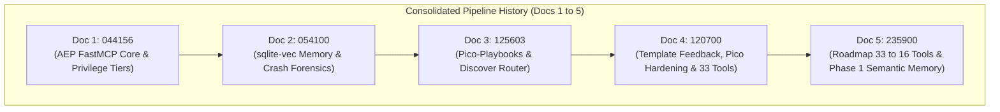

# Feature Chain Rollup: Pipeline Milestone History (Documents 1–5)

- **Document ID**: `feature_rollup.md`
- **Rollup Period**: 2026-10-23T04:41:56Z — 2026-10-23T23:59:00Z
- **Trigger**: 5th Document in the Interwoven Knowledge Graph Sequence
- **Current Active Document**: [`feature_20261023_235900_phase1_semantic_memory_unification.md`](file:///home/ancruz/Documents/workspaces/agent-execution-plane/docs/pipeline/feature_20261023_235900_phase1_semantic_memory_unification.md)
- **Author**: Graphos (Universal State Manager & Knowledge Graph Custodian)

---

## 1. Executive Summary

This rollup breaks recursive token overload across historical pipeline artifacts by consolidating architectural decisions, invariants, and milestone achievements from the first five pipeline documents into a single dense summary.

---

## 2. Document Evolution Matrix

| Doc # | Filename | Primary Scope & Architectural Additions | Resulting Tool Count | Key Invariants Established |
| :---: | :--- | :--- | :---: | :--- |
| **1** | `feature_20261023_044156.md` | Core FastMCP stdio server architecture; bubblewrap sandbox (`sandbox_run`); memfd in-RAM binary execution (`artifact_execute_in_ram`); headless visual inspection (`visual_inspect`); Unix octal privilege tiers (`FULL` / `DIMINISHED`). | 12 | Root is never assumed; escalation is per-tool via `sudo -n`; fail-soft degradation. |
| **2** | `feature_20261023_054100.md` | SQLite vector search with `sqlite-vec`; crash forensics (`diagnose_system_crashes`, `check_crash_alerts`); local man-page semantic store (`query_system_docs`); eBPF tracing (`kernel_trace`). | 18 | Auto-indexing at write-time; local offline man-pages prevent hallucinated CLI flags; crash dumps inspected without root panic. |
| **3** | `feature_20261023_125603_pico_playbooks_and_discovery.md` | Pico-Playbooks execution engine (`playbook_create`, `playbook_run`, `playbook_list`); semantic orientation router (`discover`); bilingual EN/ES lexical matching in `matcher.py`. | 24 | Discover is the primary agent entrypoint; playbooks enforce DAG dispatch with strict step verification; bilingual tags prevent English query misses. |
| **4** | `feature_20261023_120700_template_feedback_and_pico_hardening.md` | Template feedback loop (`source_template` + `proven` blocks); Pico tools hardening (kebab/snake normalization, SQLite blob in-RAM fallback, Pueue `DEGRADED` fail-soft); safe GC with cold-aging immunity; `playbook_prune` (tool 33); closed 5 tool-graph omission gaps. | 33 | 100% of tools mapped to capabilities; single-use successful artifacts immune to cold-aging; playbooks output full intermediate steps; RAM executions auto-canary Kanban tasks (`LINTED` → `CANARY`). |
| **5** | `feature_20261023_235900_phase1_semantic_memory_unification.md` | 7-Phase Tool Consolidation Roadmap (33 → 16 tools); Phase 1 fusion of `semantic_memory` (`artifact_query`, `artifact_catalog`, `artifact_reindex`, `artifact_prune` into polymorphic `artifact_catalog(action=...)`); Kanban Task 95 promoted to `PROMOTED` at `0.8875 TRUST`. | **30 (VERIFIED)** | 1 capability fusion per phase; backward-compatible playbook dispatch aliases; zero disruption to underlying SQLite database; Semgrep 0 findings; all 4 actions + error guards validated. |

---

## 3. Core System Invariants (Preserved Across All Phases)

1. **Agents-for-Agents Delivery (P0)**: The primary deliverable is the compiled, validated artifact and autonomous capability expansion without human intervention on deterministic engineering steps.
2. **Dual Engine Architecture**:
   - `engine/ponder.py`: Universal trust arbiter (confidence, multidimensional metrics, veto power, bands: `TRUST`, `CAUTION`, `WARNING`, `REJECT`).
   - `engine/matcher.py`: Universal relevance engine (BM25F multi-signal ranking, token matching, bilingual lexical tags).
3. **Pico-Lifecycle & Memory**:
   - Closed telemetry loop: every tool execution records latency, exit code, and success rates.
   - Kanban state progression: `BACKLOG` → `SYNTHESIZED` → `LINTED` → `CANARY` (auto-advanced by in-RAM run) → `PROMOTED`.
   - Safe GC: Templates and proven artifacts are protected from pruning; cold-aging never demotes artifacts with 100% success rate.
4. **Tool Reach & Security Boundaries (P1)**:
   - Tool consolidation shrinks tool sprawl while maintaining 100% capability reach.
   - All tools strictly operate within local authorizations (FastMCP stdio, bubblewrap, memfd_create).\n