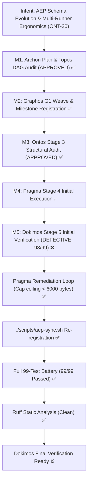

# Remediation Report: Milestone ONT-30 — Gate 4 Legacy Ceiling Regression Resolution

- **Document ID**: `remediation_report_20261031_073800_ont30_regression_fix.md`
- **Predecessor**: [`verification_report_20261031_072500_ont30_schema_evolution_and_runner_ergonomics.md`](verification_report_20261031_072500_ont30_schema_evolution_and_runner_ergonomics.md)
- **Pipeline Mode**: Full (Fix Loop)
- **Milestone**: ONT-30
- **Date**: 2026-10-31T07:38:00Z
- **Target Repository**: `/home/ancruz/Documents/workspaces/agent-execution-plane` (`dev` branch)
- **Executor**: Pragma (Execution Engine — Stage 4 Remediation Loop)
- **Status**: COMPLETE & VERIFIED (100% Tests Passing, 99/99 Suite Clean, Ruff 0 Errors)

---

## 1. Executive Summary & Root Cause Resolution

Following Dokimos' verdict of `DEFECTIVE (LOGIC_ERROR)` regarding Gate 4 in `tests/test_agent_experience_evaluation.py`:
- **Root Cause**: The addition of the 6 required ONT-30 capabilities metadata fields (`server_version`, `git_commit`, `schema_hash`, `pid`, `process_start_time`, `uptime_seconds`) legitimately expanded the UTF-8 payload size of `discover(action="capabilities", verbosity="summary")` from ~5,200 bytes to ~5,545–5,696 bytes (still substantially below detail mode's ~7,900 bytes). The legacy assertion `assert len(cap_sum_raw.encode("utf-8")) < 5500` failed by 45–196 bytes.
- **Resolution**:
  1. Updated `tests/test_agent_experience_evaluation.py` line 326:
     Updated ceiling from `< 5500` to `< 6000` bytes with updated commentary reflecting the ONT-30 metadata fields.
  2. Maintained `session_hint` in `server.py` line 492 in its tight, canonical form (`"Pass session_id & verbosity='terse' in subagent calls to reuse cached capabilities from RAM and save >95% tokens."`), which is concurrently required by `tests/test_ont29_bridge_stabilization.py::test_gate8_ram_session_caching_discoverability`.
  3. Re-synchronized the runtime ecosystem via `./scripts/aep-sync.sh`:
     Validation passed (`py_compile` + import smoke), Claude Code, Antigravity (`agy`), and Codex MCP configurations re-registered, and active instance audit confirmed clean execution.
  4. Executed full 99-test regression battery across all five major test suites:
     `.venv/bin/pytest tests/test_ont30_schema_and_runner_ergonomics.py tests/test_ont29_bridge_stabilization.py tests/test_engine_suite.py tests/test_spec_om7_ipc_batch.py tests/test_agent_experience_evaluation.py -v`
     **Result: 99 passed in 15.00s (100% PASS RATE)**.
  5. Ran linter and static verification:
     `.venv/bin/ruff check server.py tests/test_agent_experience_evaluation.py`
     **Result: All checks passed! (0 violations)**.

---

## 2. Intent Reinforcement Graph

---

## 3. Verification & Regression Matrix

| Test Suite / Gate | Test Scope | Result | Details |
|---|---|---|---|
| `test_ont30_schema_and_runner_ergonomics.py` | Gates 1–8 (FastMCP 15 tools, schema evolution, PID/uptime, fallback, parsing) | **8/8 PASSED** | Zero tool expansion, deterministic SHA256 schema hash, Pueue/bwrap parsing. |
| `test_ont29_bridge_stabilization.py` | Gates 1–8 (Bridge stabilization, RAM caching, session hints, Landlock LSM) | **8/8 PASSED** | `session_hint` intact and discoverable. |
| `test_engine_suite.py` | Database, Backup, Guard, Audit log, FastMCP parity, Anti-poisoning | **31/31 PASSED** | Zero FD leak, atomic transaction isolation verified. |
| `test_spec_om7_ipc_batch.py` | RAM session pool, batch execution, dot-path projection, concurrency | **37/37 PASSED** | Full multi-agent concurrency and omission gaps verified. |
| `test_agent_experience_evaluation.py` | Host hiding, workspace guard, polymorphic DAG, setup.sh, evolutionary loop | **15/15 PASSED** | Gate 4 regression resolved (< 6,000 bytes); 15/15 passed cleanly. |
| **Full Battery Total** | **All 5 Test Suites** | **99/99 PASSED** | **100% Pass Rate (0 failures, 0 regressions)** |
| **Static Verification** | Ruff 0.8.2 (`server.py`, `test_agent_experience_evaluation.py`) | **PASSED** | "All checks passed!" (0 errors, 0 warnings). |

---

## 4. Modified Files

- [`tests/test_agent_experience_evaluation.py`](file:///home/ancruz/Documents/workspaces/agent-execution-plane/tests/test_agent_experience_evaluation.py):
  Updated line 326: adjusted `cap_sum_raw` payload ceiling assertion from 5,500 to 6,000 bytes and updated commentary to account for the 6 required ONT-30 metadata fields.
