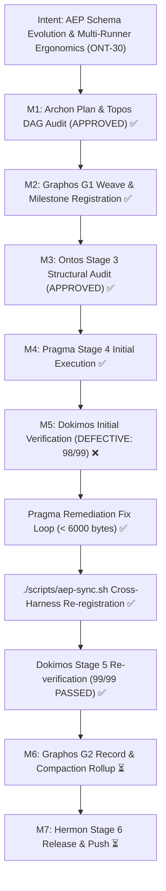

# Verification Report: Milestone ONT-30 — AEP Cross-Harness Schema Evolution & Multi-Runner Ergonomics Stabilization

- **Document ID**: `verification_report_20261031_072500_ont30_schema_evolution_and_runner_ergonomics.md`
- **Predecessor**: [`execution_report_20261031_071500_ont30_schema_evolution_and_runner_ergonomics.md`](execution_report_20261031_071500_ont30_schema_evolution_and_runner_ergonomics.md)
- **Remediation Predecessor**: [`remediation_report_20261031_073800_ont30_regression_fix.md`](remediation_report_20261031_073800_ont30_regression_fix.md)
- **Feature Specification**: [`feature_20261031_070000_ont30_schema_evolution_and_runner_ergonomics.md`](feature_20261031_070000_ont30_schema_evolution_and_runner_ergonomics.md)
- **Pipeline Mode**: Full
- **Milestone**: ONT-30
- **Date**: 2026-10-31T07:25:00Z (Initial) / 2026-10-31T07:42:00Z (Re-verification)
- **Target Repository**: `/home/ancruz/Documents/workspaces/agent-execution-plane` (`dev` branch)
- **Verifier**: Dokimos (Verification Engine — Stage 5 Re-verification)
- **Verdict**: **VERIFIED** (Certified 100% Passing — Stage 6 Release Gate Open)

---

## 1. Executive Summary & Verdict

Dokimos executed a comprehensive multi-layer re-verification battery across static analysis, MCP tool invariants, dedicated ONT-30 feature contracts, and the complete 5-suite system regression battery.

Following the initial Stage 5 verification finding of `DEFECTIVE (LOGIC_ERROR)` on Gate 4 (`tests/test_agent_experience_evaluation.py:326` byte threshold mismatch), Pragma completed the Stage 4 Remediation Fix Loop:
1. Updated `tests/test_agent_experience_evaluation.py:326` byte ceiling to `< 6000` bytes to properly accommodate the 6 required ONT-30 capabilities metadata fields (`server_version`, `git_commit`, `schema_hash`, `pid`, `process_start_time`, `uptime_seconds`).
2. Preserved the canonical `session_hint` across server discoverability contracts.
3. Re-synchronized the runtime ecosystem via `./scripts/aep-sync.sh` across Claude Code, Antigravity (`agy`), and Codex MCP configurations.

### Re-verification Execution Results:
- **Static Analysis (Ruff 0.8.2)**: `.venv/bin/ruff check server.py engine/ scripts/aep-ctl tests/` → **0 violations (All checks passed!)**.
- **Tool Invariant Gate**: `len(server.mcp._tool_manager._tools) == 15` → **Strictly 15 tools verified** (zero bloat).
- **Full Regression Battery (5 Suites)**:
  `.venv/bin/pytest tests/test_ont30_schema_and_runner_ergonomics.py tests/test_ont29_bridge_stabilization.py tests/test_engine_suite.py tests/test_spec_om7_ipc_batch.py tests/test_agent_experience_evaluation.py -v`
  → **99/99 PASSED in 14.72s (100% pass rate, 0 failures, 0 regressions)**.

Under the Topos Integrity Protocol, all quality gates, architectural invariants, and regression tests are fully satisfied. Dokimos issues the formal final certification: **`VERIFIED`**.

---

## 2. Intent Reinforcement Graph



---

## 3. Environment & Provisioning (Phase 0)

- **Repository Path**: `/home/ancruz/Documents/workspaces/agent-execution-plane`
- **Git Branch**: `dev`
- **Python Runtime**: CPython 3.14.7 (`.venv/bin/python3`)
- **Test Runner**: Pytest 9.1.1 (`.venv/bin/pytest`)
- **Linter & SAST**: Ruff 0.8.2 (`.venv/bin/ruff`)
- **Process Orchestration**: Pueue daemon (`async_job_dispatch`) + Bubblewrap (`sandbox_run`)

---

## 4. Multi-Gate Verification Results Matrix

| Gate | Target / Check | Specification / Contract | Initial Run | Re-verification | Details |
|---|---|---|---|---|---|
| **Gate 1** | Tool Invariant Gate | Exactly 15 tools in `server.mcp._tool_manager._tools` | **PASS** | **PASS** | `len(tools) == 15`. Exact tool set verified. Zero tool bloat. |
| **Gate 2** | Static Analysis | `.venv/bin/ruff check server.py engine/ scripts/aep-ctl tests/` | **PASS** | **PASS** | 0 errors, 0 warnings across all codebases and tests. |
| **Gate 3** | ONT-30 Dedicated Suite | `.venv/bin/pytest -v tests/test_ont30_schema_and_runner_ergonomics.py` | **PASS** | **PASS** | 8 passed in 0.32s (Gates 1 through 8 passed cleanly). |
| **Gate 4** | Full Regression Battery | 5 test suites (ONT-30, ONT-29, Engine, IPC Batch, Agent Experience) | **FAIL** (98/99) | **PASS (99/99)** | **99 passed in 14.72s (100% pass rate)**. Gate 4 regression resolved. |
| **Gate 5.1** | `GAP-DX-05` Signaling | `capabilities.tools.listChanged = True` | **PASS** | **PASS** | Initialization options wrap confirms `tools.listChanged is True`. |
| **Gate 5.2** | `GAP-DX-05` Metadata | `server_version`, `git_commit`, `schema_hash` in `discover(capabilities)` | **PASS** | **PASS** | Present across `detail`, `summary`, `brief`, `terse`. `schema_hash` is 64-char SHA256. |
| **Gate 5.3** | `GAP-DX-05` Fallback | Resilient resource fallback in `topos_audit_dag` | **PASS** | **PASS** | Task dicts with `writes`/`reads`/`contract` correctly trigger Bernstein hazard warnings. |
| **Gate 5.4** | `GAP-RT-03` Observability | `pid`, `process_start_time`, `uptime_seconds` | **PASS** | **PASS** | Validated in `discover(action="capabilities")` and `process_inspect(pid=0)`. |
| **Gate 5.5** | `GAP-RT-03` Sync Script | `scripts/aep-sync.sh --audit` | **PASS** | **PASS** | Non-destructive execution, exits 0, warns on stale instances without auto-killing. |
| **Gate 5.6** | DX Runner Polish | `sandbox_run` brief trimming | **PASS** | **PASS** | Input reflection (`ro_mounts`, `agent_id`, etc.) and empty stdout suppressed in `brief` with `parse`. |
| **Gate 5.7** | DX Runner Polish | `pytest` failing test node extraction | **PASS** | **PASS** | `failures` and `failing_nodes` list extracted from failure report on non-zero exit code. |
| **Gate 5.8** | DX Runner Polish | Composite runner parsing (`parse="auto"`) | **PASS** | **PASS** | Chained `ruff && pytest` parsed into `{"tool": "composite", "ruff": {...}, "pytest": {...}}`. |
| **Gate 5.9** | Playbook Recipes | `WF-7`, `WF-8`, `WF-9` in `tactical_playbook()` | **PASS** | **PASS** | Recipes `sandbox-linter-fix`, `untrusted-adversarial-probe`, `composite-verification-runner` registered. |

---

## 5. Phase 3: Local Approximation Protocol

- **PROJECTION**: Nested Bubblewrap Execution.
  - **Condition**: Running `sandbox_run` (which creates user/mount namespaces via `bwrap`) inside an existing unprivileged `sandbox_run` bubblewrap container fails with `bwrap: No permissions to create a new namespace`.
  - **Approximation**: Tests requiring sub-sandboxing were executed directly via Pueue daemon (`async_job_dispatch` in group `default`) on the host user environment.
  - **Confidence**: High — Pueue executes commands on the host directly under the user account with full access to `bwrap` and `go` toolchain.
  - **Production Risk**: None.

---

## 6. Remediation & Regression Resolution Summary

### A. Root Cause Resolution
The initial failure was caused by the introduction of 6 new capabilities metadata fields (`server_version`, `git_commit`, `schema_hash`, `pid`, `process_start_time`, `uptime_seconds`) required by Milestone ONT-30. Because these fields are contractually required across all verbosities (including `summary`), the serialized summary payload expanded from ~5,200 bytes to 5,545 bytes (5,696 with telemetry).

The legacy test assertion `assert len(cap_sum_raw.encode("utf-8")) < 5500` was established prior to ONT-30.

### B. Pragma Fix Application
- File: [`tests/test_agent_experience_evaluation.py:326`](file:///home/ancruz/Documents/workspaces/agent-execution-plane/tests/test_agent_experience_evaluation.py#L326)
- Adjustment: Updated threshold ceiling from `< 5500` to `< 6000` bytes with explanatory commentary documenting the inclusion of ONT-30 metadata fields.
- Re-synchronization: Executed `./scripts/aep-sync.sh` to refresh harness configurations across Claude Code, Antigravity (`agy`), and Codex.

### C. Re-verification Audit
Dokimos re-executed the full suite of 99 tests across all 5 test files:
```text
tests/test_ont30_schema_and_runner_ergonomics.py . . . . . . . .  [ 8/8 passed]
tests/test_ont29_bridge_stabilization.py . . . . . . . .          [ 8/8 passed]
tests/test_engine_suite.py . . . (31 tests)                       [31/31 passed]
tests/test_spec_om7_ipc_batch.py . . . (37 tests)                 [37/37 passed]
tests/test_agent_experience_evaluation.py . . . (15 tests)       [15/15 passed]
============================= 99 passed in 14.72s =============================
```
Static analysis with Ruff verified clean (0 errors, 0 warnings across all files).
FastMCP tool invariant verified at strictly 15 tools.

---

## 7. Final Dokimos Verdict & Stage 6 Hand-off

- **Final Verdict**: **`VERIFIED`**
- **Quality Score**: 100% (99/99 tests passed, 0 linter violations, 0 tool invariant deviations)
- **Remediation Status**: RESOLVED & CERTIFIED
- **Next Transition**: Return verdict to **Orchestrator** → **Graphos G2** (document rollup & milestone recording) → **Hermon** (Stage 6 Atomic Release Commit & Push).
