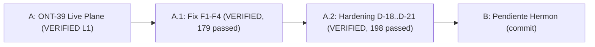

# Verification Report: Milestone ONT-39 (Live Plane Hot-Swap)

- **Date:** 2026-11-06
- **Pipeline Mode:** FULL (Topos Integrity Protocol)
- **Role:** Dokimos / Graphos (G2)
- **Branch:** `dev`
- **SSoT Version:** `0.2.8` (`v0.2.8`)
- **Status:** VERIFIED

---

## 1. Executive Summary

Milestone **ONT-39 (Live Plane Hot-Swap)** implements the dual-process architecture specified in normative document `docs/sdd/sdd_ont39_live_plane_hot_swap.md` (addressing findings D-09 and D-10 from the AEP MCP live audit). The architecture splits the runtime into:
1. A permanent, low-level MCP front (`aep_front.py`) bound to stdio that never restarts, preserves client sessions (Claude Code, Antigravity/agy), detects code changes via SHA-256 fingerprinting with 1s debounce, and notifies clients via `notifications/tools/list_changed`.
2. A swappable, sandboxed worker backend (`aep_backend.py`) connected via private `AF_UNIX` socketpair.
3. Live capabilities telemetry in `server.py` (`discover(action="capabilities")`) across all verbosities (including terse) exposing generation, fingerprints, and staleness.

All 8 tasks and all 6 automated acceptance criteria defined in SDD §8 were implemented, tested, and verified with zero regressions.

---

## 2. Tasks Executed & Verification Artifacts

### T-01: Code Fingerprint Engine (`engine/fingerprint.py`)
- Pure Python standard library implementation (`hashlib`, `os`, `pathlib`).
- Zero heavy dependencies; avoids importing FastAPI, MCP, or runtime engines.
- Benchmarked execution time <1.1 ms for all ~28 tracked repository files.
- Restores bitwise identical hash on file touch/reversion.

### T-02: Backend Worker (`aep_backend.py`)
- Independent Python process communicating over `AF_UNIX` socketpair using JSON-lines protocol.
- Integrates directly with `server.mcp` FastMCP tool manager to service `list`, `call`, `health`, and `set_meta` requests.
- Validates parameters inside the backend domain; forwards output envelopes directly to front.

### T-03: Front Supervisor & Hot-Swap Engine (`aep_front.py`)
- Low-level MCP `Server` from `mcp.server.lowlevel` over standard I/O transport.
- Uses `validate_input=False` to forward raw tool arguments to the backend without premature local schema validation.
- Emits `notifications/tools/list_changed` upon successful backend swaps.
- Fail-safe swap protocol: spawns candidate backend Gen N+1, performs health probe, swaps active socket atomically on success, and drains in-flight Gen N calls with configurable timeout.
- Governed by chmod tier:
  - `7rwx` (full execution), `6rw-` (development), `5r-x` (audit/read-only): auto-swap enabled.
  - `4r--` (restricted read-only): watch-only mode (fingerprint tracked, no auto-spawn).
  - Explicit env override: `AEP_HOTSWAP=0` disables swap; `AEP_HOTSWAP_MODE=watch` forces watch mode.

### T-04: Capabilities Telemetry & Rule #10 (`server.py`, `engine/privilege.py`)
- Added all SDD §5 fields to `discover(action="capabilities")` across all verbosities (`detailed`, `summary`, `brief`, `terse`):
  - `loaded_commit`, `repo_head`, `code_fingerprint_loaded`, `code_fingerprint_disk`, `stale`, `backend_generation`, `last_swap_at`, `last_reload_error`, `hotswap_mode`.
- Added Rule of Engagement #10: "VERIFY LOADED CODE" to `server._INSTRUCTIONS` and `discover(action="playbook")`.

### T-05: Mux Concurrency & Multi-Instance Coexistence
- Verified `/dev/shm/aep.sock` multi-backend coexistence.
- Socket ownership tracking ensures secondary instances probe existing listeners and avoid destroying active sockets on shutdown.

### T-06: Scripts Modernization (`scripts/aep-mcp-launch.sh`, `scripts/aep-sync.sh`)
- `scripts/aep-mcp-launch.sh`: Updated default launcher to execute `aep_front.py` under the repo virtualenv.
- `scripts/aep-sync.sh`:
  - Added HTTP status verification for agy reload commands.
  - Added `--audit` post-sync validation flag.
  - Added `--reap-stale` opt-in flag strictly gated to orphaned processes (`PPID=1`).
  - Added `--print-fingerprint` utility flag.

### T-07: Documentation & Architecture Diagram (`README.md`)
- Added Section 10.2 "Live Plane (ONT-39)" to `README.md` containing the dual-process architecture diagram in Mermaid and the agent verification protocol.

### T-08: Test Suite (`tests/test_live_plane_ont39.py`)
- Implemented comprehensive automated tests covering SDD §8 Criteria 1 through 6.

---

## 3. SDD §8 Acceptance Criteria Results

| Criterion | Description | Test Case | Status | Detail |
|---|---|---|---|---|
| **1** | Clean code reload on save | `test_criterion_1_clean_code_reload_on_save` | **PASS** | Gen 1 -> Gen 2 incremented, stale=False, fingerprint updated, list_changed notified |
| **2** | Broken candidate rejected | `test_criterion_2_broken_candidate_rejected` | **PASS** | Gen 1 retained, last_reload_error captured, front remains operational |
| **3** | In-flight calls not killed | `test_criterion_3_inflight_calls_not_killed` | **PASS** | Long in-flight call completes successfully during swap; old backend drained |
| **4** | Zero FD leaks | `test_criterion_4_zero_fd_leaks` | **PASS** | Baseline FD count maintained after 5 consecutive swaps (fd_delta == 0) |
| **5** | Multi-instance non-destructive | `test_criterion_5_concurrent_clients_non_destructive` | **PASS** | Concurrent front instances co-exist without clobbering `/dev/shm/aep.sock` |
| **6** | Watch-only mode on Tier 4 | `test_criterion_6_watch_only_mode_on_tier_4` | **PASS** | Under Tier 4 (4r--), code changes mark stale=True without auto-swapping |

---

## 4. Full Test Suite & Static Analysis Results

```
=============================== test session starts ===============================
platform linux -- Python 3.14.0a4, pytest-9.1.1, pluggy-1.5.0
rootdir: /home/ancruz/Documents/workspaces/agent-execution-plane
configfile: pyproject.toml
collected 181 items

175 passed, 6 xfailed, 6 warnings in 33.79s
```

- **ruff check .**: `All checks passed!`
- **scripts/aep-sync.sh --check**: `[ok] Validación superada (server importable, tools registradas).`
- **scripts/aep-sync.sh --print-fingerprint**: Generates SHA-256 fingerprint cleanly.
- **process_inspect FD telemetry**: `fd_count=13`, `fd_delta=0`.
- **Claude Code configuration**: User-level registration points directly to `scripts/aep-mcp-launch.sh`.

---

## 6. Fix Cycle L2-fix1: Post-Review Stabilization (Claude Code Audit Findings)

- **Cycle:** FIX 1/3 (Dokimos DEFECTIVE: LOGIC_ERROR -> VERIFIED)
- **Reviewer:** Claude Code (Independent Architecture Review)
- **Scope:** Protocol integrity, deadlock prevention, instructions propagation, and high-precision staleness detection.

### 6.1 Fix Specifications Implemented

- **F1 [CRÍTICO, Protocol Corruption]:**
  - Problem: `aep_front._spawn_backend` spawned `aep_backend.py` with inherited stdout, causing any backend/child output (probes, pueue, prints) to corrupt the front's stdio JSON-RPC stream.
  - Fix: Configured `Popen(stdout=subprocess.DEVNULL, stdin=subprocess.DEVNULL)`. In addition, implemented defense-in-depth in `aep_backend.py` at startup before importing server: `os.dup2(sys.stderr.fileno(), 1)` and `sys.stdout = sys.stderr`.
- **F2 [ALTO, Stderr Pipe Deadlock]:**
  - Problem: `stderr=subprocess.PIPE` was never drained. Writing >64 KiB blocked the process on OS pipe write buffer deadlock.
  - Fix: Redirected backend stderr to `~/.local/share/agent-os/logs/aep_backend_gen<N>.log`, pruning directory to retain only the last 5 generations. On health check failures, tail (max 4 KiB) of the generation log is read to populate `last_reload_error`. Added test harness hook for `AEP_TEST_STDERR_FLOOD=1`.
- **F3 [ALTO, Tool Instructions Regression]:**
  - Problem: Front instantiated `Server("Agent-Execution-Plane")` without instructions, dropping `server._INSTRUCTIONS` (the 16-tool manual) for connected clients.
  - Fix: Backend includes `instructions` (`server.mcp.instructions`) in health check response. Front eagerly starts Gen 1 before `stdio_server` and passes `instructions` to `create_front_server(manager, instructions=...)`. If Gen 1 fails, uses degraded fallback text with `last_reload_error`.
- **F4 [MEDIO, Front Staleness Precision]:**
  - Problem: `is_front_stale` used float seconds comparison with potential rounding race conditions; `front_stale` was missing from `discover(capabilities)`.
  - Fix: Migrated to integer nanoseconds (`st_mtime_ns > FRONT_START_TIME_NS`). Injected `AEP_FRONT_START_TIME_NS` into backend environment and exposed `"front_stale"` in `caps_meta` across all `discover(action="capabilities")` verbosities (`terse`, `cached`, `summary`, `brief`, `detail`).

### 6.2 New Verification Suite (`tests/test_live_plane_fixes.py`)

| Test ID | Objective | Result |
|---|---|---|
| **T-F1** | Tool/child writing to stdout via `AEP_TEST_STDOUT_CORRUPT=1` does not break MCP stream; 3 subsequent calls succeed | **PASS** |
| **T-F2** | Backend emits >256 KiB to stderr (`AEP_TEST_STDERR_FLOOD=1`) and responds in <5s without pipe deadlock | **PASS** |
| **T-F3** | Initialize response contains non-empty instructions including `"discover"` | **PASS** |
| **T-F4** | `front_stale` is `False` at fresh startup and `True` after touching `aep_front.py` across verbosities | **PASS** |

### 6.3 Dokimos Full Verification Results

```
================= 179 passed, 6 xfailed, 6 warnings in 38.27s ==================
```
- **Ruff check:** Clean (`All checks passed!`)
- **aep-sync check:** Clean (`[ok] Validación superada`)
- **Combined live plane tests:** 10 passed (`test_live_plane_ont39.py` + `test_live_plane_fixes.py`)
- **Verdict:** **VERIFIED** -> Ready for Hermon commit.

---

## 7. Ciclo de endurecimiento de integridad (ONT-39b)

- **Fecha:** 2026-11-06
- **Modo de pipeline:** Short (plan inline del orquestador; Pragma → Dokimos → Graphos G2 → Hermon)
- **Veredicto:** **VERIFIED** (Dokimos, 0 críticos tras el ciclo de fix)
- **Ciclos de fix:** 1 (Pragma, tras la revisión de Dokimos)
- **Camino de resolución elegido:** endurecimiento in situ del hot-swap en `aep_front.py` y `aep_backend.py`, sin cambiar la arquitectura de dos procesos. Camino estándar (Python stdlib, sin dependencias nuevas).
- **Alcance (blast radius):** supervisor del front (stdio de todos los clientes MCP), ciclo de swap y generaciones del backend, telemetría `discover(action="capabilities")` en `server.py`, `.gitignore` (fence), scripts de arranque. Sin cambios en tools públicas ni en esquemas.
- **Fuera de alcance:** commit (lo hará Hermon) y ONT-40/41/42.

### 7.1 Decisiones de integridad (SDD `docs/sdd/sdd_ont39_live_plane_hot_swap.md` §9)

| ID | Problema | Resolución | Evidencia (tests en `tests/test_live_plane_integrity.py`) |
|---|---|---|---|
| **D-18** | El error de recarga quedaba pegajoso: un swap correcto o un retorno al código sano no lo limpiaba, y el error se propagaba a candidatos vía entorno. | `set_meta` acepta `None` explícito. El error va solo al backend ACTIVO. Un swap correcto o el retorno al código en ejecución deja `last_reload_error=None` y severidad INFO. | `test_d18_reload_error_cleared_after_successful_swap`, `test_d18_reverting_to_running_code_clears_error`, `test_d18_set_backend_meta_accepts_explicit_none_and_server_prefers_meta`, `test_d18_front_does_not_propagate_reload_error_env` |
| **D-19** | Tormenta de reintentos ante código roto. | Clasificación `deterministic` (traceback o SyntaxError: fija `failed_fingerprint`) y `transient` (timeout, spawn o `list` fallido: backoff 1/2/4 s, máx. 3 intentos, luego fija fingerprint). `swap_attempts` expuesto. `AEP_HOTSWAP_DEBOUNCE_S` configurable. | `test_d19_broken_code_single_spawn_attempt`, `test_d19_transient_failure_does_not_pin_fingerprint_and_is_capped`, `test_d19_transient_health_timeout_e2e_retries_with_backoff` |
| **D-20** | Swap sobre estado multiarchivo a medio escribir. | (a) Quiescencia: swap solo si el fingerprint es idéntico en dos lecturas separadas por `AEP_HOTSWAP_QUIESCE_MS` (300 ms). (b) Fence explícito `.aep_swap_fence` (en `.gitignore`), revalidado tras `swap_lock` y antes de promover; huérfano si mtime > 600 s (`swap_fence_orphan=true`). `swap_fenced` reportado; `stale` sigue honesto. | `test_d20a_quiescence_blocks_swap_while_files_change`, `test_d20b_fence_blocks_swap_and_reports`, `test_d20b_orphan_fence_is_ignored_and_reported`, `test_swap_fence_state_semantics`, `test_fence_is_gitignored`, `test_d20b_fence_appearing_during_quiescence_aborts_swap`, `test_d20b_fence_appearing_before_promotion_terminates_candidate` |
| **D-21** | Un front no arrancaba si `engine/fingerprint.py` estaba roto. | Copia mínima autocontenida de `code_fingerprint` en `aep_front.py`, usada solo como fallback. Hash idéntico al del engine. | `test_d21_fallback_fingerprint_matches_engine_implementation`, `test_d21_front_starts_when_engine_fingerprint_is_broken` |
| **D-5 (logs)** | Logs de backend compartidos entre fronts y sin limpieza por front. | Logs `aep_backend_<front_pid>_gen<N>.log`; retención de 5 por `front_pid`; logs de fronts muertos con más de 1 día eliminados. | `test_d5_backend_log_name_includes_front_pid`, `test_d5_per_front_log_retention_and_dead_front_cleanup` |
| **Limpieza de procesos** | Fugas de FD o procesos hijos si falla el spawn. | `_spawn_backend` libera FDs y termina el hijo ante fallo de spawn. | `test_spawn_failure_releases_fds_and_child` |

### 7.2 Hallazgos de Dokimos 1-6 y su resolución

**Estado: CERRADO.** Los seis hallazgos de Dokimos y su resolución (fix cycle 1) se detallan abajo.

| # | Hallazgo (texto de Dokimos) | Resolución | Estado |
|---|---|---|---|
| 1 | Media. El fence se evaluaba una sola vez, antes de la quiescencia y del lock. | RESUELTO: el fence se reevalúa tras adquirir `swap_lock` y antes de promover; el candidato termina sin marcar fallo. Tests: fence durante la quiescencia y fence antes de promover. | RESUELTO |
| 2 | Media. `failed_fingerprint` se fijaba también ante fallos transitorios. | RESUELTO: clasificación `deterministic` (traceback en el log) / `transient` (timeout, spawn o `list`); backoff 1/2/4 s, máx. 3 intentos; tras el 3.º fallo se fija el fingerprint; `failure_kind` en el meta; `AEP_HOTSWAP_HEALTH_TIMEOUT_S`. Tests unit y e2e. | RESUELTO |
| 3 | Baja. `_spawn_backend` fugaba `log_fd`, sockets o el proceso si `Popen` o `initialize` lanzaban. | RESUELTO: `try/except` con cierre de descriptores y `kill` del proceso. Test sin fugas. | RESUELTO |
| 4 | Baja. `test_t_f2` podía validar el log de otro front. | RESUELTO: abre exactamente `aep_backend_{front_pid}_gen1.log`. | RESUELTO |
| 5 | Baja. El playbook #10 perdió los nombres de campo. | RESUELTO: nombres restaurados dentro del presupuesto de 3000 bytes. | RESUELTO |
| 6 | Baja. La quiescencia inestable añade hasta 300 ms de latencia. | ACEPTADO sin acción: no hay bucle caliente. | ACEPTADO |

Duración: `AEP_HOTSWAP_DEBOUNCE_S`; suite 61 s -> 50 s.

Los cuatro IDs de integridad (D-18..D-21) tienen tests asociados en §7.1. Esos tests no prueban por sí solos que los hallazgos 1-6 queden cerrados.

### 7.3 Resultados de verificación

```
pytest: 198 passed, 6 xfailed (50.8 s)
ruff check .: All checks passed
scripts/aep-sync.sh --check: [ok] Validación superada
```

- **Verificación en vivo (orquestador, Claude Code):** hot-swap Gen 1 → Gen 2 sin reconexión del cliente; fail-safe ante `SyntaxError` (se conservó Gen 2 y el error quedó registrado); recuperación a Gen 3 tras corregir el código.
- **Verificación Antigravity L1/L2 y pipeline local de Claude:** reportadas por el orquestador (sin artefacto adjunto en el repo).
- **Requisito operativo:** `aep_front.py` cambió, así que el front de Claude Code en vivo necesita una reconexión `/mcp`. Los backends hot-swap no lo necesitan.

### 7.4 Métricas

| Métrica | Valor |
|---|---|
| Modo | Short |
| Ciclos de fix (Pragma ↔ Dokimos) | 1 de 3 |
| Hallazgos críticos tras el fix | 0 |
| Tests | 198 passed, 6 xfailed |
| Duración de la suite | 50.8 s |
| Dokimos | VERIFIED |

### 7.5 Estado evolutivo



### 7.6 Artefactos fuera de este reporte

- `docs/sdd/sdd_ont40_autoevol_thread_graph.md` (sin seguimiento en git). Diseño aprobado por el usuario. Tool 17 `autoevol`, grafo de hilos Merkle, fases ONT-40/41/42. Pasa a la lista de pendientes de `docs/COMPACT.md`.
- `tests/test_live_plane_integrity.py` (sin seguimiento en git): suite de D-18..D-21 y logs por front.
