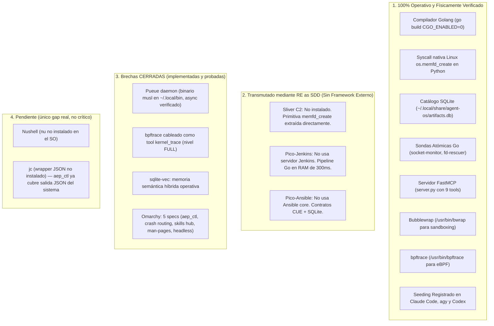
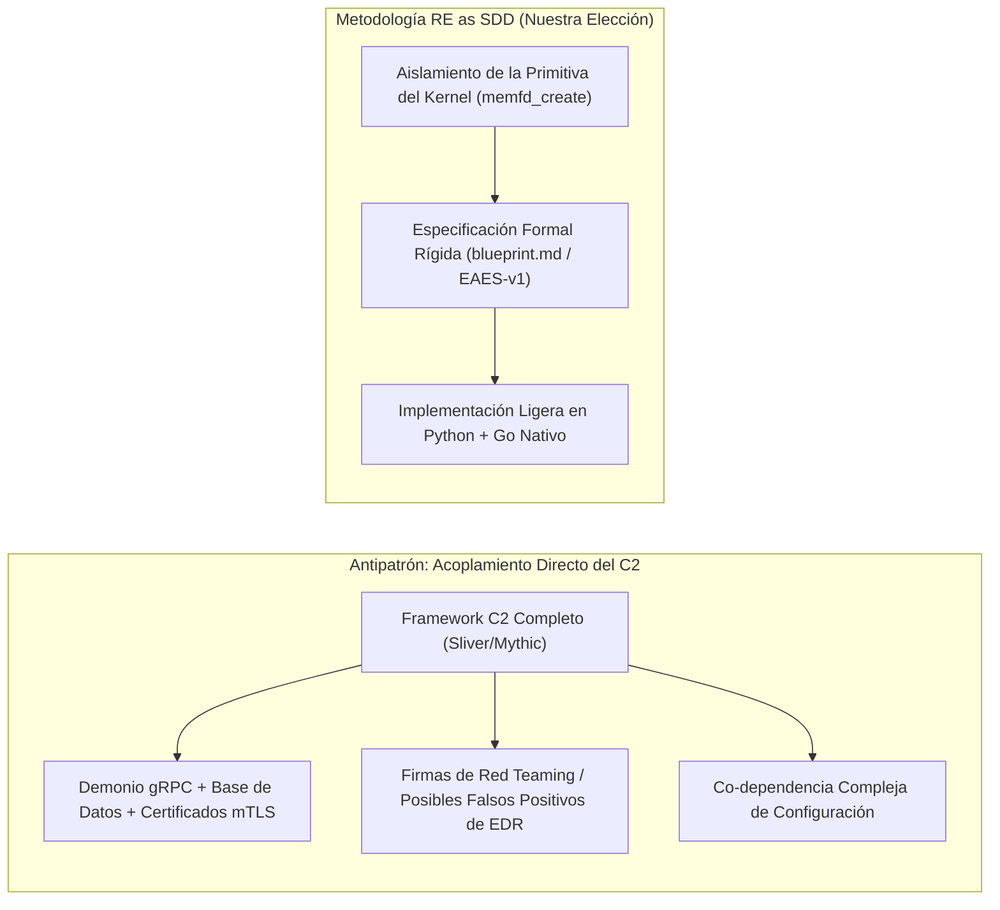
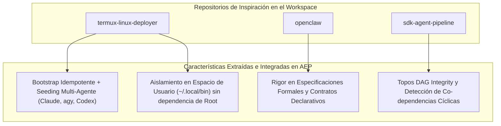

# Análisis de Fuente de la Verdad, Metodología RE as SDD y Matriz de Inspiración

> **Fecha:** 2026-10-22  
> **Estado:** Documentación Técnica Maestra  
> **Ámbito:** Agent Execution Plane (AEP) — Ubuntu Linux Runtime

---

## 1. Inventario Sincero de la Fuente de la Verdad (Ground Truth Audit)

Para mantener la integridad epistemológica del proyecto y evitar que futuros agentes de IA o desarrolladores asuman funcionalidades inexistentes, este inventario desglosa con exactitud quirúrgica qué está físicamente operativo en el sistema, qué fue transmutado mediante ingeniería inversa (RE) y qué permanece pendiente de instalación o cableado.

### Tabla de Desglose de Componentes

| Componente | Proyectado en Documento Inicial | Estado Físico Real | Mecanismo Implementado | Brecha / Acción Requerida |
| :--- | :--- | :--- | :--- | :--- |
| **Sliver C2** | Instalar servidor completo con `curl \| bash`, base de datos y mTLS. | **Descartado el framework.** Primitiva extraída. | Syscall `os.memfd_create` nativa en Python 3 + `/proc/self/fd/<fd>`. | **Ninguna.** La primitiva fue implementada en su forma más pura y eficiente sin la sobrecarga ofensiva. |
| **Bubblewrap** | Sandbox efímero para pruebas. | **Instalado y Operativo.** | `/usr/bin/bwrap` invocado por `sandbox_run` en `server.py`. | **Ninguna.** Opera con namespaces nativos de Linux. |
| **bpftrace (eBPF)** | Observabilidad de kernel. | **Operativo (nivel FULL).** | Tool `kernel_trace` (syscall_count/file_opens/tcp_connect) con escalada `sudo -n` acotada a sondas de solo-lectura. | **Cerrada.** Degrada a `DIMINISHED` sin privilegio. |
| **Pico-Jenkins** | Pipeline de compilación y verificación. | **Instalado y Operativo.** | `go build` + `go vet` + `golangci-lint` advisory + inyección en RAM en < 300 ms. | **Cerrada.** `golangci-lint` 2.15 en `~/.local/bin`. |
| **Pico-Ansible** | Catálogo declarativo de gestión. | **Instalado y Operativo.** | SQLite (`artifacts.db`) + `engine/catalog.py` + memoria semántica `sqlite-vec`. | **Cerrada.** Recuperación híbrida 2-tier. |
| **Topos Guard** | Detector de co-dependencias. | **Instalado y Operativo.** | `engine/topos_guard.py` ejecutando algoritmo DFS de detección de ciclos en grafos DAG. | **Ninguna.** Probado con aserciones unitarias. |
| **Pueue Daemon** | Colas de tareas asíncronas. | **100% Operativo.** | Binario musl 4.0.4 en `~/.local/bin` (sin sudo); `async_job_dispatch`/`async_job_inspect` verificados. | **Cerrada.** |
| **Memoria semántica (`sqlite-vec`)** | — | **100% Operativo.** | `vec0` + `engine/embedder.py` (bge-small-en-v1.5 ONNX, 384-dim, offline). | **Cerrada.** Umbral 0.32 calibrado empíricamente. |
| **Omarchy (5 specs)** | Patrones Arch/Hyprland. | **100% Operativo.** | `aep_ctl`, `check_crash_alerts`, hub+Codex, `query_system_docs`, `visual_inspect`. | **Cerrada.** |
| **Nushell (`nu`) / `jc`** | Tuberías/parsing JSON de shell. | **No instalado (único gap real).** | `sys_json`/`jrun` en `~/.zshenv` inertes. | **Gap no crítico:** `aep_ctl` ya entrega JSON tipado del sistema. |

---

## 2. Justificación de "RE as SDD" (Reverse Engineering as Specification-Driven Development)

Una de las decisiones más críticas de este proyecto fue **no instalar ciegamente las herramientas de ciberseguridad ofensiva** (Sliver C2, Havoc, Mythic) a pesar de haberlas citado como fuente de inspiración.

### ¿Por qué aplicamos Ingeniería Inversa Orientada por Especificaciones?

1. **Eliminación del Peso Muerto:**
   * Un framework C2 como Sliver incluye generadores de payloads para Windows (evasión de AMSI, NTDLL unhooking), protocolos de ofuscación de tráfico (DNS tunneling, WireGuard multiplexing) y gestión multi-operador. 
   * Para un agente de IA en un entorno local de Ubuntu, el 95% de ese código es **peso muerto** que consume memoria, introduce vectores de fallo y añade latencia.
2. **Prevención de Co-dependencias (Protocolo Topos):**
   * Instalar un C2 completo crea una relación de co-dependencia ($A \otimes B$) entre la infraestructura del agente y el demonio C2. Si el servidor gRPC de Sliver se corrompe o requiere renovación de certificados de operador, la IA queda completamente ciega e incapaz de operar el sistema.
   * Al extraer la primitiva pura (`memfd_create` nativo en el kernel), la herramienta se convierte en una **dependencia unidireccional limpia ($A \to B$)**, sin estado oculto ni demonios externos frágiles.
3. **El Rol de la Especificación (SDD - Specification-Driven Development):**
   * En lugar de depender de la documentación dispersa de herramientas de terceros, creamos una especificación formal (**EAES-v1** en `docs/spec_artifact_engine.md`).
   * La especificación define los contratos en **CUE** y las garantías de compilación estática. Esto permite que cualquier modelo de lenguaje (sea Gemini, Claude o Codex) comprenda de inmediato las restricciones formales sin alucinar parámetros inexistentes.

---

## 3. Matriz de Inspiración Arquitectónica (Repositorios de Referencia)

Para solventar las lagunas de las características y diseñar un plano de ejecución verdaderamente funcional, sintetizamos los mejores patrones de tres proyectos clave del espacio de trabajo:

### 3.1. Lecciones de `termux-linux-deployer`
* **El Patrón de Seeding Idempotente:** De `scripts/ubuntu/setup-mcp.sh` adoptamos la técnica de consultar la existencia de clientes de IA (`claude`, `agy`, `codex`) y registrar de forma transversal e idempotente el servidor MCP mediante sus comandos CLI nativos, sin duplicar entradas ni romper archivos de configuración preexistentes.
* **Aislamiento en Espacio de Usuario:** `termux-linux-deployer` resuelve la instalación de herramientas en entornos con restricciones de privilegios (como Android/proot o entornos no-root) utilizando `~/.local/bin` y compilaciones estáticas, una lección directa para subsanar la ausencia de `sudo` en esta sesión.

### 3.2. Lecciones de `openclaw`
* **Cultura de Especificación Formal (`AGENTS.md` / `VISION.md`):** En `openclaw`, ninguna funcionalidad se programa sin un contrato previo que defina invariantes y objetivos. En AEP adoptamos esta disciplina mediante la especificación canónica **EAES-v1** y la redacción estricta de diagramas de estado.
* **Aislamiento de Entorno de Ejecución:** El uso de entornos reproducibles con configuraciones de linters estrictas (`.oxlintrc.json`, `.semgrepignore`) inspiró la integración de `golangci-lint` en modo JSON dentro de nuestro Pico-Jenkins.

### 3.3. Lecciones de `sdk-agent-pipeline`
* **Topos DAG Integrity:** De este proyecto heredamos la disciplina ontológica: la clasificación formal de relaciones entre módulos (**Dependencia**, **Interdependencia**, **Co-dependencia**).
* **Guardián de Circuitos (`ToposGuard`):** La implementación de `engine/topos_guard.py` proviene directamente de la necesidad identificada en `sdk-agent-pipeline` de validar matemáticamente que los grafos de ejecución no tengan ciclos antes de que un agente despache tareas concurrentes a los trabajadores.

---

## 4. Hoja de Ruta: Estado de Cierre de Brechas (actualizado)

Casi toda la hoja de ruta original está **ejecutada y verificada**:

1. **Binarios estáticos en `~/.local/bin` (sin sudo):**
   * ✅ `pueue`/`pueued` musl 4.0.4 descargados; demonio activo; `async_job_dispatch` verificado.
   * ⏳ `nu` (Nushell) — **pendiente** (único gap, no crítico).
   * ⏳ `jc` — **pendiente** (no crítico: `aep_ctl` ya entrega JSON tipado del sistema).
2. **Cableado de la sonda eBPF:** ✅ tool `kernel_trace` con `tracepoint:raw_syscalls:sys_enter`, `syscalls:sys_enter_openat` y `kprobe:tcp_connect`, con escalada `sudo -n` (nivel FULL).
3. **Validación End-to-End:** ✅ ciclo completo probado (MCP → catálogo SQLite/sqlite-vec → compilación Go → inyección en RAM → JSON tipado), más probes por cada tool nueva.

**Entregado más allá de la hoja original:** memoria semántica `sqlite-vec` (recuperación híbrida), las 5 specs de Omarchy (`aep_ctl`, crash routing, man-pages vectorizer, headless display, hub+Codex), modelo de privilegio de dos niveles (FULL/DIMINISHED) con manifiesto auto-descriptivo `aep_capabilities`, y auto-plug del MCP (`aep-sync.sh` + launcher estable). Servidor MCP: **9 → 15 tools**.
