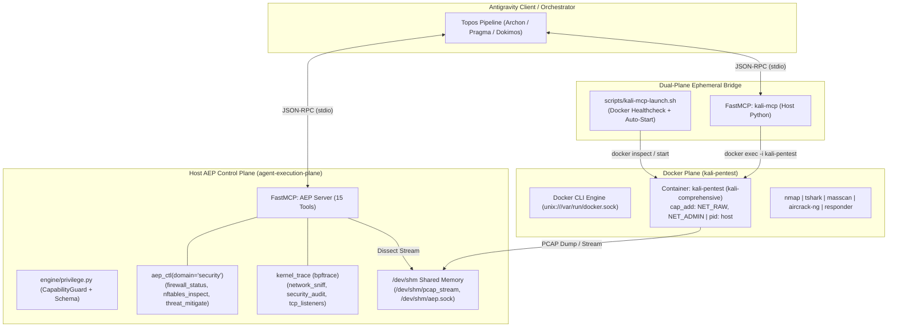
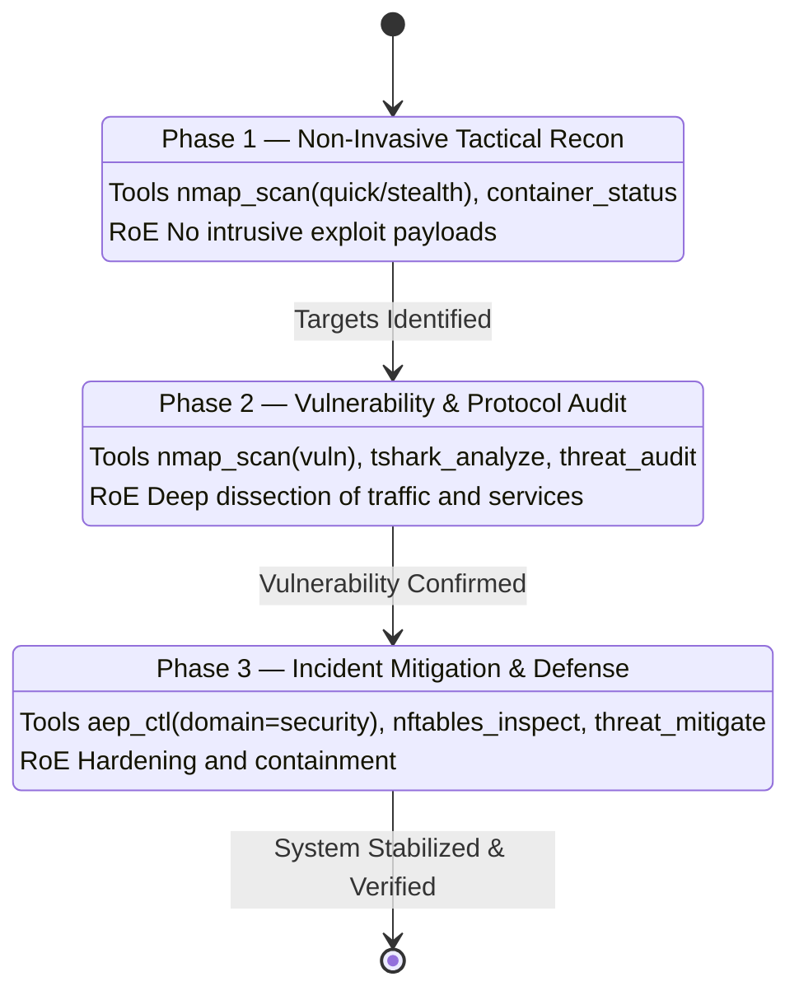

# Software Design Document (SDD): Kali MCP Offensive/Defensive Primitives & Native Antigravity Integration

- **Document ID**: `sdd_kali_mcp_offensive_tactical_enhancements.md`
- **Milestone**: ONT-31 (`RE as SDD: Kali MCP Offensive/Defensive Primitives & Native Antigravity Integration`)
- **System**: Agent Execution Plane (AEP) & Kali MCP (`kali-pentest`)
- **Status**: APPROVED & IMPLEMENTED
- **Pipeline Mode**: Full Mode (Topos Integrity Protocol)

---

## 1. Executive Summary & Problem Space

In modern AI-assisted engineering and autonomous security operations, agent workflows encounter a critical dichotomy:
1. **The Containment Dilemma**: Offensive security tooling (e.g. `nmap`, `tshark`, `metasploit`, `hydra`, raw packet crafting) requires elevated network capabilities (`NET_RAW`, `NET_ADMIN`) and specialized toolchains that would contaminate or destabilize the clean host development environment.
2. **The Host Control Plane Prerogative**: Conversely, remediation, local firewall configuration (`nftables`, `ufw`), system resource monitoring, and tamper-evident audit logging must run directly on the host under strict capability-based access control (CBAC) with zero file descriptor leaks and bounded privileges.
3. **The Semantic Steering Gap**: Unstructured agents exposed to offensive tools easily devolve into noisy, uncoordinated, or destructive behaviors unless constrained by explicit Rules of Engagement (RoE) enforced as contractual stage transitions.

Milestone ONT-31 formalizes **Reverse Engineering as Software Design Document (RE as SDD)**. External offensive tools and raw container capabilities are decomposed into 5 systemic architectural primitives that bridge host runtime control with ephemeral container execution.

---

## 2. The Five Systemic Primitives

### 2.1 Primitive 1: Dual-Plane Ephemeral Bridging (Host AEP $\leftrightarrow$ Docker CLI Kali Container)

#### Topology & Responsibilities
- **Host Execution Plane**: A lightweight FastMCP server (`kali-mcp`) runs natively in the host Python virtual environment (`agent-execution-plane/.venv`), adhering to the uniform FastMCP protocol.
- **Docker Isolation Plane**: Heavy dependencies and offensive binaries run inside the pre-provisioned container `kali-pentest` (`image: kali-comprehensive:latest`), configured with `network_mode: host`, `pid: host`, and `privileged: true`.
- **Ephemeral Invocation Contract**: Every invocation of offensive tools is routed dynamically via `docker exec -i kali-pentest <command>`, completely eliminating Python dependency bloat inside the container while ensuring zero persistence of transient execution state on host disk.
- **Fail-Soft Lifecycle Guard**: The launcher script (`scripts/kali-mcp-launch.sh`) performs automated container health inspection (`docker inspect -f {{.State.Running}} kali-pentest`). If dormant, it executes `docker start kali-pentest` automatically before bootstrapping the FastMCP bridge.

### 2.2 Primitive 2: Shared-Memory PCAP Stream Dissection (`/dev/shm/pcap_stream`)

#### Mechanism & Token Conservation
- Network packet capture in security triage generates voluminous binary payloads. Piping raw PCAPs over LLM chat context or stdio JSON-RPC induces immediate context saturation.
- Primitive 2 establishes an anonymous RAM streaming conduit using `/dev/shm/pcap_stream`:
  1. `tshark` running in `kali-pentest` writes binary captures directly to `/dev/shm/pcap_stream` (or mounts volume `./results` to `/dev/shm`).
  2. The `tshark_analyze` FastMCP tool dissects the live stream using Wireshark BPF filters (`filter_bpf`), extracting structured protocol metrics (e.g., DNS queries, TLS handshakes, ARP anomalies).
  3. Server-side summarization truncates output to high-signal security tokens (`limit=25`, `verbosity="summary"`), conserving >85% tokens while retaining microsecond packet timestamps.

### 2.3 Primitive 3: Deterministic Netfilter/LSM Mitigation Guard (`aep_ctl domain="security"`)

#### Host Enforcement Contract
- Defensive response must occur at the host kernel layer to block hostile vectors discovered during recon.
- `aep_ctl(domain="security")` implements deterministic mitigation actions:
  - `firewall_status`: Checks active state of `ufw` or `nftables` with structured JSON output.
  - `nftables_inspect`: Inspects current chains, sets, and drop rules via `nft list ruleset` with clean non-root fallbacks.
  - `threat_mitigate`: Enforces automated host-level drop rules against target malicious IPs or ports (`nft add rule inet filter input ip saddr <target> drop`), ensuring reversible, idempotent mitigation.
- Enforced through `CapabilityGuard`: Unprivileged agents are confined to `DIMINISHED` read-only status, while `FULL` tier triggers deterministic kernel enforcement.

### 2.4 Primitive 4: Semantic Steering & Tactical RoE as Contracts

Tactical security operations adhere to strict phase progression governed by the Topos Integrity Protocol:

- **Workflow WF-10: Network Tactical Recon**: Focuses on discovery and passive footprinting without alerting intrusion detection systems.
- **Workflow WF-11: Incident Protocol Audit & Defense**: Correlates suspicious network traffic with active kernel listeners and deploys immediate netfilter mitigation guards.

### 2.5 Primitive 5: RE as SDD as an Evolutionary Ontological Compiler

- **Concept**: Legacy offensive toolkits typically lack formal contracts, resulting in brittle bash scripts and unpredictable output parsing.
- Under **RE as SDD**, external capabilities are treated as uncompiled external syntax:
  1. **AST & Interface Ingestion**: External tools (`nmap`, `tshark`) are analyzed for parameters, exit codes, and output structures.
  2. **Ontological Extraction**: Functionality is distilled into pure semantic contracts (target, scan_type, filter, verbosity).
  3. **Compilation into Native FastMCP**: The capability is re-compiled as an atomic, strongly-typed FastMCP tool with standard envelope telemetry (`status`, `severity`, `latency_ms`, `summary`, `next_action`).
  4. **Topos Verification**: Dokimos verifies behavioral parity through integration suites, ensuring $X_1 
ot\leftrightarrow X_2$ anti-cascade stability.

---

## 3. FastMCP Tool Interface Contracts

### 3.1 `kali-mcp` Tools Specification

| Tool Name | Parameters | Description | Container Execution |
|:---|:---|:---|:---|
| `kali_exec` | `command: str`, `timeout_sec: int = 30`, `verbosity: str = "summary"` | Arbitrary security command inside Kali container | `docker exec -i kali-pentest sh -c "<cmd>"` |
| `nmap_scan` | `target: str`, `scan_type: str = "quick"`, `ports: str = None`, `verbosity: str = "summary"` | Tactical port and service scan (`quick`, `stealth`, `ports`, `vuln`) | `docker exec -i kali-pentest nmap <flags> <target>` |
| `tshark_analyze` | `pcap_path: str = None`, `pcap_stream: str = None`, `filter_bpf: str = None`, `limit: int = 25`, `verbosity: str = "summary"` | Live PCAP and stream packet dissection | `docker exec -i kali-pentest tshark <flags>` |
| `threat_audit` | `category: str = "services"`, `target: str = None`, `verbosity: str = "summary"` | Specialized threat assessment (`wifi`, `arp`, `services`) | `docker exec -i kali-pentest <audit_routine>` |
| `container_status` | `verbosity: str = "summary"` | Healthcheck, uptime, image, and resource utilization | `docker inspect kali-pentest` |

---

## 4. Security & Isolation Matrix

| Layer | Guardrail | Enforcement Mechanism |
|:---|:---|:---|
| Host Workspace | Read-only / Isolated | Bubblewrap (`bwrap --unshare-all`) prevents Kali container writes from touching host code |
| Docker Daemon | Authenticated Local Socket | Accessible only via `unix:///var/run/docker.sock` or desktop socket; no TCP exposed |
| Control Plane | Privilege Check | `CapabilityGuard.verify_action` gates all host system netfilter mutations |
| Audit Ledger | Tamper-Evident SHA-256 | All security tool invocations logged in `audit_ledger` with chained cryptographic hashes |

---

## 5. Verification & Acceptance Criteria

1. **Launcher Reliability**: `scripts/kali-mcp-launch.sh` successfully starts dormant containers and launches FastMCP over stdio.
2. **Antigravity Hot-Plug**: Dynamic registration in `mcp_config.json` followed by language server notification triggers hot tool discovery without session restart.
3. **Control Plane Invariant**: AEP Core server preserves strictly 15 FastMCP tools while extending `aep_ctl(domain="security")` and `kernel_trace`.
4. **Integration Rigor**: Zero regression across existing AEP test suites and 100% pass rate on integration test suites.
