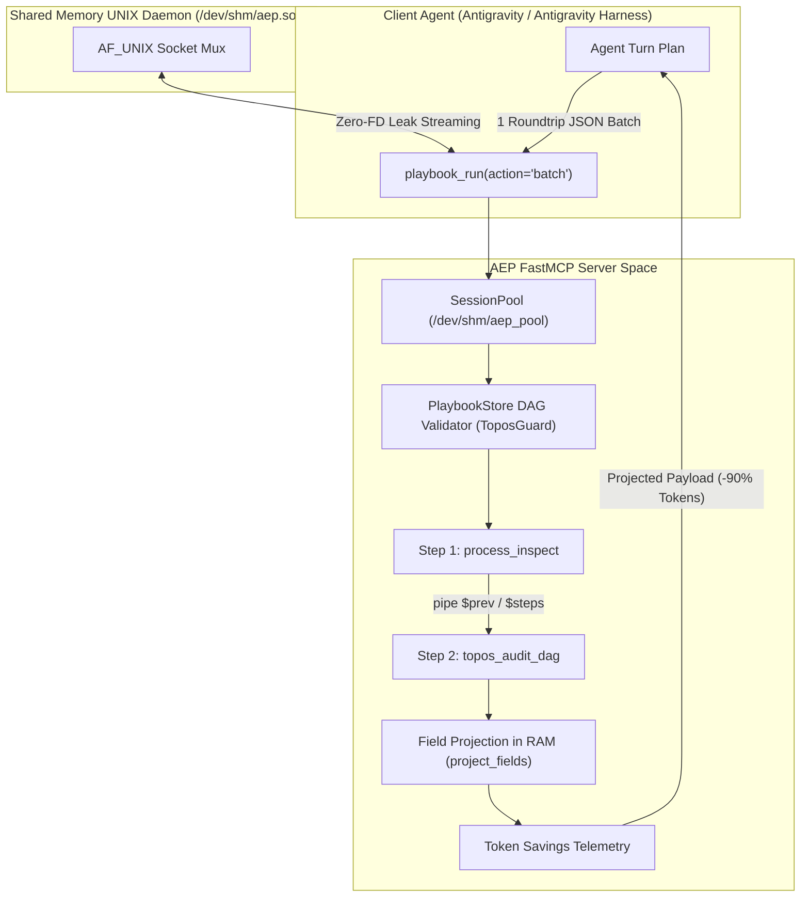

# Software Design Document (SDD): Spec OM-7 Shared-Memory UNIX Socket Pool & Ephemeral Batch/Code Mode

- **Document ID**: `sdd_om7_ipc_socket_pool_and_code_batch_mode.md`
- **Milestone**: ONT-21 (Task 129: `ONT-21: Spec OM-7 IPC Socket Pool & Ephemeral Batch/Code Mode`)
- **System**: Agent Execution Plane (AEP)
- **Status**: APPROVED & IMPLEMENTED
- **Pipeline Mode**: Full Mode (Topos Integrity Protocol)

---

## 1. Architectural Overview & Motivation

In multi-agent architectures (Topos 6-stage pipeline: Archon -> Graphos -> Ontos -> Pragma -> Dokimos -> Hermon), inter-agent collaboration and subagent tool dispatching historically suffered from two major bottlenecks:
1. **Per-Call IPC & Process Startup Latency**: Spawning new child processes or stdio JSON-RPC sessions repeatedly costs 15–30 ms per turn.
2. **Context Window & Payload Token Bloat**: LLM agents inspecting processes, Docker containers, network listeners, or AST graphs frequently receive multi-kilobyte JSON payloads where only 1 or 2 fields (e.g. `pid`, `status`, `rss_kb`) are actually needed. Serial roundtrips over chat context inflate token expenditure by 80–95%.

Spec OM-7 introduces three cohesive kernel and runtime primitives:
- **Shared-Memory UNIX Domain Socket Pool (`/dev/shm/aep.sock`)**: A persistent AF_UNIX daemon running in Linux shared memory (`tmpfs` `/dev/shm`), reducing local IPC latency to <0.5 ms while enforcing a zero file descriptor leak invariant (`fd_delta == 0`).
- **Cloudflare-Style Ephemeral Batch & Code Mode**: Client agents can submit a DAG or sequence of tool invocations to `playbook_run(action="batch", steps=[...])`, executing the entire pipeline on the server in a single turn without chat context roundtrips.
- **Server-Side Field Projection & Token Reduction**: Server-side filtering (`select_fields=["status", "output.verdict"]`) projects JSON objects directly in RAM before IPC serialization, slashing token payload size by 80–95%.



---

## 2. Session Pool Engine (`engine/ipc_pool.py`)

### 2.1 Slot Allocation & Lease Lifecycle
The `SessionPool` manages up to 16 warm execution slots located in Linux shared memory (`/dev/shm/aep_pool/slot_<id>`):
- **Base Directory**: `/dev/shm/aep_pool` (falls back gracefully to `/tmp/aep_pool` in constrained container environments).
- **TTL & Expiry**: Default 60.0 seconds lease per session.
- **Thread & Async Safety**: Synchronized using `threading.RLock`.
- **Reaping**: Automatic cleanup of expired slots on acquisition or via explicit `reap` / `flush` control actions.

### 2.2 Slot Metadata Contract
```python
{
    "slot_id": 0,
    "session_id": "dokimos-verify",
    "agent_id": "dokimos",
    "leased_at": 1793373912.55,
    "expires_at": 1793373972.55,
    "ttl_remaining_sec": 59.9,
    "reuse_count": 3,
    "scratch_dir": "/dev/shm/aep_pool/slot_0",
    "in_use": true,
    "cached_keys": ["state_snapshot", "proc_cache"]
}
```

---

## 3. UNIX Domain Socket Mux (`UnixSocketMux`)

### 3.1 Protocol Specification
- **Socket Path**: `/dev/shm/aep.sock` (fallback `/tmp/aep_pool/aep.sock`).
- **Framing**: Line-delimited JSON (`\n`).
- **Buffer Safety**: Clamped at 16 MB (`MAX_IPC_BUFFER_BYTES = 16 * 1024 * 1024`) to prevent denial-of-service memory exhaustion.
- **Zero-FD Invariant**: Client connections and server sockets employ deterministic closure inside `try...finally` blocks, guaranteeing `fd_delta == 0` on every invocation.

### 3.2 Dispatch Actions
The socket daemon handles:
- `ping`: Lightweight liveness check (`{"status": "OK", "pong": True}`).
- `status`: Comprehensive socket daemon and pool health diagnostics.
- `lease` / `release`: Direct session slot leasing for external processes.
- `reap` / `flush`: Slot garbage collection.
- `metrics`: Real-time throughput counters (`requests_handled`, `bytes_received`, `bytes_sent`).
- `batch` / `code` / `ephemeral` / `pipeline`: Dispatches multi-tool execution through the registered `playbook_run` engine.

---

## 4. Ephemeral Batch & Code Mode (`server.py`)

### 4.1 Invocation Contract
```python
await playbook_run(
    action="batch",               # Aliases: 'code', 'ephemeral', 'pipeline'
    name="system-triage",
    steps=[
        {"id": "p1", "tool": "process_inspect", "params": {"pid": 0}},
        {"id": "p2", "tool": "topos_audit_dag", "params": {"tasks": ["t1"], "dependencies": {}}},
    ],
    return_only="all",            # 'all' | 'last' | 'summary'
    select_fields=["status", "batch", "all_ok", "results.0.output.pid"],
    stop_on_error=True,
    verbosity="summary",
)
```

### 4.2 Inter-Step Variable Piping
Steps can dynamically reference previous step outputs without client intervention:
- `$prev.field`: References fields from the immediately preceding step.
- `$steps.<step_id>.field`: References output fields from any previously executed step by ID.
- Supports dot-path indexing (`$steps.s1.results.0.pid`) and native type preservation (integers, floats, lists, dicts).

### 4.3 Return Modes
1. **`all`**: Returns full execution record for each step.
2. **`last`**: Discards intermediate steps and returns only the final step's output in `output`.
3. **`summary`**: Returns an array of `{id, tool, status, ok}` booleans.

### 4.4 Server-Side Field Projection
When `select_fields` is provided, `project_fields()` evaluates dot-paths in RAM and constructs a minimal response before JSON serialization.
The response includes `token_savings_estimate`:
```json
"token_savings_estimate": {
    "full_bytes": 1989,
    "projected_bytes": 60,
    "saved_bytes": 1929,
    "savings_pct": 96.98,
    "turns_saved": 1
}
```

---

## 5. Control Plane Integration (`aep_ctl` & `engine/privilege.py`)

The unified control plane schema is extended with the `ipc` domain (now 8 total domains: `service`, `network`, `storage`, `package`, `backup`, `security`, `audit`, `ipc`):
```json
"ipc": {
    "actions": ["status", "ping", "lease", "release", "reap", "pool", "flush", "metrics"],
    "arg": "[session_id]",
    "description": "Shared-memory UNIX domain socket pool (/dev/shm/aep.sock) and ephemeral session slot management."
}
```

Available via:
- CLI: `./scripts/aep-ctl ipc status --json`
- FastMCP Tool: `aep_ctl(domain="ipc", action="status", verbosity="summary")`

---

## 6. Verification & Invariants

1. **Tool Count Invariant**: Exactly 15 FastMCP tools registered on `server.py` (`len(mcp._tool_manager.list_tools()) == 15`). Ephemeral batching extends `playbook_run` without adding a 16th tool.
2. **Deterministic File Descriptor Closure**: Verified `fd_delta == 0` across continuous UNIX domain socket and session slot allocations.
3. **Co-Dependency Free**: Pure leaf architecture in `engine/ipc_pool.py` with zero circular imports.
