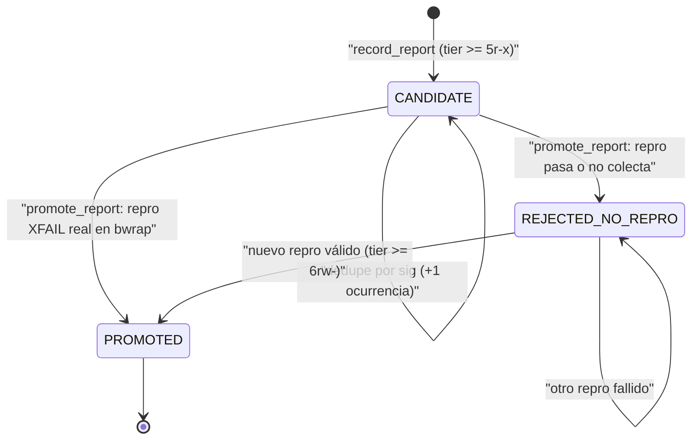

# SDD ONT-43: field report de herramientas hacia `autoevol` (cuarentena y promoción por reproducción)

- **Estado**: VERIFIED (Dokimos, 987 passed; F1–F3 en §6 y endurecimiento O1–O3 / R1–R3 en §7). Ver registro `docs/pipeline/feature_20261107_135303_ont43_field_report.md`.
- **Código**: `engine/telemetry.py`, `engine/threads_field.py`, `engine/threads.py`, `engine/threads_reconcile.py`, `server.py` (`autoevol(action="report")`).
- **Tests**: `tests/test_ont43_field_report.py` (48), `tests/test_ont43_adversarial.py` (11).
- **Pipeline**: Short. Specify -> Plan -> Tasks -> Validate, en forma resumida (sin Archon/Ontos).

---

## 1. Specify

### 1.1 Problema

`autoevol` descubre gaps por análisis estático del grafo de hilos (omisiones, drift declarado frente a observado, probes). Los fallos reales de herramientas en tiempo de ejecución (un `PARAM_ERROR` al usar una herramienta con un caso concreto, un `EXEC_FAILED` de un binario) nunca llegaban a `autoevol`. El operador tenía que transcribirlos a mano como gap, sin evidencia reproducible.

### 1.2 Requisitos

- **R1**: el sobre de error de una herramienta debe llevar una señal mínima y estable para reportar el fallo (`evol_hint`).
- **R2**: el texto del error **no** participa en la señal ni en la clave de dedupe.
- **R3**: un reporte se guarda como candidato, sin efectos sobre el código ni sobre los ciclos.
- **R4**: un candidato sólo pasa a gap verificable si un test de reproducción **falla de verdad** (XFAIL estricto) en el sandbox.
- **R5**: la promoción falla cerrada: sin aislamiento `bwrap`, no hay ejecución.
- **R6**: un gap promovido entra en el grafo como `field_discrepancy`, fuera de la raíz Merkle R y de la caché, y reconcile lo trata como drift.

### 1.3 Modelo de amenaza

| Activo | Amenaza | Mitigación |
|--------|---------|------------|
| Texto de error de la herramienta | Prompt injection dentro del mensaje de error | Texto = **dato no confiable**. No participa en `sig`. Se sanea (`sanitize_dict`), se trunca a 300 caracteres por campo, y no se re-emite en respuestas |
| Ciclos de `evolve` / `fix_test` | Un reporte dispara cambios de código | Un reporte **nunca** abre un ciclo. Abrir exige el opt-in de reconcile y su cupo propio |
| Repro de un reporte | Código arbitrario en `tests/field/` | Ruta acotada a `tests/field/test_fr_<sig>.py::nombre`, archivo regular dentro del árbol, marcador XFAIL estricto de la misma firma, ejecución sólo de ese test, en `bwrap`, fail-closed |
| Ledger de eventos | Flood de reportes | Dedupe por firma; tope `AEP_FIELD_MAX_REPORTS` (20 firmas nuevas / 24 h); sobre el tope, `CAPPED` sin escritura |
| Señal en el sobre | Auto-realimentación (un `report` que genera otro `evol_hint`) | `autoevol(report)` nunca emite `evol_hint` |
| Señal en el sobre | Filtrar información por modos compactos | `evol_hint` se omite en `terse`, `brief` y `cached` |
| Denegaciones de política | Tratarlas como fallos de herramienta | Lista blanca de estados. Denegaciones fuera por construcción |

**Límite declarado**: el XFAIL prueba que el test falla, no la causa del fallo. El `conftest.py` del directorio de repro se ejecuta dentro del sandbox. Un adversario con el mismo uid no está cubierto por el gate (igual que en SDD §9 de ONT-42c).

### 1.4 Señal `evol_hint`

Forma en el sobre de error (sólo cuando aplica):

```json
"evol_hint": {"sig": "<12 hex>", "report": "autoevol(action='report', sig='<sig>', report={tool, action, status, error_class, expected, observed})"}
```

- `sig = sha256(tool | action[:32] | STATUS | error_class)[:12]`, verificada al registrar (§7).
- `error_class`: clave explícita (`error_class`, `error_type`, `exception`), o el **primer token** de `error` en minúsculas, sin puntos ni dos puntos, con caracteres `[a-z0-9_]` y máximo 40. Vacío => `unknown`.
- Estados que emiten señal: `ERROR`, `*_ERROR`, `EXEC_FAILED`, `FAILED`.

### 1.5 Ciclo de vida de un candidato



Notas:
- `PROMOTED` es terminal. Un intento posterior devuelve `already: true`.
- `REJECTED_NO_REPRO` es reintentable con otro repro.
- Un evento `field.rejected` no degrada un `PROMOTED`.

### 1.6 Tiers

| Acción | Tier mínimo | Efecto |
|--------|-------------|--------|
| `report` (registrar candidato) | `5r-x` | Sólo escribe el evento `field.candidate` / `field.occurrence` |
| `report` con `repro_test` (promover) | `6rw-` | Ejecuta el repro en `bwrap` y escribe `field.promoted` o `field.rejected` |
| `autoevol(gaps)` con firmas promovidas | cualquiera de lectura | Muestra `field_discrepancy` como overlay |
| Abrir ciclos desde reconcile | `6rw-` + opt-in | Igual que E4 (`open_cycles=true` o `AEP_RECONCILE_OPEN=1`, cupo `AEP_RECONCILE_MAX_OPENS`) |

Con tier menor que el requerido: `PERMISSION_DENIED`, sin escritura.

### 1.7 Variables de entorno

| Variable | Defecto | Efecto |
|----------|---------|--------|
| `AEP_FIELD_MAX_REPORTS` | 20 | Firmas nuevas por ventana de 24 h. Inválida o < 1 => 20 |

---

## 2. Plan

### 2.1 Puntos de integración

- `engine/telemetry.py::attach_envelope`: añade `evol_hint` después de construir el sobre, antes de la poda de modo compacto.
- `engine/threads_field.py`: módulo de cuarentena. Depende sólo de `engine.threads_events` y `engine.security`. No importa `server` ni otros `threads_*`. El sandbox llega **inyectado** (`run_repro`).
- `engine/threads.py::set_field_provider`: el servidor inyecta el proveedor de firmas promovidas. El gap `field_discrepancy` se superpone **fuera de R** y fuera de la caché (el estado es externo).
- `engine/threads_reconcile.py::DRIFT_KINDS`: incluye `field_discrepancy`.
- `server.py::autoevol`: acción `report` (argumentos `sig`, `repro_test`, `report`). Sin `sig`, lista candidatos.

### 2.2 Interfaz de `autoevol(action="report")`

| Argumentos | Resultado |
|------------|-----------|
| (ninguno) o sólo `limit` | Lista candidatos (estado y ocurrencias) |
| `sig` + `report={tool, action, status, error_class, input_summary?, expected?, observed?}` | `RECORDED` (nuevo), `DEDUPED` / ocurrencia (existente), `CAPPED` (tope) |
| `sig` + `repro_test` | `PROMOTED`, `REJECTED_NO_REPRO`, `SANDBOX_UNAVAILABLE` (fail-closed), `PERMISSION_DENIED` (tier) |

### 2.3 Validación del repro (antes de ejecutar)

1. La ruta empieza por `tests/field/`.
2. Es archivo regular dentro del árbol (sin enlaces que salgan del árbol).
3. El nombre del archivo es `test_fr_<sig>.py` con el **mismo sig**.
4. La función de test tiene `@pytest.mark.xfail(strict=True, reason="FR-<sig> ...")`, verificado por AST.

Si falla cualquiera, `REJECTED_NO_REPRO` con razón, sin ejecutar nada.

### 2.4 Criterio de XFAIL real

Se ejecuta **sólo** el nodo indicado. El resultado es real si y sólo si `xfailed == 1` y `passed`, `failed`, `errors` y `xpassed` son 0. Cualquier otro resultado es `REJECTED_NO_REPRO`.

---

## 3. Tasks

| Id | Tarea | Módulo | Estado |
|----|-------|--------|--------|
| T1 | Lista blanca de estados y `evol_hint` en `attach_envelope` | `engine/telemetry.py` | ✅ |
| T2 | `field_sig` y `normalize_error_class` (puros) | `engine/telemetry.py` | ✅ |
| T3 | Cuarentena: `record_report`, dedupe, tope, saneado | `engine/threads_field.py` | ✅ |
| T4 | Promoción: validación AST, ejecución en sandbox, XFAIL real | `engine/threads_field.py` | ✅ (F1: fail-closed) |
| T5 | Acción `autoevol(action="report")` y cableado del proveedor | `server.py`, `engine/threads.py` | ✅ |
| T6 | `field_discrepancy` en `DRIFT_KINDS` | `engine/threads_reconcile.py` | ✅ |
| T7 | Pruebas unitarias y adversariales (`bwrap` real) | `tests/test_ont43_*.py` | ✅ (59 pruebas) |
| T8 | Texto específico para `field_discrepancy` en la spec | `engine/threads_spec.py` | ⏳ backlog |

---

## 4. Validate

### 4.1 Pruebas de aceptación

| Propiedad | Prueba |
|-----------|--------|
| Denegaciones no generan señal | `test_ont43_field_report.py` (estados de política) |
| Señal omitida en `terse`, `brief`, `cached` | `test_ont43_field_report.py` |
| `report` no se realimenta | `test_ont43_field_report.py` |
| Texto del error fuera de `sig` | `test_ont43_adversarial.py` (inyección) |
| Traversal rechazado | `test_ont43_adversarial.py` |
| Firma malformada rechazada | `test_ont43_adversarial.py` |
| Repro en `bwrap` sin red y de sólo lectura | `test_ont43_adversarial.py` (sandbox real) |
| Sin `bwrap` => `SANDBOX_UNAVAILABLE`, no ejecuta | `test_ont43_adversarial.py` (F1) |
| Exactamente 1 XFAIL | `test_ont43_field_report.py` |
| Reporte no abre ciclos | `test_ont43_field_report.py` |

### 4.2 Cierre natural (ciclo completo)

El ciclo se cierra cuando el gap queda resuelto de forma verificable:

1. Un fallo real produce `evol_hint` con `sig`.
2. El operador registra el reporte (`autoevol(report)`), con `tool`, `action`, `status` y `error_class` (la firma se recomputa) y, opcionalmente, `expected` y `observed`.
3. Se escribe `test_fr_<sig>.py` con XFAIL estricto que reproduce el fallo.
4. `promote` lo confirma: el gap `field_discrepancy` aparece.
5. Reconcile **propone** `spec` / `evolve` para él. Abrir el ciclo exige el opt-in y el cupo.
6. El parche `evolve` que resuelve el fallo **quita el `xfail`**. El test pasa, y el gap desaparece en la siguiente ejecución de `autoevol(gaps)`.

Si el parche no quita el `xfail`, el test sigue fallando de forma esperada y el gap permanece: no hay falso cierre.

---

## 5. Decisiones registradas

- **D-FR-1**: lista blanca de estados (no "severidad ERROR") para la señal. Razón: las denegaciones son el gobierno funcionando, no fallos.
- **D-FR-2**: `sig` sin texto del mensaje. Razón: el texto es dato no confiable. Coste: colisiones por primer token (precisión de dedupe).
- **D-FR-3**: promoción siempre en `bwrap`, fail-closed. Razón: el repro es código no confiable. Sin `trusted=False`, ni en `bwrap` caído.
- **D-FR-4**: `field_discrepancy` fuera de R y de la caché. Razón: el estado de cuarentena es externo al árbol; incluirlo cambiaría R con cada reporte.
- **D-FR-5**: `open_discrepancy` (D-xx) sigue en `REPORT`. Razón: cambiar su clase afectaría a la política de ciclos existente.

---

## 6. Addendum: seguimiento F1–F3

### 6.1 Cambios

| Id | Cambio | Dónde |
|----|--------|-------|
| F1 | Validación de firma (`SIG_RE`, 12 hex) en la entrada de `autoevol(report)`, antes de toda rama y del tier. Firma inválida: ERROR sin tocar estado. | `engine/threads_field.py`, `server.py` |
| F2 | Plantilla de spec específica para `field_discrepancy`. `TEMPLATE_REV` en la clave de caché E2. | `engine/threads_spec.py`, `engine/threads_spec_cache.py` |
| F3 | Promoción rechaza `INVALID_REPRO` ante cualquier `conftest.py` bajo `tests/field` (incl. symlinks) o `pytest_plugins` a nivel de módulo. Corrida con `--confcutdir <árbol>/tests`. | `engine/threads_field.py`, `server.py` |

### 6.2 Decisiones registradas

- **D-FR-6**: la firma se valida antes de cualquier rama y del tier. Razón: una entrada malformada no debe tocar estado ni consumir cupo.
- **D-FR-7**: `TEMPLATE_REV` forma parte de la clave de caché E2. Razón: un cambio de plantilla no debe servir specs cacheadas anteriores. Regla: subir `TEMPLATE_REV` al cambiar plantillas.
- **D-FR-8**: el repro se ejecuta sin `conftest.py` del árbol de `tests/field` ni `pytest_plugins`, y con `--confcutdir` sobre `tests/`. Razón: evitar autocarga de código no revisado al colectar.

### 6.3 Riesgo residual

Un módulo auxiliar en `tests/field` importado por el repro ejecuta código fuera de la cobertura del AST. Contenido por `bwrap` (sólo lectura, sin red); no añade capacidad sobre el repro. Endurecimiento opcional: permitir sólo `test_fr_*.py` en `tests/field` (decisión de política).

### 6.4 Criterio de aceptación añadido

| Propiedad | Prueba |
|-----------|--------|
| Firma inválida en `report` no toca estado | `test_ont43_field_report.py` (seguimiento F1) |
| Cambio de `TEMPLATE_REV` invalida la caché E2 | `test_ont43_field_report.py` (seguimiento F2) |
| `conftest.py` o `pytest_plugins` en repro => `INVALID_REPRO` | `test_ont43_field_report.py` (seguimiento F3) |

## 7. Addendum: endurecimiento O1–O3 y R1–R3 (2026-11-12)

### 7.1 Cambios

| Id | Cambio | Dónde |
|----|--------|-------|
| O1 | Lista blanca en `tests/field`: sólo archivos regulares `test_fr_<12hex>.py`; sin symlinks, subdirectorios, helpers ni `__init__`. El repro no puede importar vecinos ni usar imports relativos. Repros multiarchivo quedan fuera de política. Cierra la opción de endurecimiento de §6.3. | `engine/threads_field.py` |
| O2 | Vinculación del fallo: `xfail(strict=True, reason="FR-<sig> ...", raises=<Clase>)` obligatorio; `<Clase>` debe coincidir con `error_class` del candidato. Pytest falla el test si salta otra excepción. Candidato sin `error_class` => `REJECTED_NO_REPRO` ("re-record"). | `engine/threads_field.py` |
| O3 | Firma verificable: `field_sig(tool, action, status, error_class)` única en `engine/threads_field.py`; `engine/telemetry.py` la importa (arista unidireccional). `evol_hint` lleva `status` y `error_class`. `report` exige los cuatro componentes y recalcula la firma; mismatch o falta => ERROR sin guardar. El formato antiguo `{tool, expected, observed}` ya no se acepta. | `engine/threads_field.py`, `engine/telemetry.py`, `server.py` |
| R1 | El repro no puede redefinir el nombre de la excepción vinculada (`class`, `def`, asignación, `import ... as`; en forma atributo, la raíz debe ser `builtins` o un módulo importado plano). | `engine/threads_field.py` |
| R2 | Prueba de paridad de normalización entre `norm_error_class` y `normalize_error_class`. | `tests/test_ont43_field_report.py` |
| R3 | Prueba de dos promociones seguidas, sin `__pycache__`. | `tests/test_ont43_field_report.py` |

### 7.2 Decisiones registradas

- **D-FR-9**: el reporte tiene forma `{tool, action, status, error_class, input_summary?, expected?, observed?}` y la firma `sha256(tool|action|status|error_class)[:12]` se recomputa en cada `report`. Razón: `error_class` no puede mentirse; un sig no verificable permitiría reportar una clase falsa.
- **D-FR-10**: `raises=` es obligatorio y debe coincidir con `error_class`. Razón: un XFAIL causado por otra excepción no es la falla reportada.
- **D-FR-11**: lista blanca `tests/field/test_fr_<12hex>.py`. Razón: elimina el módulo auxiliar importable que era el riesgo residual de §6.3.

### 7.3 Riesgo residual

- El repro es código no confiable. Queda contenido por `bwrap` (sólo lectura, sin red), sin capacidad adicional sobre el propio repro.
- `raises=` liga el fallo a la clase declarada; no demuestra la causa raíz.

### 7.4 Criterio de aceptación añadido

| Propiedad | Prueba |
|-----------|--------|
| O1: sólo `test_fr_<12hex>.py` regular, sin helpers | `test_ont43_adversarial.py`, `test_ont43_field_report.py` |
| O2: `raises=` obligatorio y coincidente; otra excepción falla el test | `test_ont43_adversarial.py`, `test_ont43_field_report.py` |
| O3: firma recalculada; mismatch o falta => ERROR sin guardar | `test_ont43_field_report.py` |
| R1: no redefinir la excepción vinculada | `test_ont43_adversarial.py` |
| R2: paridad de normalización | `test_ont43_field_report.py` |
| R3: dos promociones seguidas | `test_ont43_field_report.py` |
