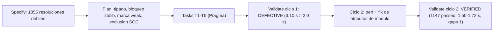

# SDD ONT-46: precisión del extractor de hilos (tipado de receptor, aristas `weak`)

- **Estado**: VERIFIED (ciclo 2; commits `6b05f7b`..`6aad7e0` sobre `99f80bb`, sin commit de Graphos)
- **Registro**: `docs/pipeline/feature_20261113_ont46_extractor_precision.md`
- **Modo**: Short
- **Módulos**: `engine/threads_extractors.py`, `engine/threads_model.py`, `engine/threads.py`

## 1. Specify

**Problema.** El extractor resuelve `obj.method()` con receptor sin tipo buscando un nombre único en el proyecto. `x.append`, `x.execute`, `x.terminate` o `x.list_tools` se conectan a cualquier definición homónima aunque `x` sea un objeto de la biblioteca estándar o de terceros. Cada conexión espuria infla `covers` y altera el ranking.

**Medición (antes de cambiar código).**

| Medición | Valor |
|----------|-------|
| Resoluciones débiles por nombre único | 1855 |
| Pares (llamador, destino) afectados | 305 |
| `x.append` → `PlaneEventSpool.append` | 128 casos |
| Gaps si se elimina la resolución débil sin reemplazo | 1 → 104 |

**Criterio de éxito.** Eliminar la resolución espuria sin perder cobertura legítima: gaps se mantienen en 1 (`test_gate8`, visible), aristas débiles visibles y marcadas, extracción en frío < 2.0 s, `root_hash` estable, co-dependencias 0.

## 2. Plan

| Decisión | Contenido |
|----------|-----------|
| **Tipado del receptor** | `_TypeIndex` resuelve receptores por tipo conocido (atributos y variables con tipo de construcción, import de proyecto). Si el tipo se conoce, la arista es fuerte. |
| **Bloqueo builtin / stdlib** | `_EXTERNAL_METHODS` (476 nombres de métodos de la biblioteca estándar, Python 3.14.7) y builtins: sin tipo conocido, la llamada se descarta como externa y se cuenta en `external_skipped`. |
| **Caída débil marcada** | Si no hay tipo y no hay bloqueo, la resolución por nombre único sigue existiendo pero se crea con `Edge.weak = True` y se cuenta en `weak_edges`. Nunca se borra en silencio. |
| **Exclusión de SCC** | Las aristas débiles no participan en la clasificación de componentes (`_dependency_adjacency(include_weak=False)`). Una arista débil nunca forma co-dependencia. |
| **Spawn coverage** | Un literal de ruta de proyecto cuenta como cobertura sólo dentro de una llamada spawn o de una llamada cuyo cuerpo menciona `sys.executable` (`has_exec`), o vía alias local de un nivel. Siempre marcada débil. |
| **Contrato** | `Edge.weak`; `autoevol(graph)` en modo full expone `weak_edges`; `autoevol(thread)` marca `"weak": true` sólo en aristas débiles; `GRAPH_SCHEMA_VERSION = "threads/2"`. |

**Ruta y blast radius.** Short, un track de Pragma. Producción: tres módulos de `engine/threads*.py`. Sin cambios de tiers, de API pública de MCP ni de esquema de persistencia (el cambio de payload se versiona como `threads/2`).

## 3. Tasks

| Task | Commit | Qué | Estado |
|------|--------|-----|--------|
| T1 | `6b05f7b` | `Edge.weak` en el modelo | ✅ |
| T2 | `e3f504e` | `_TypeIndex`, `_EXTERNAL_METHODS`, contadores `weak_edges` / `external_skipped` | ✅ |
| T3 | `5ce73e3` | `threads/2`, `weak_edges` en payload, SCC sin aristas débiles, fila `thread` con `weak` | ✅ |
| T4 | `8c2583e` | Tests de regresión de precisión sobre el repo real | ✅ |
| T5 | `34ef73b`, `6fafcc9` | Cobertura por spawn restringida y marcada débil; alias local de un nivel | ✅ (F1, F1b del orquestador) |
| Ciclo 2 | `4844d30` | `perf`: una pasada cacheada por función en `_TypeIndex.facts`; lista de nodos por test reutilizada; `global` sólo en funciones / métodos de nivel de módulo | ✅ |
| Ciclo 2 | `6aad7e0` | `fix`: `_store_names` cuenta sólo `Name` con `ctx` Store; atributos de módulo de proyecto tipados vía import; 4 tests dejan de dar cobertura falsa; test sintético (p) | ✅ |

## 4. Validate

Dokimos ciclo 1: **DEFECTIVE (LOGIC_ERROR)**. `test_cold_extraction_under_two_seconds_and_stable_r`: 3.10 s frente a un tope de 2.0 s (base 1.3 s). Perfil: `local_env` repetía `ast.walk` por función (4373 llamadas, 4.9 s). Dos aristas falsas por `server.mcp._tool_manager.list_tools()`.

Dokimos ciclo 2: **VERIFIED**.

| Criterio | Resultado | Umbral |
|----------|-----------|--------|
| Suite completa | 1147 passed, 0 failed (183 s) | 0 fallos |
| Extracción en frío | 1.50–1.72 s | < 2.0 s (margen escaso) |
| `root_hash` | `bb4094ddcf76` estable | estable |
| `ruff check` | limpio | limpio |
| Gaps | 1 (`test_gate8`) | ≤ 1 (trinquete `GAPS_BASELINE`) |
| Co-dependencias / `own_gaps` | 0 / 0 | 0 / 0 |
| Aristas | 7194 (base 7264) | informativo |
| Aristas débiles | 111 | visibles |
| Claves del payload terse | idénticas a `dev` | sin cambio de forma |
| Funciones a cobertura `none` | 0 | 0 |
| Funciones de direct a transitive | 5 (cobertura directa falsa) | informativo |

**Calidad de la cobertura débil.** Muestra de 10 aristas débiles revisadas: 9 correctas, 1 plausible.

**Pérdida real.** Llamadas vía campos `Callable` de adaptadores (`ad.read_sysctl()`, `kit.summarize()`) ya no se atribuyen. Sin efecto en cobertura medida.

## 5. Contrato de salida

- `Edge.weak: bool` (default `False`).
- `autoevol(action="graph")` en forma completa (no terse) expone `weak_edges` y `py_version`. El payload terse no cambia de claves. `external_skipped` queda en `ExtractionInfo` (interno, no expuesto).
- `autoevol(action="thread")` añade `"weak": true` sólo a las filas de arista débil; las aristas fuertes no cambian de forma.
- `GRAPH_SCHEMA_VERSION = "threads/2"` entra en la clave Merkle (`_sha(GRAPH_SCHEMA_VERSION, ...)`); los consumidores deben tratar `threads/2` como la forma vigente.
- Invariante: una arista `weak` nunca forma co-dependencia ni interdependencia.
- Cobertura por spawn: sólo dentro de llamadas spawn / `sys.executable` o alias local de un nivel; el resto de literales de ruta no cuenta.

## 6. Residuo y backlog

| Ítem | Estado |
|------|--------|
| `_TypeIndex.resolve` no sigue defaults de campos `Callable` | backlog |
| `threads_supervise.file_units` aún incluye aristas `weak` | backlog |
| `_EXTERNAL_METHODS` depende de la versión de Python (se registra `py_version`) | aceptado, visible |
| 20 nombres de método del proyecto coinciden con `_EXTERNAL_METHODS` (`acquire`, `append`, `create_task`, `execute`, `flush`, `get`, `is_running`, `mro`, `release`, `reset`, `resolve`, `run`, `select`, `shutdown`, `start`, `step`, `stop`, `terminate`, `acquire_lock`, `release_lock`): receptor sin tipo con esos nombres no genera arista | trade-off aceptado |

## 7. Evolución

