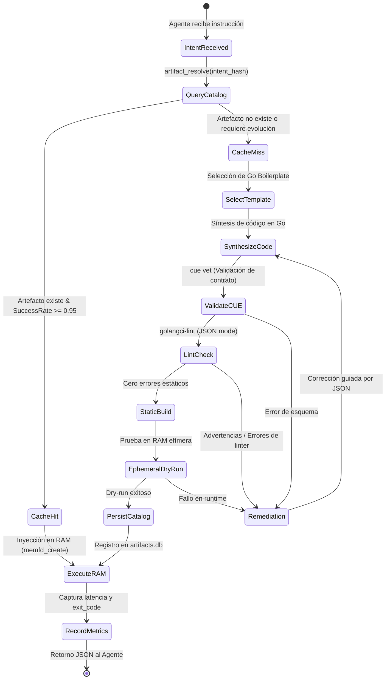

# SPEC: Evolutionary Artifact Engine Specification (EAES-v1)
**Estándar de Generación, Verificación Estática y Reutilización de Artefactos de Ejecución para Agentes de IA**

> [!IMPORTANT]
> **Axioma Fundamental contra la Alucinación:**  
> La alucinación de un LLM en operaciones de sistema no es un déficit intrínseco de conocimiento; es la consecuencia directa de operar sobre abstracciones ciegas y herramientas tradicionales de texto plano (Bash/POSIX) que ocultan la fuente de la verdad.  
> **EAES-v1** erradica la alucinación estableciendo que toda solución de gestión debe materializarse como un **Artefacto Atómico en Golang**, validado contractualmente mediante **CUE**, auditado estáticamente con **`golangci-lint`**, verificado en memoria RAM (`memfd_create`) y catalogado en una base de datos local para su evolución y reutilización.

---

## 1. Los 5 Axiomas de la Especificación

### Axioma 1: Prohibición de Scripts Ad-Hoc Frágiles
Ningún agente debe intentar resolver tareas complejas de introspección de sistema, análisis de red o gestión de procesos mediante tuberías frágiles de Bash (`awk`, `sed`, `grep`) ni scripts interpretados con dependencias no tipadas.

### Axioma 2: Contratos Declarativos Rígidos (CUE)
Todo artefacto debe originarse a partir de un esquema formal en **CUE (`cuelang.org`)**. El contrato define entradas tipadas, restricciones matemáticas (rangos de puertos, IPs válidas, límites de memoria) y salidas JSON estructuradas garantizadas.

### Axioma 3: Binarios Go Atómicos y Autocontenidos
El código ejecutable debe compilarse en **Golang estático puro (`CGO_ENABLED=0`)**:
* 1 solo binario de 2 a 4 MB.
* Cero dependencias dinámicas de librerías del sistema (`glibc` independiente).
* Compilación ultra-rápida (inferior a 500 ms).
* Apto para inyección directa en RAM a través del descriptor anónimo `memfd_create` y la syscall `fexecve`.

### Axioma 4: Pipeline de Calidad Obligatorio (El Mini-Jenkins Local)
Ningún binario generado por IA puede ejecutarse en producción sin superar el pipeline de validación:
1. `cue vet` sobre el contrato de datos.
2. `golangci-lint run --out-format=json` (40+ analizadores estáticos sin advertencias).
3. `go build -ldflags="-s -w"` para eliminar símbolos de depuración redundantes.
4. Dry-run previo en RAM en un namespace efímero (`bwrap` o `memfd_create`).

### Axioma 5: Catálogo Evolutivo y Memoria de Artefactos
Todo artefacto validado debe persistirse en una base de datos local embebida (**SQLite / DuckDB**). Cuando el agente recibe una intención de gestión (*intent*), debe consultar el catálogo antes de sintetizar código nuevo. Si el artefacto ya existe y cuenta con métricas de éxito del 100%, se reutiliza de forma inmediata.

---

## 2. Diagrama de Estados del Ciclo de Vida del Artefacto



---

## 3. Esquema del Catálogo Local (`schemas/database.sql`)

La base de datos local embebida opera sobre SQLite (`~/.local/share/agent-os/artifacts.db`):

```sql
-- Catálogo de Artefactos Atómicos de Gestión
CREATE TABLE IF NOT EXISTS artifacts (
    id TEXT PRIMARY KEY,                       -- UUID v4
    name TEXT NOT NULL UNIQUE,                 -- Nombre identificativo (kebab-case)
    intent_hash TEXT NOT NULL,                 -- Hash SHA-256 de la intención funcional
    category TEXT NOT NULL,                    -- 'network', 'process', 'memory', 'filesystem', 'async'
    cue_contract TEXT NOT NULL,                -- Especificación CUE del contrato
    go_source TEXT NOT NULL,                   -- Código fuente completo en Go
    binary_blob BLOB,                          -- Binario ELF estático pre-compilado (opcional)
    binary_hash TEXT,                          -- Hash SHA-256 del binario
    version INTEGER NOT NULL DEFAULT 1,        -- Versión evolutiva del artefacto
    success_rate REAL NOT NULL DEFAULT 1.0,    -- Tasa histórica de éxito [0.0 - 1.0]
    execution_count INTEGER NOT NULL DEFAULT 0,-- Total de ejecuciones registradas
    avg_latency_ms REAL NOT NULL DEFAULT 0.0,  -- Latencia promedio de ejecución
    created_at TIMESTAMP DEFAULT CURRENT_TIMESTAMP,
    updated_at TIMESTAMP DEFAULT CURRENT_TIMESTAMP
);

CREATE INDEX IF NOT EXISTS idx_artifacts_intent ON artifacts(intent_hash);
CREATE INDEX IF NOT EXISTS idx_artifacts_category ON artifacts(category);

-- Registro de Métricas y Telemetría de Ejecución
CREATE TABLE IF NOT EXISTS execution_metrics (
    id INTEGER PRIMARY KEY AUTOINCREMENT,
    artifact_id TEXT NOT NULL,
    exit_code INTEGER NOT NULL,
    latency_ms REAL NOT NULL,
    memory_peak_kb INTEGER,
    error_message TEXT,
    executed_at TIMESTAMP DEFAULT CURRENT_TIMESTAMP,
    FOREIGN KEY(artifact_id) REFERENCES artifacts(id) ON DELETE CASCADE
);
```

---

## 4. Contrato Formal de Artefacto en CUE (`schemas/artifact_contract.cue`)

```cue
package schema

#ParameterType: "string" | "int" | "bool" | "list_string"

#ArtifactParameter: {
    name:        string
    type:        #ParameterType
    required:    bool | *true
    description: string
    default?:    string | int | bool
}

#ArtifactSpec: {
    name:        =~"^[a-z0-9-]+$"
    version:     int & >=1
    category:    "network" | "process" | "memory" | "filesystem" | "async"
    description: string
    
    parameters: [...#ArtifactParameter]
    
    output_schema: {
        format: "json"
        fields: [string]: string
    }
    
    constraints: {
        max_memory_mb: int & <=64 | *16
        timeout_sec:   int & <=30 | *5
        allow_network: bool | *false
        run_in_ram:    bool | *true
    }
}
```

---

## 5. Protocolo de Herramientas FastMCP para el Artifact Engine

El servidor FastMCP expone las siguientes funciones RPC a los agentes de IA:

| Herramienta | Parámetros | Retorno | Función |
| :--- | :--- | :--- | :--- |
| `artifact_resolve` | `intent: str, category: str, params: dict` | `JSON {status, artifact_id, cached, go_source}` | Busca en la mini-DB un artefacto compatible o genera el esqueleto desde plantilla. |
| `artifact_lint` | `go_source: str` | `JSON {valid: bool, errors: list[dict]}` | Ejecuta `golangci-lint` en modo JSON devolviendo contexto de remediación si hay fallos. |
| `artifact_build` | `artifact_id: str, go_source: str` | `JSON {success: bool, binary_hash: str, compile_time_ms: int}` | Compila estáticamente (`CGO_ENABLED=0 go build`) y persiste el binario en la DB. |
| `artifact_run_ram` | `artifact_id: str, args: list[str]` | `JSON {exit_code: int, stdout_json: dict, latency_ms: float}` | Inyecta el binario en RAM con `memfd_create` + `fexecve` y captura la telemetría tipada. |
| `artifact_feedback` | `artifact_id: str, exit_code: int, latency_ms: float, err: str | None` | `JSON {updated_success_rate: float}` | Actualiza la memoria evolutiva del artefacto en la base de datos. |

---

## 6. Garantías contra la Fricción y la Alucinación

1. **Cero Salida no Estructurada:** Todo artefacto Go debe obligatoriamente emitir su resultado final en `stdout` como un JSON válido que cumpla con `output_schema`.
2. **Auto-Corrección Guiada por Linter:** Si el agente comete un error de sintaxis o tipo, no recibe un mensaje genérico de error de Bash; recibe un diccionario estructurado de `golangci-lint` con `file`, `line`, `column` y `rule_id`, permitiendo corregir en 1 sola iteración.
3. **Inmutabilidad y Rollback:** Si un artefacto modificado degrada su `success_rate` por debajo de 0.80, el motor marca la versión como defectuosa y revierte automáticamente a la versión anterior en la DB.
