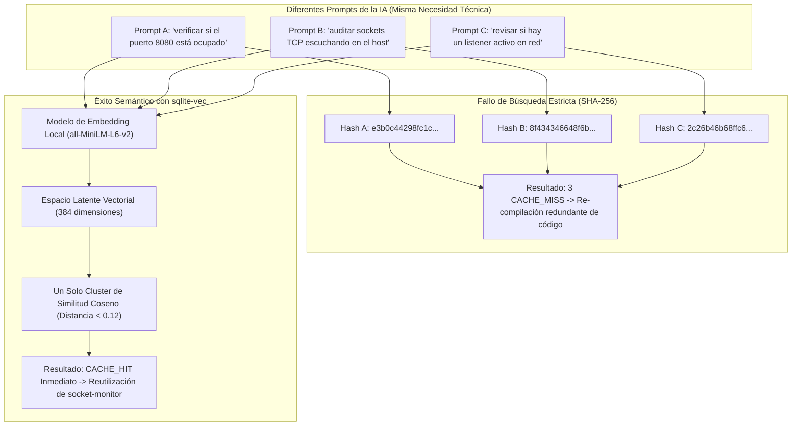
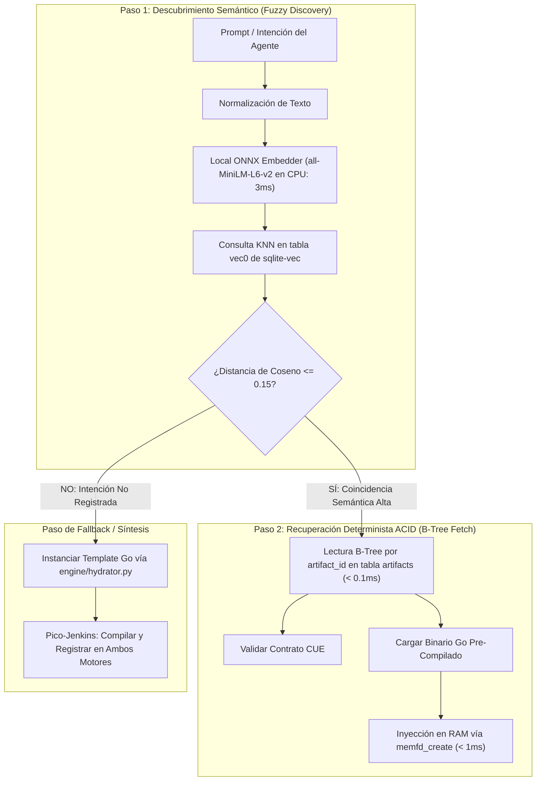

# Búsqueda Híbrida y Memoria Semántica de Artefactos con `sqlite-vec`

> **Fecha:** 2026-10-22  
> **Estado:** Documentación Técnica de Mejora Arquitectónica (Enhancement)  
> **Proyecto:** Agent Execution Plane (AEP) — Runtime Ubuntu

---

## 1. El Problema Fundamental: Fragilidad del Hash Estricto ante LLMs

En la concepción inicial del catálogo de artefactos (`engine/catalog.py`), la resolución de intenciones se basaba en un **hash SHA-256 estricto** (`intent_hash`):

$$\text{intent\_hash} = \text{SHA-256}(\text{category} + \text{"::"} + \text{intent})$$

Si bien este mecanismo es matemáticamente determinista y se resuelve en microsegundos ($O(1)$) mediante un índice B-Tree clásico de SQLite, presenta un **defecto de diseño insalvable ante agentes de IA**:

> **El Teorema de la Variabilidad Léxica Estocástica:**  
> Un Modelo de Lenguaje (LLM) casi nunca formula la misma necesidad de gestión con las mismas palabras exactas a lo largo de diferentes sesiones o invocaciones.



Si confiamos exclusivamente en búsquedas relacionales por texto exacto o hash:
* Cada mínima variación de prompt provoca un `CACHE_MISS`.
* La IA gasta tokens y tiempo de CPU en sintetizar y compilar código Go idéntico una y otra vez.
* La memoria evolutiva del sistema se fragmenta en cientos de registros duplicados en la base de datos.

---

## 2. `sqlite-vec` vs. `pgvector` en Entornos Agénticos Embebidos

Para resolver este problema sin violar los principios de diseño de AEP, evaluamos el ecosistema vectorial moderno:

### ¿Por qué no usar PostgreSQL con `pgvector`?
1. **Violación del Principio *Small Core*:** Levantar un servidor PostgreSQL completo, administrar usuarios, demonios (`systemd`), sockets de dominio Unix y puertos TCP (`5432`) introduce una sobrecarga masiva para una consola local de un solo usuario.
2. **Co-dependencias de Infraestructura:** Si el servicio de PostgreSQL colapsa o entra en recuperación tras un reinicio abruptly, el agente de IA queda inoperativo.
3. **Huella de Memoria:** PostgreSQL consume entre 150 MB y 500 MB en reposo; SQLite consume **0 MB** cuando no se ejecuta y menos de 15 MB bajo carga.

### La Solución Canónica: `sqlite-vec`
Creado por Alex Garcia (el creador de `sqlite-vss`), **`sqlite-vec`** es el estándar de facto para búsqueda vectorial embebida en SQLite:
* **Escrito en C puro:** Cero dependencias dinámicas, sin runtime de C++ pesado ni librerías BLAS externas.
* **Aceleración SIMD Nativa:** Utiliza instrucciones AVX2 (x86_64) y NEON (ARM64) directamente en el procesador del host para calcular distancias de cosenos a velocidad de hardware.
* **Integrado en el archivo `.db`:** Los vectores viven dentro del mismo archivo `artifacts.db` que las tablas relacionales, manteniendo la atomicidad ACID y facilitando respaldos con una simple copia de fichero.

---

## 3. Eficiencia Computacional vs. Eficiencia Semántica

La pregunta clave de diseño es:  
*¿Por qué no almacenar todo únicamente como vectores? ¿Por qué mantener la base de datos relacional?*

La respuesta reside en la diferencia fundamental entre **buscar intenciones** y **recuperar contratos ejecutables**:

| Dimensión | Búsqueda Relacional (B-Tree) | Búsqueda Vectorial (`sqlite-vec`) | Veredicto Arquitectónico |
| :--- | :--- | :--- | :--- |
| **Latencia de Consulta** | **$< 0.1 \text{ ms}$** ($O(\log N)$ o $O(1)$) | **$5 \text{ a } 15 \text{ ms}$** (Embedding + KNN) | **B-Tree gana por 100x en velocidad bruta.** |
| **Costo Computacional** | Cero (búsqueda de punteros en memoria). | Inferencia matemática de 384 dimensiones. | **B-Tree no gasta ciclos de CPU.** |
| **Comprensión de Intención** | **Cero:** Si cambia una letra, falla. | **Total:** Entiende sinónimos, diferentes idiomas y conceptos equivalentes. | **`sqlite-vec` gana por goleada semántica.** |
| **Integridad de Contratos** | **Estricta:** Integridad referencial, claves foráneas y tipos garantizados. | **Aproximada:** Los vectores solo miden cercanía matemática, no corrigen tipos. | **La ejecución requiere la verdad relacional.** |

> **Conclusión:** Usar solo vectores es ineficiente para recuperar binarios y contratos; usar solo B-Tree es ineficiente para entender al agente. **La respuesta es la Búsqueda Híbrida.**

---

## 4. Arquitectura de Búsqueda Híbrida en 2 Pasos (The Hybrid Retrieval Pattern)

AEP implementa el patrón de recuperación en dos fases:



### Funcionamiento Operativo:
1. **El Agente formula una intención:** *"necesito listar los procesos que tienen archivos bloqueados"*.
2. **Inferencia de Embedding Local:** Un modelo local embebido (`all-MiniLM-L6-v2`) genera el vector de 384 floats en **3 milisegundos en CPU** (sin GPU y sin enviar datos a APIs externas).
3. **Interrogación a `sqlite-vec`:** Se ejecuta una consulta de similitud de cosenos sobre la tabla virtual `vec_artifacts`.
4. **Decisión por Umbral de Similitud:**
   * Si la distancia es $\le 0.15$ (similitud $\ge 85\%$): Se obtiene el `artifact_id` correspondiente (`fd-rescuer`).
   * Se ejecuta una consulta relacional por clave primaria ($O(1)$) en la tabla `artifacts`, extrayendo el binario Go estático ya compilado.
   * El binario se inyecta directamente en memoria RAM con `os.memfd_create`.
5. **Tiempo Total de Resolución en Memoria:** **Menos de 6 milisegundos**, evitando la re-generación de código y el gasto de miles de tokens de contexto.

---

## 5. Esquema de Base de Datos Híbrido (`schemas/hybrid_database.sql`)

Para habilitar este soporte en el catálogo, el esquema DDL se extiende combinando la tabla relacional con la tabla virtual vectorial de `sqlite-vec`:

```sql
-- Habilitar extensión vectorial
-- SELECT load_extension('vec0');

-- 1. Tabla Relacional Clásica (Ground Truth ACID)
CREATE TABLE IF NOT EXISTS artifacts (
    id TEXT PRIMARY KEY,
    name TEXT NOT NULL UNIQUE,
    intent_description TEXT NOT NULL,          -- Descripción en lenguaje natural
    category TEXT NOT NULL,
    cue_contract TEXT NOT NULL,
    go_source TEXT NOT NULL,
    binary_blob BLOB,
    binary_hash TEXT,
    version INTEGER NOT NULL DEFAULT 1,
    success_rate REAL NOT NULL DEFAULT 1.0,
    execution_count INTEGER NOT NULL DEFAULT 0,
    avg_latency_ms REAL NOT NULL DEFAULT 0.0,
    created_at TIMESTAMP DEFAULT CURRENT_TIMESTAMP,
    updated_at TIMESTAMP DEFAULT CURRENT_TIMESTAMP
);

-- 2. Tabla Virtual Vectorial con sqlite-vec (vec0)
-- 384 dimensiones corresponden al estándar ligero all-MiniLM-L6-v2
CREATE VIRTUAL TABLE IF NOT EXISTS vec_artifacts USING vec0(
    artifact_id TEXT PRIMARY KEY,
    intent_embedding float[384] distance_metric=cosine
);

-- 3. Consulta de Coincidencia Híbrida (Ejemplo de Ejecución)
-- SELECT 
--     a.id, a.name, a.binary_blob, v.distance
-- FROM vec_artifacts v
-- JOIN artifacts a ON a.id = v.artifact_id
-- WHERE v.intent_embedding MATCH ? AND v.distance <= 0.15
-- ORDER BY v.distance ASC
-- LIMIT 1;
```

---

## 6. Generador de Embeddings Local en CPU (Zero API Cost / Offline)

Para no depender de OpenAI, Google o Anthropic para calcular vectores (lo que añadiría latencia de red, costo por token y riesgo de fuga de datos de administración del sistema):

* **Runtime:** `fastembed` o `onnxruntime` en Python.
* **Modelo:** `BAAI/bge-small-en-v1.5` o `sentence-transformers/all-MiniLM-L6-v2`.
* **Peso en disco:** ~90 MB cuantizado en formato ONNX.
* **Rendimiento:** Genera un vector en **$2 \text{ a } 4 \text{ ms}$** utilizando 2 hilos de CPU sin interferir con las tareas del sistema operativo.
* **Privacidad Total:** Los nombres de procesos, puertos y rutas de archivo jamás salen de la máquina física de Ubuntu.

---

## 7. Conclusión de la Mejora

La incorporación de `sqlite-vec` transforma al **Artifact Engine** de un simple almacén estático de archivos en una **Memoria Semántica de Infraestructura**:

1. **Erradica la Alucinación:** La IA encuentra herramientas previamente probadas aunque no recuerde el nombre exacto de la función.
2. **Reduce el Desperdicio de Tokens:** Se reutilizan artefactos en 5 ms en lugar de regenerar código en 10 segundos.
3. **Mantiene la Independencia:** Opera 100% local en Ubuntu dentro de un único archivo SQLite, preservando la ligereza y el principio de *Small Core* de la arquitectura.
